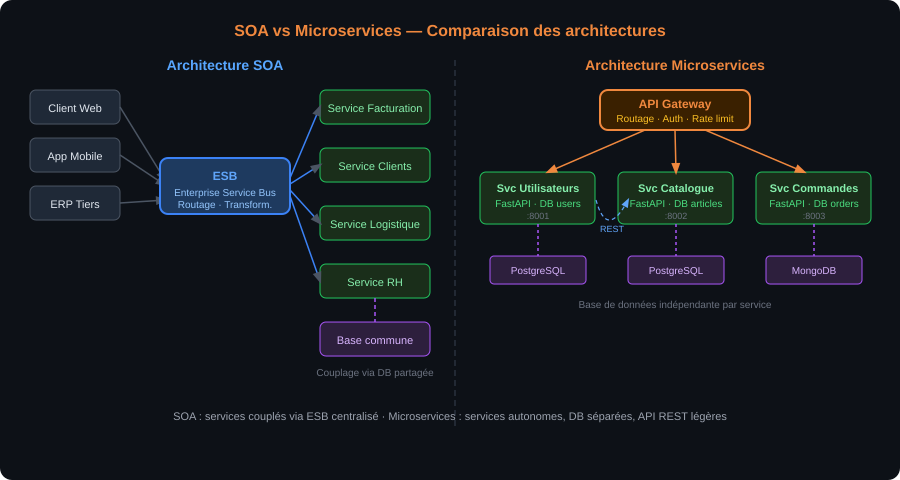
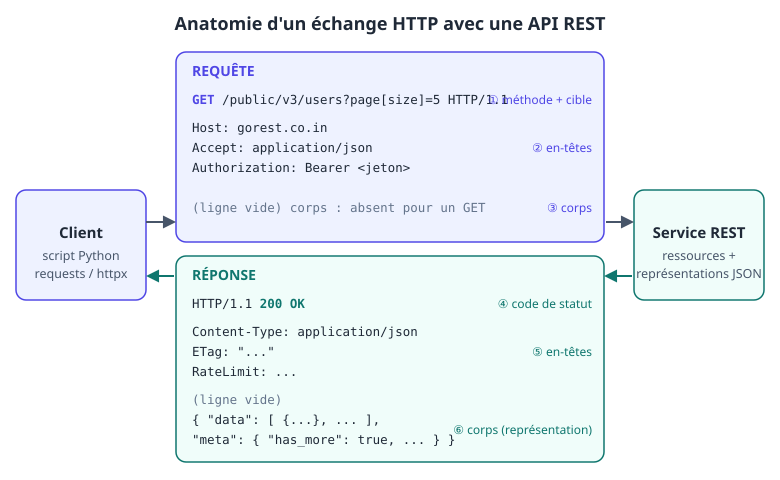
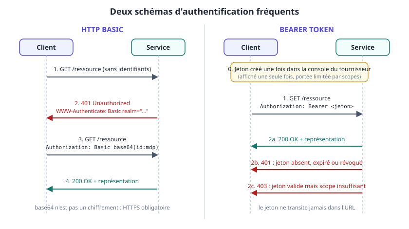
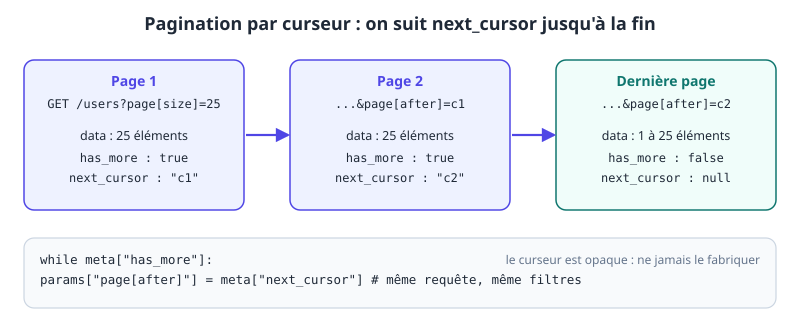
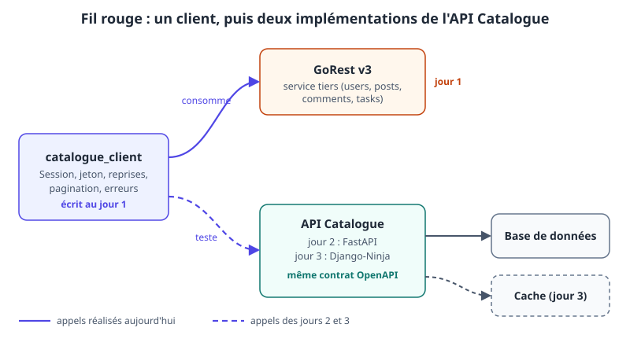

# Jour 1 — Écosystème des web services et consommation d'API REST avec Python

> **Formation** : Python Avancé — Web Services (3 jours, réf. PYT100614-F)
> **Programme de référence** : [Dawan — Python Avancé : Web Services](https://www.dawan.fr/formations/python/python-avance/python-avance-web-services)
> **Projet fil rouge** : API Catalogue — un catalogue de formations consommé (jour 1), puis exposé par FastAPI (jour 2) et par Django-Ninja (jour 3)
> **Blocs couverts** : 1 (connaître le besoin et l'écosystème) · 2 (interroger des services web REST, atelier)

**Prérequis** : stage « Python : Initiation + Approfondissement » ou notions équivalentes (fonctions, classes, modules, environnements virtuels, gestion des exceptions).
**Durée** : 7 h (lundi 9h30 – 17h30, pause déjeuner 12h30 – 13h30, deux pauses de 15 minutes).

## Objectifs pédagogiques

À la fin de la journée, les stagiaires sont capables de :

- situer les web services, l'architecture orientée service (SOA), REST et OpenAPI dans une architecture d'entreprise ;
- lire une requête et une réponse HTTP (méthode, en-têtes, statut, corps) et choisir le bon verbe et le bon code ;
- interroger une API REST avec `requests` et `httpx` : paramètres, filtres, tri, pagination ;
- authentifier les appels (BASIC, Bearer) sans exposer de secret dans le code ni dans Git ;
- interpréter les erreurs (401, 403, 404, 422, 429) et rendre un client robuste (délais d'attente, reprises, idempotence) ;
- livrer un module client réutilisable, `catalogue_client`, qui servira de client de test les jours 2 et 3.

### Livrable de la journée

Un dépôt `api-catalogue/` contenant :

- un environnement virtuel et un fichier `requirements.txt` ;
- un jeton d'API stocké hors du code (`.env`, ignoré par Git) ;
- le module `catalogue_client/gorest.py` : session HTTP configurée, authentification Bearer, reprises automatiques, exceptions typées, pagination par générateur ;
- trois scripts d'atelier (`explorer.py`, `basic_auth.py`, `crud_authentifie.py`) ;
- un jeu de commandes `curl.exe` de référence.

> [!NOTE] Choix pédagogique
> Le service cible est **GoRest** (`gorest.co.in`), une API publique de test : gratuite, sans carte bancaire, avec lecture sans jeton et écriture avec jeton. Ses quatre ressources principales (`users`, `posts`, `comments`, `tasks`) jouent le rôle des stagiaires, fiches, commentaires et tâches de préparation de session du catalogue. Les mêmes noms de champs serviront de modèle pour l'API que les stagiaires écriront le jour 2.

## Organisation de la journée

| Heure | Séquence | Blocs programme |
|---|---|---|
| 09h30 – 09h45 | Accueil, tour de table, vérification des postes (Python, accès réseau) | — |
| 09h45 – 10h20 | **Théorie** — Web services, SOA, REST, OpenAPI | Bloc 1 |
| 10h20 – 10h55 | **Pratique** — Premiers appels avec `curl.exe` et un client graphique | Bloc 1 |
| 10h55 – 11h10 | Pause | |
| 11h10 – 12h30 | **Pratique guidée** — `requests`, paramètres, en-têtes, JSON | Bloc 2 |
| 12h30 – 13h30 | Déjeuner | |
| 13h30 – 14h45 | **Pratique guidée** — authentification, erreurs, reprises, pagination | Bloc 2 |
| 14h45 – 15h00 | Pause | |
| 15h00 – 16h45 | **Atelier** — Interroger des services web ouverts et avec authentification | Bloc 2 |
| 16h45 – 17h30 | Démonstrations, synthèse, aperçu du jour 2 | — |

> [!TIP] Rythme
> La théorie ne dépasse jamais 20 minutes d'affilée. Chaque notion est suivie d'une manipulation : le formateur démontre, les stagiaires reproduisent dans leur éditeur (code-along). Les sections marquées **🛠️ Micro-atelier** durent 5 à 10 minutes.

---

## B1 bloc 1 · 70 min

### 1.1 Qu'est-ce qu'un web service ?

Un **web service** (service web) est un programme qui rend une fonction ou des données accessibles à un autre programme, **à travers un réseau**, selon trois conventions partagées :

- un **protocole** de transport standard (HTTP dans la quasi-totalité des cas) ;
- un **format d'échange** standard (JSON, XML) ;
- un **contrat** qui décrit ce que le service accepte et renvoie.

Le service ne sait rien du langage du client, et le client ne sait rien du langage du service. Un script Python peut interroger un service écrit en Java, en Go ou en PHP, et inversement. C'est cela, l'**interopérabilité**.

> [!NOTE] Analogie : la prise électrique
> Un appareil se branche sur n'importe quelle prise murale sans connaître la centrale qui produit le courant. Le web service joue le rôle de la prise : la forme de la fiche (HTTP, JSON, contrat) est standard, la production derrière la prise est un détail d'implémentation.

**Où les trouve-t-on en entreprise ?** Quelques situations typiques pour des équipes de développement :

| Besoin | Exemple de service consommé |
|---|---|
| Paiement en ligne | API d'un prestataire de paiement |
| Géolocalisation, adresses | API d'adresses ou de cartographie |
| Notifications | API d'envoi d'e-mails ou de SMS |
| Échange entre applications internes | API d'un ERP, d'un CRM, d'un annuaire |
| Données ouvertes | API de portails open data |
| Intelligence artificielle | API de modèles de langage |

Dans tous ces cas, le développeur est **consommateur** d'une API qu'il n'a pas écrite. Les jours 2 et 3, il devient **fournisseur**.

### 1.2 Les grandes familles de services web

| Famille | Format d'échange | Description du contrat | Usage courant |
|---|---|---|---|
| **SOAP** | XML (enveloppe SOAP) | WSDL | systèmes d'entreprise historiques, banques, administrations |
| **REST** | JSON le plus souvent, XML possible | OpenAPI (Swagger) | API publiques et internes, applications mobiles, microservices |
| **GraphQL** | JSON | schéma typé | clients qui choisissent précisément les champs à recevoir |
| **gRPC** | Protocol Buffers sur HTTP/2 | fichier `.proto` | communication interne haute performance entre services |

Cette formation se concentre sur **REST**, qui domine aujourd'hui les API exposées par les éditeurs et les équipes web. Les trois autres familles restent utiles à reconnaître : un projet réel combine souvent plusieurs styles.

> [!WARN] Piège de vocabulaire
> « API REST » est devenu un terme générique qui désigne en pratique « API HTTP qui renvoie du JSON ». Peu d'API respectent toutes les contraintes REST de la thèse d'origine (section 1.4). Le formateur utilisera « API REST » au sens courant, et précisera quand une contrainte précise est en jeu.

### 1.3 Architecture orientée service (SOA)




La **SOA** (Service-Oriented Architecture) est un style d'architecture dans lequel un système d'information est découpé en **services** autonomes, qui coopèrent par des messages plutôt que par des appels de fonctions internes.

Les composantes à connaître :

| Composante | Rôle |
|---|---|
| **Fournisseur** (provider) | expose le service et implémente la logique |
| **Consommateur** (consumer) | appelle le service, sans connaître son implémentation |
| **Contrat** | décrit les opérations, les paramètres, les formats, les erreurs (WSDL pour SOAP, OpenAPI pour REST) |
| **Registre ou catalogue** | permet de découvrir les services disponibles (annuaire d'entreprise, portail développeur) |
| **Bus ou passerelle** | route, sécurise, journalise et limite les appels (API gateway, ESB) |

Principes qui reviennent dans toutes les définitions de la SOA :

- **couplage faible** : le consommateur dépend du contrat, jamais du code du fournisseur ;
- **réutilisabilité** : un même service sert plusieurs consommateurs ;
- **autonomie** : un service se déploie, se met à jour et tombe en panne indépendamment des autres ;
- **découverte et composition** : on assemble des services pour construire un processus métier.

> [!NOTE] Analogie : les prestataires d'un chantier
> Un maçon, un électricien et un plombier se coordonnent par un plan et des interfaces (emplacement des gaines, arrivées d'eau), pas en travaillant dans la tête les uns des autres. Le contrat joue le rôle du plan : tant qu'il est respecté, chacun peut changer d'outils ou d'équipe.

**SOA et microservices.** Les microservices reprennent l'idée de services autonomes, avec des services plus petits, déployés indépendamment, souvent derrière des API REST. On y retrouve les mêmes questions : contrat, versionnement, authentification, tolérance aux pannes. Ce sont précisément les sujets des trois jours.

### 1.4 REST : un style d'architecture

**REST** (REpresentational State Transfer) est un style d'architecture décrit par Roy Fielding dans sa thèse de doctorat (2000). Il s'appuie sur les mécanismes du Web : URL, verbes HTTP, codes de statut, en-têtes.

**Les contraintes du style :**

| Contrainte | Signification pratique |
|---|---|
| Client–serveur | l'interface et le stockage évoluent séparément |
| **Sans état** (stateless) | chaque requête contient tout ce qu'il faut pour être traitée ; le serveur ne mémorise pas le client entre deux appels |
| Cache | les réponses indiquent si elles sont réutilisables (`ETag`, `Cache-Control`) |
| **Interface uniforme** | ressources identifiées par URL, manipulées par des représentations, avec des verbes standard |
| Système en couches | proxys, passerelles et répartiteurs de charge s'intercalent sans que le client le sache |
| Code à la demande (optionnel) | le serveur peut envoyer du code exécutable (rarement utilisé) |

**Vocabulaire de base :**

- une **ressource** est une entité identifiable : un utilisateur, une formation, une session ;
- une **URL** (ou URI) identifie la ressource : `/public/v3/users/0190a8e4-…` ;
- une **représentation** est la forme transmise de la ressource, ici un document JSON ;
- un **verbe** HTTP exprime l'action : lire (`GET`), créer (`POST`), modifier (`PATCH`, `PUT`), supprimer (`DELETE`).

> [!TIP] Convention de nommage des URL
> Des **noms pluriels** pour les collections (`/users`, `/posts`), un **identifiant** pour un élément (`/users/{id}`), des ressources liées en sous-chemin ou en filtre (`/posts?filter[user_id]=…`). Le verbe est dans la méthode HTTP, pas dans l'URL : `DELETE /users/42`, et non `GET /deleteUser?id=42`.

**Niveaux de maturité (modèle de Richardson).** Grille utile pour évaluer une API existante :

| Niveau | Caractéristique | Exemple |
|---|---|---|
| 0 | un seul point d'entrée, tout passe par `POST` | `POST /api` avec l'action dans le corps |
| 1 | des ressources distinctes | `/users`, `/posts` |
| 2 | verbes HTTP et codes de statut utilisés correctement | `GET /users`, `POST /users` → `201` |
| 3 | liens hypermédia entre ressources (HATEOAS) | la réponse contient les URL des actions possibles |

La plupart des API professionnelles visent le **niveau 2**, et c'est la cible du fil rouge. GoRest ajoute des liens de pagination dans l'en-tête `Link` (RFC 8288), un début d'hypermédia.

### 1.5 Anatomie d'un échange HTTP

Un appel d'API est un échange HTTP : une requête, une réponse.



**La requête** comprend :

1. une **ligne de requête** : méthode, cible (chemin et paramètres), version du protocole ;
2. des **en-têtes** (headers) : `Accept`, `Content-Type`, `Authorization`, etc. ;
3. un **corps** (body), facultatif : le document JSON envoyé avec `POST` ou `PATCH`.

**La réponse** comprend un **code de statut**, des en-têtes et un corps.

**Les méthodes HTTP** à connaître :

| Méthode | Action | Sûre | Idempotente | Corps de requête |
|---|---|---|---|---|
| `GET` | lire une ressource ou une collection | oui | oui | non |
| `HEAD` | lire uniquement les en-têtes | oui | oui | non |
| `POST` | créer une ressource ou déclencher un traitement | non | **non** | oui |
| `PUT` | remplacer entièrement une ressource | non | oui | oui |
| `PATCH` | modifier partiellement une ressource | non | selon l'API | oui |
| `DELETE` | supprimer une ressource | non | oui | non |
| `OPTIONS` | connaître les méthodes autorisées (CORS) | oui | oui | non |

- **Sûre** : la méthode ne modifie pas l'état du serveur.
- **Idempotente** : répéter la requête N fois produit le même état final qu'une seule fois. C'est la propriété qui autorise une **reprise automatique** après une coupure réseau (section 2.8).

> [!WARN] `POST` n'est pas idempotent
> Un `POST` rejoué après un délai d'attente peut créer deux ressources. Les API sérieuses proposent un en-tête `Idempotency-Key`, que GoRest accepte sur ses `POST`. Nous l'utiliserons dans l'atelier.

**Les codes de statut** se lisent par famille :

| Famille | Sens | Codes à connaître |
|---|---|---|
| `2xx` | succès | `200 OK`, `201 Created` (avec `Location`), `204 No Content` |
| `3xx` | redirection ou cache | `301`, `302`, `304 Not Modified` |
| `4xx` | erreur **du client** | `400`, `401`, `403`, `404`, `409`, `412`, `422`, `429` |
| `5xx` | erreur **du serveur** | `500`, `502`, `503`, `504` |

**Les en-têtes qui comptent pour un client d'API :**

| En-tête | Sens | Sens de circulation |
|---|---|---|
| `Accept` | format de réponse souhaité (`application/json`) | requête |
| `Content-Type` | format du corps envoyé ou reçu | les deux |
| `Authorization` | identification (BASIC, Bearer) | requête |
| `User-Agent` | identifie le client (utile aux fournisseurs) | requête |
| `ETag`, `If-Match`, `If-None-Match` | version d'une ressource, cache et concurrence | les deux |
| `Link` | URL des pages suivantes ou précédentes | réponse |
| `Retry-After` | délai avant de réessayer (après `429` ou `503`) | réponse |
| `RateLimit`, `RateLimit-Policy` | quota restant et politique de limitation | réponse |

### 1.6 Décrire et documenter une API : OpenAPI et Swagger

**OpenAPI** est la spécification standard pour décrire une API REST dans un document YAML ou JSON : chemins, méthodes, paramètres, schémas de données, codes de réponse, schémas de sécurité. **Swagger** désigne l'ensemble d'outils historiquement associé : **Swagger UI** (documentation interactive), **Swagger Editor**, générateurs de code.

Un extrait minimal, pour savoir le lire :

```yaml
openapi: 3.1.0
info:
  title: API Catalogue
  version: "1.0"
paths:
  /formations:
    get:
      summary: Lister les formations
      parameters:
        - name: duree_max
          in: query
          schema: { type: integer }
      responses:
        "200":
          description: Liste paginée
          content:
            application/json:
              schema:
                type: array
                items: { $ref: "#/components/schemas/Formation" }
components:
  schemas:
    Formation:
      type: object
      required: [code, titre]
      properties:
        code: { type: string, example: PYT100614-F }
        titre: { type: string }
        duree_jours: { type: integer }
```

**Deux démarches de conception :**

| Démarche | Principe | Quand l'utiliser |
|---|---|---|
| **Contract-first** | on écrit le contrat OpenAPI, puis on génère squelettes et clients | API partagée entre plusieurs équipes |
| **Code-first** | on écrit le code, le framework génère le contrat | équipe unique, itérations rapides |

FastAPI (jour 2) et Django-Ninja (jour 3) sont **code-first** : ils produisent automatiquement le document OpenAPI et une page Swagger UI à partir des annotations de type Python. GoRest publie lui aussi une spécification OpenAPI 3.1 et une page Swagger UI (`gorest.co.in/docs/api`).

> [!TIP] Réflexe de consommateur
> Avant d'écrire une ligne de client, ouvrir la page Swagger UI ou la référence du fournisseur. Les champs obligatoires, les valeurs autorisées et les codes d'erreur y figurent.

### 1.7 Outils de test de services web

Avant de coder un client, on **explore** l'API avec un outil interactif :

| Outil | Type | Intérêt |
|---|---|---|
| `curl` | ligne de commande | présent partout, copiable dans la documentation et les tickets |
| HTTPie | ligne de commande | syntaxe plus lisible que `curl` |
| Postman, Bruno | application graphique | collections d'appels, variables d'environnement, partage en équipe |
| Extension VS Code *REST Client* | fichiers `.http` | requêtes versionnées dans le dépôt, exécutées depuis l'éditeur |
| Swagger UI | navigateur | tester depuis la documentation OpenAPI |
| Console GoRest | navigateur | console de test du fournisseur, sans installation |

> [!WARN] Piège Windows : `curl` n'est pas `curl.exe`
> Dans Windows PowerShell 5.1, `curl` est un **alias** de `Invoke-WebRequest`, dont la syntaxe diffère. Les commandes de ce support utilisent **`curl.exe`** pour appeler le vrai programme. Sous Linux et macOS, `curl` suffit.

### 🛠️ Micro-atelier 1 — Premiers appels avec `curl.exe` (35 min)

**Objectif** : lire une requête et une réponse HTTP complètes, sans écrire de code.

**Étape 1 — Une collection, sans jeton.** Les lectures GoRest ne demandent pas de jeton. L'option `-g` désactive l'interprétation des crochets par `curl` (sinon `page[size]` est pris pour une plage) :

```bash
curl.exe -g "https://gorest.co.in/public/v3/users?page[size]=3"
```

**Étape 2 — Voir la conversation HTTP complète.** `-i` affiche les en-têtes de réponse, `-v` affiche aussi la requête envoyée :

```bash
curl.exe -g -i "https://gorest.co.in/public/v3/users?page[size]=3"
curl.exe -g -v "https://gorest.co.in/public/v3/users?page[size]=3"
```

À repérer dans la réponse : le code de statut, `Content-Type`, `ETag`, `RateLimit-Policy` et `RateLimit`, l'objet `meta` du corps (`has_more`, `next_cursor`), et l'éventuel en-tête `Link`.

**Étape 3 — Un élément.** Copier un `id` de l'étape 1 :

```bash
curl.exe "https://gorest.co.in/public/v3/users/<id-copié>"
```

**Étape 4 — Filtres, tri, champs.** Les paramètres de liste sont décrits dans la référence de la ressource :

```bash
curl.exe -g "https://gorest.co.in/public/v3/users?filter[status]=active&sort=name&fields[users]=id,name&page[size]=5"
curl.exe -g "https://gorest.co.in/public/v3/posts?include=user,comments&page[size]=2"
```

**Étape 5 — Provoquer des erreurs volontairement.** GoRest propose des points d'entrée de test :

```bash
curl.exe -i "https://gorest.co.in/public/v3/http/status/404"
curl.exe -i "https://gorest.co.in/public/v3/http/status/429"
curl.exe -g "https://gorest.co.in/public/v3/http/delay/2000"
```

**Étape 6 — Rejouer dans un client graphique.** Reproduire l'étape 4 dans Postman, Bruno ou la console GoRest, et comparer.

**Checklist de fin de micro-atelier**

- [ ] le stagiaire sait lire le statut, les en-têtes et le corps d'une réponse ;
- [ ] il distingue une collection (`data` + `meta`) d'un élément seul ;
- [ ] il a obtenu un `404` et un `429` volontairement et lu leur corps ;
- [ ] il sait pourquoi `-g` est nécessaire avec des crochets.

**Questions de contrôle** (à poser à l'oral, réponses ci-dessous) :

1. Quelle contrainte REST impose d'envoyer le jeton à chaque requête ?
2. `PUT` ou `PATCH` pour changer uniquement l'adresse e-mail d'un utilisateur ?
3. Pourquoi une reprise automatique est-elle risquée sur un `POST` ?
4. Que signifie `304 Not Modified` pour un client ?

| Question | Réponse |
|---|---|
| 1 | **Sans état** : le serveur ne conserve pas de session, chaque requête porte son `Authorization`. |
| 2 | `PATCH` : modification partielle. `PUT` remplace la ressource entière. |
| 3 | `POST` n'est pas idempotent : si la première requête a abouti avant la coupure, la reprise crée un doublon. |
| 4 | La copie locale (identifiée par son `ETag`) est toujours valide : aucun corps n'est renvoyé. |

---

## B2 bloc 2 · 155 min

### 2.1 Préparer l'environnement de travail (10 min)

**Prérequis techniques** : Python 3.10 ou supérieur (3.12 recommandé), un éditeur (VS Code, PyCharm), un accès Internet sortant vers `gorest.co.in` et `httpbin.org` (atelier BASIC).

```bash
# Linux, macOS
mkdir api-catalogue && cd api-catalogue
python3 -m venv .venv
source .venv/bin/activate
```

```powershell
# Windows PowerShell
mkdir api-catalogue; cd api-catalogue
python -m venv .venv
.venv\Scripts\Activate.ps1
```

```bash
python --version                      # 3.10 minimum
pip install requests httpx python-dotenv pytest
pip freeze > requirements.txt
git init
```

Arborescence cible de la journée :

```
api-catalogue/
├── .env                      # secrets locaux — jamais versionné
├── .gitignore
├── requirements.txt
├── catalogue_client/
│   ├── __init__.py
│   ├── config.py
│   └── gorest.py
├── explorer.py
├── basic_auth.py
└── crud_authentifie.py
```

```bash
# .gitignore (à créer avant le premier commit)
printf '.venv/\n__pycache__/\n*.pyc\n.env\n' > .gitignore
```

> [!DANGER] Un jeton n'entre jamais dans Git
> Un secret commité reste dans l'historique, même après suppression du fichier. Le fichier `.env` est dans `.gitignore` **avant** le premier `git add`. Si un jeton a fuité : le révoquer dans la console du fournisseur, puis en créer un nouveau.

**Créer le jeton GoRest** (une fois, en début de séance) :

1. se connecter à GoRest avec un compte Google, Microsoft ou GitHub ;
2. ouvrir la page **Tokens** et créer un jeton (un jeton par projet) ;
3. accorder les portées (`scopes`) nécessaires à l'atelier : lecture et écriture sur `users`, et au minimum lecture sur `posts`, `comments` et `tasks` ;
4. **copier le jeton immédiatement** : il n'est affiché qu'une seule fois.

Le fournisseur précise qu'il s'agit d'une API de test publique : aucune donnée personnelle réelle ne doit y être envoyée, et les données sont réinitialisées toutes les 3 heures.

```bash
# .env
GOREST_TOKEN=colle-ici-le-jeton
```

### 2.2 Choisir une bibliothèque cliente HTTP

| Bibliothèque | Nature | Points forts | Limites |
|---|---|---|---|
| `urllib.request` | bibliothèque standard | aucune dépendance | verbeuse, JSON et sessions à gérer à la main |
| `http.client` | bibliothèque standard | contrôle total du protocole | très bas niveau |
| **`requests`** | tierce, synchrone | API très lisible, sessions, adaptateurs, écosystème immense | pas d'`async`, pas de HTTP/2 |
| **`httpx`** | tierce, sync et `async` | API proche de `requests`, `async`, HTTP/2 en option, `base_url` natif | écosystème d'extensions plus récent |
| `aiohttp` | tierce, `async` | client et serveur asynchrones | API différente de `requests` |

**Choix pour la journée** : `requests` pour construire le client (section 2.3 à 2.10), puis `httpx` pour les appels concurrents (section 2.11). Les deux se ressemblent assez pour qu'une migration soit mécanique.

### 2.3 Premier appel avec `requests`

```python
import requests

URL = "https://gorest.co.in/public/v3/users"

r = requests.get(URL, params={"page[size]": 5}, timeout=10)

print(r.status_code)                    # 200
print(r.headers["Content-Type"])        # application/json...
print(r.url)                            # URL réellement envoyée
print(r.elapsed.total_seconds())        # durée de l'échange

corps = r.json()
for u in corps["data"]:
    print(u["id"], u["name"], u["status"])
print(corps["meta"])                    # has_more, next_cursor, total
```

L'objet `Response` expose :

| Attribut ou méthode | Contenu |
|---|---|
| `status_code` | code HTTP (entier) |
| `ok` | `True` si le code est inférieur à 400 |
| `headers` | en-têtes de réponse (insensibles à la casse) |
| `text` | corps décodé en `str` |
| `content` | corps brut en `bytes` |
| `json()` | corps décodé en objets Python (lève `ValueError` si ce n'est pas du JSON) |
| `url` | URL finale, redirections et encodage compris |
| `elapsed` | durée entre l'envoi et la réception des en-têtes |
| `history` | liste des redirections suivies |
| `request` | requête envoyée (méthode, URL, en-têtes) |
| `raise_for_status()` | lève `HTTPError` si le code est `4xx` ou `5xx` |

> [!WARN] `timeout` n'a pas de valeur par défaut
> Sans `timeout`, `requests` peut attendre indéfiniment une réponse qui n'arrive pas. Un script de production bloqué sur un appel réseau est un incident classique. **Tout appel porte un `timeout`.** La section 2.8 détaille la forme `(connexion, lecture)`.

### 🛠️ Micro-atelier 2 — Inspecter ce qui est vraiment envoyé (10 min)

`requests` permet de construire la requête **sans l'envoyer** : très utile pour comprendre l'encodage des paramètres.

```python
import requests

req = requests.Request(
    "GET",
    "https://gorest.co.in/public/v3/users",
    params={"filter[status]": "active", "sort": "name", "page[size]": 3},
    headers={"Accept": "application/json"},
)
prepared = req.prepare()

print(prepared.method, prepared.url)
print(dict(prepared.headers))
print(prepared.body)           # None pour un GET

## pour éxécuter la requête préparée
s = requests.Session()
response = s.send(prepared, timeout=10)
print(response.status_code, response.text)
```

À constater : les crochets sont encodés en `%5B` et `%5D` dans `prepared.url`. L'encodage est équivalent pour le serveur, qui décode les paramètres avant de les interpréter.

**Consigne** : modifier `params` pour demander uniquement les champs `id` et `email` (`fields[users]=id,email`), puis envoyer la requête avec `requests.Session().send(prepared, timeout=10)` et afficher le résultat.

### 2.4 Envoyer des paramètres : requête, chemin, en-têtes, corps

Une requête transporte des informations à quatre endroits :

| Emplacement | Usage | Syntaxe `requests` |
|---|---|---|
| **Chemin** (path) | identifier une ressource | f-string : `f"{base}/users/{user_id}"` |
| **Chaîne de requête** (query) | filtrer, trier, paginer | `params={...}` |
| **En-têtes** | format, authentification, versions | `headers={...}` |
| **Corps** (body) | données à créer ou modifier | `json={...}` |

**Paramètres de requête** : `params` encode les valeurs, y compris les espaces et les caractères accentués.

```python
params = {
    "filter[status]": "active",
    "sort": "-created_at",          # tri décroissant
    "fields[users]": "id,name",     # champs retournés
    "page[size]": 10,
}
r = requests.get(URL, params=params, timeout=10)
```

> [!TIP] Valeurs multiples
> GoRest attend une liste séparée par des virgules (`filter[status]=active,inactive`). Il faut donc passer la chaîne `"active,inactive"`, et non une liste Python : `requests` encoderait la liste en paramètres répétés (`status=a&status=b`), une convention différente selon les API. Toujours lire la référence du fournisseur.

**Paramètres de chemin** : un identifiant venu de l'extérieur (saisie, fichier) ne se colle pas tel quel dans une URL.

```python
from urllib.parse import quote

def url_utilisateur(base: str, user_id: str) -> str:
    return f"{base}/users/{quote(user_id, safe='')}"
```

`quote(..., safe="")` neutralise les `/`, `?` et `#` qui détourneraient la requête vers un autre chemin.

**En-têtes** : `Accept: application/json` indique le format attendu. `requests` ajoute lui-même `Content-Type: application/json` quand on utilise `json=`.

**Corps** : deux formes à ne pas confondre.

```python
# JSON : Content-Type: application/json
requests.post(URL, json={"name": "Léa", "email": "lea@example.com"}, timeout=10)

# Formulaire : Content-Type: application/x-www-form-urlencoded
requests.post(URL, data={"name": "Léa"}, timeout=10)
```

Une API REST moderne attend du JSON : on utilise `json=`, jamais `data=json.dumps(...)` (qui n'ajoute pas l'en-tête `Content-Type`).

### 2.5 Gérer les paramètres d'accès à l'API

Un client sérieux ne répète pas l'URL de base, le jeton et le délai d'attente dans chaque appel. Ces **paramètres d'accès** sont regroupés dans un objet de configuration, alimentés par l'environnement.

```python
# catalogue_client/config.py
import os
from dataclasses import dataclass, field
from typing import Self

from dotenv import load_dotenv

load_dotenv()  # lit .env s'il existe, sans écraser les variables déjà définies


@dataclass(frozen=True, kw_only=True)
class Settings:
    base_url: str = "https://gorest.co.in/public/v3"
    token: str | None = field(default=None, repr=False)   # repr=False : le jeton n'apparaît pas dans les logs
    timeout: tuple[float, float] = (3.05, 10.0)           # (connexion, lecture) en secondes

    @classmethod
    def from_env(cls) -> Self:
        return cls(
            base_url=os.getenv("GOREST_BASE_URL", cls.base_url),
            token=os.getenv("GOREST_TOKEN") or None,
        )

```

**Où stocker un secret ?**

| Emplacement | Verdict |
|---|---|
| Constante dans le code source | **interdit** : visible par quiconque lit le dépôt |
| Fichier `.env` ignoré par Git | acceptable pour le poste de développement |
| Variable d'environnement du serveur ou de la CI | pratique standard en déploiement |
| Gestionnaire de secrets (coffre-fort du cloud, Vault) | recommandé en production |
| Paramètre d'URL (`?token=…`) | **à proscrire** : le jeton se retrouve dans les journaux des proxys, l'historique du navigateur et les en-têtes `Referer` |

GoRest v3 applique cette règle : le jeton ne peut être transmis que par l'en-tête `Authorization: Bearer`, jamais dans l'URL.

**Versionner l'URL : l'exemple GoRest v2 → v3.** Le chemin porte la version : `/public/v3/users`. L'ancienne version v2 reste en service, mais chacune de ses réponses porte désormais un en-tête `Deprecation` (depuis le 1er novembre 2026). Les différences illustrent ce qu'un changement de version casse chez les consommateurs :

| Aspect | v2 | v3 |
|---|---|---|
| Identifiants | entiers (`7162384`) | UUID version 7 (chaînes triables par date) |
| Liste | tableau JSON nu, pagination en en-têtes `X-Pagination-*` | objet `{"data": [...], "meta": {...}}` |
| Jeton | en-tête `Authorization: Bearer` ou paramètre `?access-token=` | uniquement `Authorization: Bearer`, avec portées (`users:write`) |
| Erreurs | liste de `{field, message}` | Problem Details (RFC 9457) avec un `code` stable |
| Modification | `PUT` et `PATCH` | `PATCH` (JSON Merge Patch), avec `ETag` et `If-Match` |
| Tâches | `/todos` | `/tasks`, avec priorité et description |

> [!NOTE] Enseignement pour les jours 2 et 3
> Le jour où un champ change de forme, tous les clients cassent. Une API qu'on publie se versionne dès le premier jour (`/v1/…`), et toute évolution incompatible passe par une nouvelle version. Ce principe guidera l'API Catalogue.

### 2.6 Authentifier les appels : BASIC, Bearer et autres

Une API publique en lecture se passe d'identification. Dès qu'elle écrit des données, limite les appels par utilisateur ou expose des données privées, elle exige une **authentification** : prouver *qui* appelle. L'**autorisation** vient ensuite : décider *ce que* cet appelant a le droit de faire.

| Schéma | Principe | Transport | Usage typique |
|---|---|---|---|
| **HTTP BASIC** (RFC 7617) | identifiant et mot de passe encodés en base64 | `Authorization: Basic <base64>` | API internes simples, outils d'administration |
| **Bearer token** (RFC 6750) | jeton opaque ou signé, présenté par son porteur | `Authorization: Bearer <jeton>` | la majorité des API modernes, dont GoRest |
| **Clé d'API** | clé statique attribuée à une application | en-tête personnalisé (`X-API-Key`) selon le fournisseur | API publiques à quota |
| **OAuth 2.0** | un serveur d'autorisation délivre des jetons d'accès à durée limitée, au nom d'un utilisateur ou d'une application | `Authorization: Bearer <jeton d'accès>` | connexion « avec Google », API de grands éditeurs |
| **JWT** | format de jeton signé qui embarque des informations (identité, expiration) | généralement en Bearer | jetons d'accès, SSO |



**Ce que le schéma montre.**

- BASIC suit un **défi–réponse** : le serveur répond `401` avec `WWW-Authenticate: Basic realm="..."`, le client rejoue la requête avec ses identifiants. En pratique, un client envoie directement l'en-tête dès le premier appel.
- Bearer suppose un **jeton obtenu au préalable** (console du fournisseur ou serveur d'autorisation). Le terme *bearer* signifie « porteur » : quiconque possède le jeton est considéré comme son titulaire. Un jeton se protège comme un mot de passe.

> [!NOTE] Analogie : badge et mot de passe
> BASIC revient à décliner son identité et son mot de passe à chaque passage de porte. Bearer revient à présenter un badge d'accès : le gardien ne demande plus qui vous êtes, il vérifie que le badge est valide et ouvre les portes qu'il autorise. Perdre le badge revient à donner les clés : d'où la possibilité de le révoquer.

**BASIC avec `requests`.**

```python
import base64
import requests

# 1. Forme courte : requests fabrique l'en-tête
r = requests.get("https://httpbin.org/basic-auth/user/passwd",
                 auth=("user", "passwd"), timeout=10)
print(r.status_code, r.json())          # 200 {'authenticated': True, 'user': 'user'}

# 2. Ce qui est réellement envoyé
print(r.request.headers["Authorization"])   # Basic dXNlcjpwYXNzd2Q=
print(base64.b64decode("dXNlcjpwYXNzd2Q=").decode())   # user:passwd
```

> [!DANGER] base64 n'est pas du chiffrement
> N'importe qui peut décoder l'en-tête `Basic` en une ligne, comme ci-dessus. BASIC n'a de sens que sur **HTTPS**. Et jamais `verify=False` pour « faire passer » un certificat refusé : le correctif consiste à installer la bonne chaîne de certificats, pas à désactiver la vérification.

**Bearer avec `requests`.** Trois niveaux de propreté :

```python
import os
import requests

jeton = os.environ["GOREST_TOKEN"]

# 1. En-tête à la main
r = requests.get(URL, headers={"Authorization": f"Bearer {jeton}"}, timeout=10)

# 2. Objet d'authentification réutilisable
class BearerAuth(requests.auth.AuthBase):
    def __init__(self, token: str):
        self.token = token

    def __call__(self, r: requests.PreparedRequest) -> requests.PreparedRequest:
        r.headers["Authorization"] = f"Bearer {self.token}"
        return r

r = requests.get(URL, auth=BearerAuth(jeton), timeout=10)

# 3. Session : l'authentification s'applique à tous les appels
s = requests.Session()
s.auth = BearerAuth(jeton)
r = s.get(URL, timeout=10)
```

**401 ou 403 ?** Deux codes à ne pas confondre, car l'action corrective diffère :

| Code | Signification | Action du client |
|---|---|---|
| `401 Unauthorized` | non identifié : jeton absent, faux, expiré ou révoqué | vérifier ou renouveler le jeton |
| `403 Forbidden` | identifié, mais **non autorisé** : portée insuffisante, ressource protégée | demander les droits, changer de ressource |

GoRest illustre les deux : sans jeton ou avec un jeton invalide, `401` avec `WWW-Authenticate` ; avec un jeton sans la portée demandée, `403` avec `error="insufficient_scope"` ; la tentative de modifier une ligne d'exemple (`read_only: true`) donne aussi `403`.

> [!TIP] Principe du moindre privilège
> Créer des jetons **distincts par usage**, avec le minimum de portées. Un script de lecture n'a pas besoin de `users:write`. Si un jeton fuite, l'impact reste limité et la révocation ne coupe qu'un seul usage.

### 🛠️ Micro-atelier 3 — Voir l'authentification à l'œuvre (10 min)

1. Appeler `https://httpbin.org/basic-auth/user/passwd` **sans** `auth` : relever le code (`401`) et l'en-tête `WWW-Authenticate`.
2. Rappeler avec `auth=("user", "mauvais")` : même code ?
3. Rappeler avec `auth=("user", "passwd")` : relever le code et le JSON.
4. Appeler `POST https://gorest.co.in/public/v3/users` **sans** jeton avec un corps JSON valide : relever le code et le corps.

**Résultat attendu** : `401` aux étapes 1, 2 et 4, `200` à l'étape 3. Le corps de l'étape 4 est un document d'erreur structuré, que la section suivante apprend à lire.

### 2.7 Lire et classer les erreurs

Un appel d'API peut échouer de **deux façons** radicalement différentes :

| Catégorie | Symptôme | Exceptions `requests` |
|---|---|---|
| **Réseau** : aucune réponse exploitable | DNS, connexion refusée, coupure, délai dépassé | `ConnectionError`, `ConnectTimeout`, `ReadTimeout` (toutes sous `RequestException`) |
| **HTTP** : le serveur a répondu avec un `4xx` ou `5xx` | un code de statut et un corps d'erreur | `HTTPError`, levée seulement si on appelle `raise_for_status()` |

**Par défaut, `requests` ne lève aucune exception pour un `404` ou un `500`** : la réponse est retournée normalement. Il faut tester `r.ok`, `r.status_code`, ou appeler `r.raise_for_status()`.

```python
try:
    r = requests.get(URL, timeout=(3.05, 10))
    r.raise_for_status()
except requests.exceptions.Timeout:
    ...   # trop lent : réessayer ou abandonner
except requests.exceptions.ConnectionError:
    ...   # réseau indisponible
except requests.exceptions.HTTPError as exc:
    print(exc.response.status_code, exc.response.text)
```

**Le format des erreurs : Problem Details (RFC 9457).** Les API récentes standardisent le corps d'erreur (type de média `application/problem+json`). GoRest v3 l'utilise :

```json
{
  "type": "https://www.gorest.co.in/docs/api/errors#validation_failed",
  "title": "Unprocessable Content",
  "status": 422,
  "code": "validation_failed",
  "detail": "Some fields are not valid.",
  "instance": "/public/v3/users",
  "request_id": "0190a8e4-0000-7000-8000-0000000000aa",
  "errors": [
    { "pointer": "/email", "code": "taken", "detail": "has already been taken" }
  ]
}
```

| Champ | Sens |
|---|---|
| `type` | URI qui identifie la catégorie d'erreur |
| `title` | libellé court, identique pour une même catégorie |
| `status` | code HTTP répété dans le corps |
| `detail` | explication propre à cette occurrence |
| `instance` | ressource concernée par l'erreur |
| `code`, `errors`, `request_id` | **extensions** propres à GoRest : code stable, erreurs par champ (`pointer` au format JSON Pointer), identifiant à communiquer au support |

> [!TIP] Conserver le `request_id`
> Le consigner dans les journaux de l'application. En cas d'erreur `500`, le fournisseur demande cet identifiant pour retrouver l'incident dans ses propres traces.

**Que faire selon le code ?**

| Code | Cause fréquente | Réaction du client |
|---|---|---|
| `400` | paramètre inconnu ou hors plage (`page[size]` trop grand) | corriger la requête, ne pas réessayer |
| `401` | jeton absent ou invalide | renouveler le jeton, ne pas réessayer en boucle |
| `403` | portée insuffisante, ressource en lecture seule | changer de jeton ou de ressource |
| `404` | ressource inexistante, ou invisible pour ce jeton | traiter comme « absent » |
| `409` | doublon, conflit avec une clé d'idempotence en cours | consulter le détail avant d'agir |
| `412` | `If-Match` ne correspond plus : quelqu'un a modifié la ressource | relire la ressource, refaire la modification |
| `422` | donnée invalide | afficher les erreurs par champ (`errors[].pointer`) |
| `429` | quota dépassé | attendre `Retry-After`, puis réessayer |
| `500`, `502`, `503`, `504` | panne côté serveur ou intermédiaire | **réessayer** avec attente croissante (`GET` seulement par défaut) |

La règle qui découle de ce tableau : **ne réessayer que les erreurs transitoires** (`429`, `5xx`, délais dépassés). Réessayer un `422` ou un `403` ne produira jamais un autre résultat.

**Des exceptions métier pour isoler le reste du code des détails HTTP :**

```python
class ApiError(Exception):
    """Réponse d'erreur du service (corps Problem Details si présent)."""

    def __init__(self, status: int, problem: dict | None = None):
        self.status = status
        self.problem = problem or {}
        self.code = self.problem.get("code")
        self.errors = self.problem.get("errors", [])
        self.request_id = self.problem.get("request_id")
        detail = self.problem.get("detail") or self.problem.get("title") or "erreur HTTP"
        super().__init__(f"{status} {self.code or ''} {detail}".strip())


class AuthError(ApiError): ...          # 401, 403
class NotFound(ApiError): ...           # 404
class ValidationFailed(ApiError): ...   # 422
class RateLimited(ApiError): ...        # 429
```

L'appelant écrit `except ValidationFailed as exc: afficher(exc.errors)` sans jamais manipuler un code numérique. L'atelier final assemble ces classes dans le module client.

### 2.8 Rendre le client robuste : délais, reprises, quotas

**1. Délais d'attente (timeouts).** `requests` accepte un entier ou un **couple** `(connexion, lecture)` :

```python
requests.get(URL, timeout=(3.05, 10))   # 3,05 s pour établir la connexion, 10 s pour attendre les données
```

- le délai de **connexion** couvre l'établissement de la liaison avec le serveur ;
- le délai de **lecture** couvre l'attente entre deux octets reçus, pas la durée totale de la réponse.

> [!WARN] `timeout` n'est pas un délai global
> Un serveur qui envoie un octet toutes les 9 secondes ne déclenche jamais un délai de lecture de 10 secondes. Pour borner la durée totale, il faut un mécanisme externe (`concurrent.futures`, `asyncio.timeout`, ou un délai côté orchestrateur).

**2. Reprises automatiques avec attente croissante (backoff).** `requests` délègue à `urllib3` :

```python
from requests.adapters import HTTPAdapter
from urllib3.util.retry import Retry

retry = Retry(
    total=3,                                          # 3 reprises au maximum
    backoff_factor=0.5,                               # attente croissante entre les reprises
    status_forcelist=(429, 500, 502, 503, 504),       # codes jugés transitoires
    allowed_methods=frozenset({"GET", "HEAD", "OPTIONS"}),   # méthodes idempotentes uniquement
    respect_retry_after_header=True,                  # honore Retry-After
    raise_on_status=False,                            # rend la dernière réponse au lieu de lever RetryError
)

session = requests.Session()
session.mount("https://", HTTPAdapter(max_retries=retry))
```

Les points de vigilance :

- `allowed_methods` exclut `POST` par défaut, pour la raison vue en section 1.5 ;
- `raise_on_status=False` laisse la **dernière réponse** (par exemple le `503` final) remonter au code appelant, qui la convertit en exception métier ; sans ce réglage, `requests` lève `RetryError`, plus pauvre en informations ;
- l'attente croissante évite que tous les clients retombent en même temps sur un serveur qui se rétablit (effet de troupeau).

Pour **voir** les reprises dans la console :

```python
import logging
logging.basicConfig(level=logging.DEBUG)   # urllib3 journalise « Incremented Retry for ... »
```

> [!WARN] Ne pas journaliser les en-têtes sensibles
> Les journaux de niveau `DEBUG` de certaines bibliothèques (en particulier `http.client` avec `debuglevel = 1`) affichent les en-têtes complets, `Authorization` compris. Ne jamais activer ces journaux sur un environnement qui conserve les logs.

**3. Quotas et limitation de débit (rate limiting).** Les fournisseurs plafonnent le nombre d'appels. Pour GoRest :

| Situation | Limite documentée |
|---|---|
| sans jeton | 120 appels par minute et par adresse IP |
| avec jeton | 300 appels par minute par défaut, réglable de 1 à 600 sur la page des jetons |

Chaque réponse porte les en-têtes `RateLimit-Policy` (la limite et sa fenêtre, par exemple `"token";q=300;w=60`) et `RateLimit` (appels restants et secondes avant réinitialisation). Au-delà de la limite : `429` avec `Retry-After`.

```python
r = requests.get(URL, timeout=10)
print(r.headers.get("RateLimit-Policy"))
print(r.headers.get("RateLimit"))
```

Un client bien élevé **lit ces en-têtes et ralentit avant d'être bloqué**. À défaut, la combinaison `429` + `Retry-After` + `respect_retry_after_header=True` fournit un filet de sécurité.

**4. Reprendre un `POST` sans doublon : l'idempotence par clé.** L'en-tête `Idempotency-Key` accepté par GoRest transforme un `POST` en opération rejouable pendant 24 heures : une seconde requête avec la **même clé, le même chemin et le même corps** renvoie la première réponse (en-tête `Idempotent-Replayed: true`) sans créer de seconde ressource.

```python
import uuid

cle = str(uuid.uuid4())     # générée UNE fois par opération, pas par tentative
r = session.post(f"{BASE}/users", json=donnees,
                 headers={"Idempotency-Key": cle}, timeout=10)
```

La même clé avec un corps différent est refusée (`422`, code `idempotency_key_mismatch`).

### 2.9 Parcourir de grandes collections : la pagination

Une collection de dizaines de milliers d'éléments ne se renvoie pas en une réponse. L'API la découpe en **pages**. GoRest renvoie 25 éléments par défaut, jusqu'à 100 avec `page[size]`.

| Technique | Principe | Avantages | Limites |
|---|---|---|---|
| **Par décalage** (`page[number]`) | « donne-moi la page 7 » | accès direct à une page, total simple | les pages dérivent si des éléments sont ajoutés ou supprimés pendant le parcours ; borné à 10 000 pages chez GoRest |
| **Par curseur** (`page[after]`) | « donne-moi la suite après ce repère » | stable pendant les écritures, performant | pas d'accès direct à la page N, curseur **opaque** |



GoRest renvoie la pagination par curseur dans l'objet `meta` du corps **et** dans l'en-tête `Link` (RFC 8288) :

| Élément | Contenu |
|---|---|
| `meta.has_more` | `true` s'il reste une page |
| `meta.next_cursor` | valeur à renvoyer dans `page[after]` ; `null` sur la dernière page |
| `meta.total` | nombre total, uniquement avec `page[count]=true` (la requête est alors plus coûteuse) |
| `Link` | URL `rel="next"`, `"prev"`, `"first"` |

Un **générateur** Python se prête bien au parcours : il produit les éléments au fil de l'eau, sans charger toute la collection en mémoire.

```python
from collections.abc import Iterator
from typing import Any

def iterer(session: requests.Session, url: str, params: dict | None = None,
           taille: int = 100) -> Iterator[dict[str, Any]]:
    params = {**(params or {}), "page[size]": taille}
    while True:
        r = session.get(url, params=params, timeout=(3.05, 10))
        r.raise_for_status()
        corps = r.json()
        yield from corps["data"]
        if not corps["meta"]["has_more"]:
            return
        params["page[after]"] = corps["meta"]["next_cursor"]
```

Deux règles à retenir :

- le curseur **n'est valable qu'avec la même requête** : les filtres et le tri doivent rester identiques d'une page à l'autre (le dictionnaire `params` est conservé et seul `page[after]` change) ;
- le curseur est **opaque** : on le recopie tel quel, on ne le décode pas, on ne le fabrique pas.

`requests` décode aussi l'en-tête `Link` : `r.links["next"]["url"]` donne directement l'URL de la page suivante, utile quand l'API ne place pas le curseur dans le corps.

```python
from itertools import islice

premiers = list(islice(iterer(session, f"{BASE}/users"), 250))   # plafonner un parcours
```

### 🛠️ Micro-atelier 4 — Compter et parcourir (10 min)

1. Appeler `GET /users?page[size]=1&page[count]=true` et lire `meta.total`.
2. Parcourir **toute** la liste des utilisateurs actifs avec `iterer(...)` et `{"filter[status]": "active"}` ; compter les éléments obtenus.
3. Comparer le décompte avec `meta.total` obtenu avec le même filtre. Expliquer un éventuel écart (données modifiées entre les deux appels, visibilité des lignes d'exemple et des lignes personnelles).
4. Plafonner le parcours à 250 éléments avec `islice`.

### 2.10 Écrire des données : créer, modifier, supprimer

Les écritures exigent un jeton portant la portée d'écriture de la ressource (`users:write` pour les utilisateurs).

```python
session = requests.Session()
session.auth = BearerAuth(jeton)

# Créer : POST, 201 Created, URL de la nouvelle ressource dans Location
r = session.post(f"{BASE}/users",
                 json={"name": "Stagiaire Test", "email": "stagiaire.test@example.com"},
                 timeout=10)
print(r.status_code, r.headers.get("Location"))
user = r.json()

# Modifier partiellement : PATCH (JSON Merge Patch), 200 OK
r = session.patch(f"{BASE}/users/{user['id']}", json={"status": "inactive"}, timeout=10)

# Supprimer : DELETE, 204 No Content (corps vide)
r = session.delete(f"{BASE}/users/{user['id']}", timeout=10)
print(r.status_code)     # 204
```

**`PUT` ou `PATCH` ?**

| Méthode | Sémantique | Conséquence |
|---|---|---|
| `PUT` | **remplace** la ressource entière | les champs omis sont perdus |
| `PATCH` avec JSON Merge Patch (RFC 7396) | n'applique que les champs présents dans le corps | les champs omis restent inchangés ; `null` efface un champ |

GoRest v3 propose uniquement `PATCH`. Le corps envoyé se limite aux champs à modifier.

**Éviter les écrasements : `ETag` et `If-Match` (verrouillage optimiste).** Quand deux clients modifient la même ressource, le dernier écrase le premier à son insu. L'API retourne un `ETag` (empreinte de la version) ; le client le renvoie dans `If-Match`. Si la ressource a changé entre-temps, le serveur répond `412 Precondition Failed`.

```python
r = session.get(f"{BASE}/users/{user['id']}", timeout=10)
etag = r.headers["ETag"]                         # version lue

r = session.patch(f"{BASE}/users/{user['id']}",
                  json={"name": "Nouveau nom"},
                  headers={"If-Match": etag}, timeout=10)
# 200 si la version n'a pas changé, 412 sinon
```

Le fournisseur précise que l'`ETag` à utiliser provient d'une lecture **sans** `include`, ou de la dernière écriture, et qu'un `ETag` faible ne correspond jamais.

**Réduire le trafic : `Prefer: return=minimal`.** Cet en-tête (RFC 7240) demande une réponse sans corps après une modification. Le comportement par défaut est `return=representation`, qui renvoie l'élément complet.

### 2.11 Aller plus loin avec `httpx` : client unifié et appels concurrents

`httpx` reprend la philosophie de `requests` et ajoute le support natif de l'asynchrone.

| Point | `requests` | `httpx` |
|---|---|---|
| Délai par défaut | **aucun** | 5 secondes |
| Redirections | suivies par défaut | **non** suivies par défaut (`follow_redirects=True` pour les activer) |
| URL de base | à écrire soi-même | `base_url=` natif |
| Asynchrone | non | oui (`AsyncClient`) |
| HTTP/2 | non | en option |
| Reprises | `Retry` d'`urllib3` via un adaptateur | `HTTPTransport(retries=n)` : uniquement les erreurs de **connexion**, pas les codes `5xx` |

**Client synchrone :**

```python
import httpx

with httpx.Client(base_url="https://gorest.co.in/public/v3",
                  headers={"Accept": "application/json"},
                  timeout=10.0) as client:
    r = client.get("/users", params={"page[size]": 3})
    r.raise_for_status()
    print(r.json()["data"][0]["name"])
```

**Appels concurrents.** Pour interroger plusieurs ressources indépendantes, `asyncio.gather` lance les appels en parallèle. Un `Semaphore` limite la concurrence : sans lui, un `gather` sur 500 appels dépasse le quota en quelques secondes.

```python
import asyncio
import httpx

BASE = "https://gorest.co.in/public/v3"


async def compter(client: httpx.AsyncClient, ressource: str) -> tuple[str, int | None]:
    r = await client.get(f"/{ressource}", params={"page[size]": 1, "page[count]": "true"})
    r.raise_for_status()
    return ressource, r.json()["meta"]["total"]


async def main() -> None:
    limite = asyncio.Semaphore(4)       # au plus 4 appels simultanés

    async with httpx.AsyncClient(base_url=BASE, timeout=10.0) as client:
        async def borne(nom: str):
            async with limite:
                return await compter(client, nom)

        resultats = await asyncio.gather(*(borne(n) for n in ("users", "posts", "comments", "tasks")))

    for nom, total in resultats:
        print(f"{nom:10} {total}")


asyncio.run(main())
```

**Authentification avec `httpx` :** `auth=httpx.BasicAuth("user", "passwd")` pour BASIC ; pour Bearer, un en-tête par défaut sur le client (`headers={"Authorization": f"Bearer {jeton}"}`).

> [!TIP] Choisir sans dogme
> Un script ou un client de test (le cas du fil rouge) : `requests` suffit et se lit partout. Un service qui fait des centaines d'appels concurrents ou qui est lui-même asynchrone (FastAPI, jour 2) : `httpx`.

---

## B3 bloc 2 (atelier) · 105 min

### 🛠️ Atelier 1 — Interroger des services web ouverts et avec authentification

**Contexte.** L'équipe pédagogique veut un **client Python réutilisable** pour consulter et alimenter un service tiers de test. Ce client deviendra, les jours 2 et 3, l'outil de vérification de l'API Catalogue. L'atelier se déroule en quatre étapes progressives. Chaque étape se termine par un point de contrôle avec le formateur.

| Étape | Contenu | Durée |
|---|---|---|
| 1 | Explorer GoRest sans jeton avec `requests` | 20 min |
| 2 | S'authentifier en BASIC | 10 min |
| 3 | Écrire le module `catalogue_client` (session, jeton, reprises, erreurs, pagination) | 35 min |
| 4 | Scénario d'écriture authentifié (création, doublon, `ETag`, droits, suppression) | 30 min |
| — | Point de contrôle, extensions pour les plus rapides | 10 min |



#### Étape 1 — Explorer sans authentification (20 min)

**Consignes.** Dans `explorer.py`, avec `requests` uniquement :

1. afficher les 10 premiers utilisateurs **actifs**, triés par nom (nom et e-mail) ;
2. récupérer **un** article avec son auteur et ses commentaires en une seule requête (`include`) ; afficher le titre, le nom de l'auteur et le nombre de commentaires ;
3. lister les tâches **urgentes** dont le statut est `todo` ou `in_progress` ;
4. demander un utilisateur inexistant : afficher le code de statut et les 200 premiers caractères du corps ;
5. demander `page[size]=1000` : relever le code de statut et le comparer à la référence de l'API ;
6. provoquer volontairement un délai d'attente dépassé avec `/http/delay/3000` et `timeout=1`, et l'attraper proprement.

**Corrigé formateur — `explorer.py`**

```python
???
```

**Point de contrôle**

- [ ] les six sorties s'affichent sans trace d'exception non gérée ;
- [ ] le stagiaire explique la différence entre l'échec de l'étape 4 (réponse HTTP) et celui de l'étape 6 (aucune réponse) ;
- [ ] il sait où trouver, dans la référence, le code attendu pour l'étape 5.

#### Étape 2 — S'authentifier en BASIC (10 min)

GoRest n'implémente pas BASIC : on utilise le service de test `httpbin.org`, dont la route `/basic-auth/{identifiant}/{mot_de_passe}` n'accepte que le couple indiqué dans son propre chemin.

**Consignes.** Dans `basic_auth.py`, écrire une fonction `tester(identifiant, mot_de_passe, essai)` qui renvoie le code de statut de l'appel, puis afficher les résultats d'un bon et d'un mauvais mot de passe.

```python
????
```

**Question de réflexion.** Le mot de passe figure ici dans l'URL, uniquement parce que `httpbin` l'exige pour son rôle de bac à sable. Pourquoi ne faut-il **jamais** reproduire cette pratique avec un vrai secret ? *(Réponse : l'URL est journalisée par les proxys, les serveurs et l'historique du navigateur.)*

> [!TIP] Si `httpbin.org` est indisponible
> Le service est public et peut être saturé. Le formateur remplace cette étape par une démonstration commentée de l'en-tête `Authorization: Basic …` (`r.request.headers`) et reporte l'authentification BASIC « pour de vrai » au jour 2, où les stagiaires l'implémentent eux-mêmes côté serveur avec FastAPI.

#### Étape 3 — Écrire le module `catalogue_client` (35 min)

**Cahier des charges.** Le module expose une classe `GoRestClient` qui :

1. lit sa configuration (URL de base, jeton, délais) dans `Settings.from_env()` (section 2.5) ;
2. utilise **une** `requests.Session` avec `Accept: application/json` et un `User-Agent` identifiable ;
3. ajoute `Authorization: Bearer …` **seulement si** un jeton est configuré ;
4. applique un `timeout` par défaut à chaque appel ;
5. rejoue automatiquement les `GET` en cas de `429` ou `5xx`, en respectant `Retry-After` ;
6. convertit toute réponse `>= 400` en **exception métier** typée, avec le corps Problem Details ;
7. offre `lister` (générateur paginé), `lire` (élément et `ETag`), `creer` (avec `Idempotency-Key`), `modifier` (avec `If-Match` facultatif) et `supprimer`.

**Corrigé formateur — `catalogue_client/gorest.py`**

```python
????
```

```python
# catalogue_client/__init__.py
from .config import Settings
from .gorest import (ApiError, AuthError, Conflit, GoRestClient, NotFound,
                     RateLimited, ValidationFailed)

__all__ = ["ApiError", "AuthError", "Conflit", "GoRestClient", "NotFound",
           "RateLimited", "Settings", "ValidationFailed"]
```

**Vérification rapide** (dans un terminal, venv actif, à la racine du dépôt) :

```bash
python -c "from catalogue_client import GoRestClient; c = GoRestClient(); print(next(c.lister('users', taille=3))['name'])"
```

> [!NOTE] Pourquoi `raise_on_status=False` et `ok` ?
> Après trois reprises infructueuses, `urllib3` lèverait `MaxRetryError` ; `requests` la transformerait en `RetryError`, sans corps ni code d'erreur exploitable. Avec `raise_on_status=False`, la **dernière réponse** (un `503`, par exemple) est rendue à `request()`, qui la convertit en `ApiError` complète. Les deux réglages vont ensemble.

**Point de contrôle**

- [ ] le module s'importe sans exception, avec et sans `GOREST_TOKEN` ;
- [ ] `repr(Settings.from_env())` n'affiche pas le jeton ;
- [ ] le stagiaire explique pourquoi `lister` est un générateur et ce qui se passerait sur une collection de 2 millions de lignes avec une liste ;
- [ ] il justifie `allowed_methods` : pourquoi `POST` n'est-il pas rejoué ?

#### Étape 4 — Scénario d'écriture authentifié (30 min)

**Consignes.** Dans `crud_authentifie.py`, avec `GoRestClient` :

1. tenter une création **sans jeton** et constater l'exception ;
2. créer un utilisateur avec un e-mail unique ;
3. tenter de créer le **même e-mail** une seconde fois et afficher les erreurs par champ ;
4. relire l'utilisateur pour obtenir son `ETag`, le modifier avec `If-Match`, puis rejouer **la même modification avec l'ancien `ETag`** ;
5. tenter de modifier une ligne d'exemple (`read_only: true`) ;
6. supprimer l'utilisateur et vérifier qu'une relecture échoue.

**Corrigé formateur — `crud_authentifie.py`**

```python
???
```

**Résultats attendus** d'après la référence GoRest :

| Étape | Exception | Statut documenté |
|---|---|---|
| 1 | `AuthError` | `401` |
| 2 | — | `201` |
| 3 | `ApiError` (ou `ValidationFailed`, `Conflit`) | `422` dans l'exemple de la référence, `409` pour un doublon : **constater le code réel** |
| 4a | — | `200` |
| 4b | `Conflit` | `412` |
| 5 | `AuthError` | `403` |
| 6 | `NotFound` | `404` |

**Points de contrôle**

- [ ] chaque étape produit le résultat attendu, ou le stagiaire explique l'écart (jeton sans la portée `users:write`, données réinitialisées toutes les 3 heures) ;
- [ ] aucun jeton n'apparaît dans le terminal, dans le code ni dans `git status` ;
- [ ] le stagiaire sait dire quelles erreurs justifient une **reprise** (aucune de celles de ce scénario) et lesquelles une **correction** (toutes).

> [!WARN] Pièges fréquents dans l'atelier
> `401` sur toutes les écritures : variable `GOREST_TOKEN` absente (fichier `.env` placé hors du dossier de travail ?) ou jeton recopié avec un espace. `403` sur une écriture qui devrait passer : portée `users:write` non cochée à la création du jeton. `ModuleNotFoundError: catalogue_client` : le script est lancé depuis un autre dossier que la racine du dépôt. `429` : trop d'appels en peu de temps, relire `RateLimit` et patienter.

#### Extensions pour les plus rapides

1. **Cache conditionnel.** Dans `lire`, accepter un `etag` en entrée, l'envoyer en `If-None-Match` et gérer le `304 Not Modified` en renvoyant la copie locale.
2. **Tests sans réseau.** Avec `pytest` et la bibliothèque `responses` (`pip install responses`), écrire un test qui simule un `422` et vérifie que `creer` lève `ValidationFailed` avec le bon `errors`.
3. **Version asynchrone.** Réécrire `lister` avec `httpx.AsyncClient` et comparer le temps de parcours de trois ressources avec `asyncio.gather` (section 2.11).
4. **Journal d'appels.** Ajouter un `logging` qui trace la méthode, le chemin, le statut et la durée, **sans** l'en-tête `Authorization`.

---

## Synthèse de fin de journée

### Ce qui est en place

```
api-catalogue/
├── .env                      # GOREST_TOKEN (non versionné)
├── .gitignore
├── requirements.txt
├── catalogue_client/
│   ├── __init__.py
│   ├── config.py             # Settings.from_env()
│   └── gorest.py             # GoRestClient, exceptions, BearerAuth
├── explorer.py               # lectures sans authentification
├── basic_auth.py             # BASIC sur httpbin
└── crud_authentifie.py       # scénario Bearer + ETag
```

### Les réflexes installés

| Réflexe | Pourquoi |
|---|---|
| Lire la référence de l'API **avant** d'écrire du code | champs obligatoires, codes d'erreur et quotas y sont documentés |
| `timeout` sur **tous** les appels | `requests` n'en a aucun par défaut |
| Un jeton dans `.env` ou une variable d'environnement, jamais dans le code ni l'URL | un secret commité ou journalisé est compromis |
| Une `Session` par client | réutilise les connexions, centralise authentification et reprises |
| Reprendre seulement les erreurs transitoires et les méthodes idempotentes | un `422` ne se corrige pas en réessayant, un `POST` rejoué crée des doublons |
| `Idempotency-Key` sur les créations | rend un `POST` rejouable |
| Transformer les réponses d'erreur en exceptions métier | le code appelant ne manipule plus de codes numériques |
| Parcourir avec un générateur et le curseur fourni | mémoire constante, résultats cohérents |
| Surveiller `RateLimit`, `Retry-After`, `Deprecation` | un client qui s'adapte évite les blocages et les mauvaises surprises de version |

### Pièges vus aujourd'hui (à récapituler oralement)

1. `curl` est un alias de `Invoke-WebRequest` dans Windows PowerShell : utiliser `curl.exe`, avec `-g` quand l'URL contient des crochets.
2. `requests` ne lève pas d'exception sur un `404` ou un `500` : tester `r.ok` ou appeler `raise_for_status()`.
3. Pas de `timeout`, pas de garantie de fin : un appel peut bloquer indéfiniment.
4. `timeout` borne l'attente entre deux octets, pas la durée totale d'une réponse.
5. `Retry` sans `raise_on_status=False` remplace l'erreur HTTP exploitable par une `RetryError` opaque.
6. Un `POST` n'est pas idempotent : sans clé d'idempotence, une reprise automatique peut créer un doublon.
7. `base64` n'est pas un chiffrement : BASIC sans HTTPS expose le mot de passe, et `verify=False` désactive la protection contre l'usurpation de serveur.
8. Un curseur de pagination n'est valable qu'avec la **même** requête, et ne se fabrique pas.
9. `401` (identité inconnue) et `403` (identité connue, droit manquant) appellent des corrections différentes.
10. Une API évolue : v2 reste en ligne mais dépréciée. Une version incompatible se publie sous un nouveau chemin, jamais en remplaçant l'ancien.

### Aperçu du jour 2 — blocs 3 et 4

Aujourd'hui, les stagiaires étaient **consommateurs**. Demain, ils deviennent **fournisseurs** :

- **Bloc 3 — Implémenter un service web REST** : rappels sur l'architecture REST, composantes et méthodes d'appel, sérialisation des données, conseils pour concevoir des points d'entrée (`/formations`, `/sessions`) ;
- **Bloc 4 — Implémenter un service web avec Python** : bibliothèques d'API REST (FastAPI, Flask, Sanic), déclaration de routes et de méthodes, paramètres, validation et gestion des erreurs, authentification BASIC et Bearer ;
- **Atelier** : créer un service web avec FastAPI.

`catalogue_client` servira de client de test : chaque route écrite demain sera vérifiée avec le même module, après avoir simplement changé `GOREST_BASE_URL`.

**À préparer pour demain** : conserver le dépôt `api-catalogue/` tel quel (il est commité, sans le fichier `.env`) ; le formateur indique en début de journée la commande d'installation de FastAPI et de son serveur d'exécution.

---

## Annexe — Commandes du jour (cheat-sheet)

```bash
# --- curl.exe (Windows) ou curl (Linux, macOS) ---------------------------
curl.exe -g "https://gorest.co.in/public/v3/users?page[size]=3"          # liste
curl.exe -g -i "https://gorest.co.in/public/v3/users?page[size]=3"       # avec en-têtes de réponse
curl.exe -g -v "https://gorest.co.in/public/v3/users?page[size]=3"       # requête et réponse complètes
curl.exe "https://gorest.co.in/public/v3/users/<id>"                     # un élément
curl.exe -g "https://gorest.co.in/public/v3/users?filter[status]=active&sort=name&fields[users]=id,name"
curl.exe -g "https://gorest.co.in/public/v3/posts?include=user,comments&page[size]=2"
curl.exe -g "https://gorest.co.in/public/v3/tasks?filter[priority]=urgent&filter[status]=todo,in_progress"

# Écriture (jeton requis) — syntaxe bash ; en PowerShell, remplacer \ par ` et $GOREST_TOKEN par $env:GOREST_TOKEN
curl.exe -X POST "https://gorest.co.in/public/v3/users" \
  -H "Authorization: Bearer $GOREST_TOKEN" -H "Content-Type: application/json" \
  -d '{"name":"Stagiaire Test","email":"stagiaire.test@example.com"}'

# Outils de test GoRest
curl.exe -i "https://gorest.co.in/public/v3/http/status/429"
curl.exe "https://gorest.co.in/public/v3/http/delay/2000"
curl.exe "https://gorest.co.in/public/v3/http/echo"

# BASIC sur httpbin
curl.exe -u user:passwd "https://httpbin.org/basic-auth/user/passwd"
```

```python
# --- requests : mémo -----------------------------------------------------
r = requests.get(url, params={...}, headers={...}, timeout=(3.05, 10))
r = requests.post(url, json={...}, timeout=10)
r.status_code, r.ok, r.headers["Content-Type"], r.json(), r.text, r.url, r.elapsed
r.raise_for_status()                   # HTTPError si 4xx ou 5xx
r.links["next"]["url"]                 # en-tête Link décodé
requests.get(url, auth=("user", "mdp"), timeout=10)                  # BASIC
requests.get(url, headers={"Authorization": f"Bearer {jeton}"}, timeout=10)   # Bearer

# Session avec reprises
s = requests.Session()
s.mount("https://", HTTPAdapter(max_retries=Retry(total=3, backoff_factor=0.5,
        status_forcelist=(429, 500, 502, 503, 504), raise_on_status=False)))
```

| Code | À retenir | Réessayer ? |
|---|---|---|
| `200`, `201`, `204` | succès (lecture ou modification, création, suppression) | — |
| `304` | copie locale toujours valide | — |
| `400` | requête mal formée ou hors plage | non |
| `401` | jeton absent ou invalide | non, renouveler le jeton |
| `403` | droit insuffisant, ligne en lecture seule | non |
| `404` | ressource inconnue ou invisible | non |
| `409`, `412` | conflit, version périmée | après relecture |
| `422` | validation des champs | non, corriger la donnée |
| `429` | quota dépassé | oui, après `Retry-After` |
| `500`, `502`, `503`, `504` | panne serveur ou intermédiaire | oui, avec attente croissante |

| Ressource GoRest v3 | Chemin | Portée d'écriture |
|---|---|---|
| Utilisateurs | `/public/v3/users` | `users:write` |
| Articles | `/public/v3/posts` | `posts:write` |
| Commentaires | `/public/v3/comments` | `comments:write` |
| Tâches | `/public/v3/tasks` | `tasks:write` |
| Outils HTTP | `/public/v3/http/status/{code}`, `/http/delay/{ms}`, `/http/echo` | aucun jeton |
