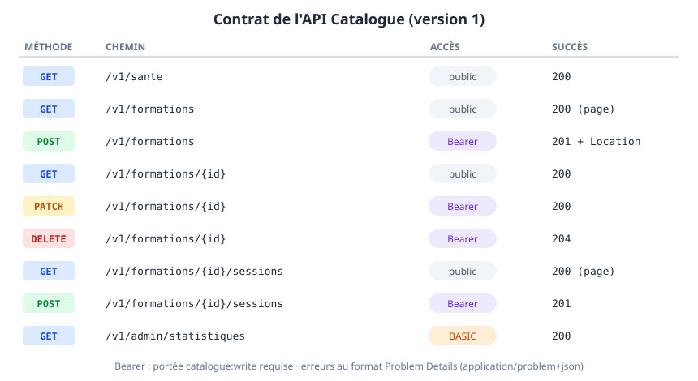
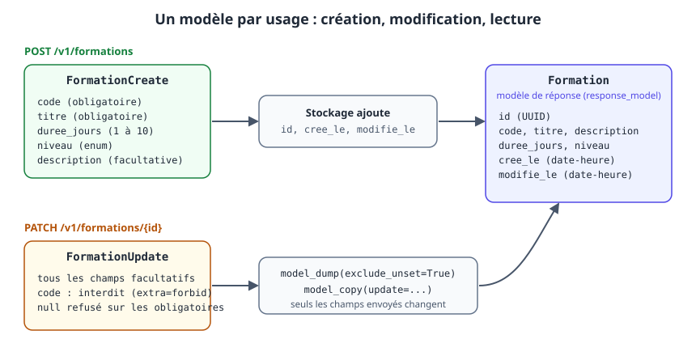
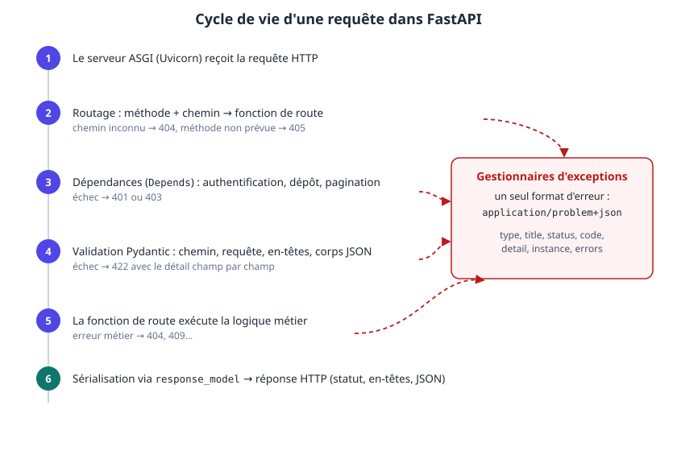
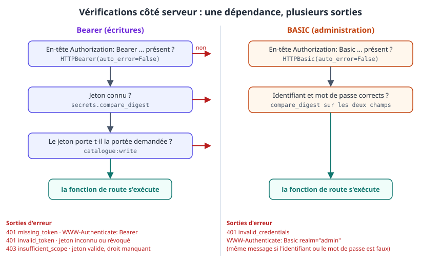

# Jour 2 — Concevoir et implémenter l'API Catalogue avec FastAPI

> **Formation** : Python Avancé — Web Services (3 jours, réf. PYT100614-F)
> **Programme de référence** : [Dawan — Python Avancé : Web Services](https://www.dawan.fr/formations/python/python-avance/python-avance-web-services)
> **Projet fil rouge** : API Catalogue — un catalogue de formations exposé en REST ; le jour 3, le même contrat est réimplémenté avec Django-Ninja
> **Blocs couverts** : 3 (implémenter un service web REST) · 4 (implémenter un service web avec Python, atelier FastAPI)

**Prérequis** : journée 1 terminée (dépôt `api-catalogue/` avec le module `catalogue_client`), notions de classes, d'annotations de type et d'exceptions en Python.
**Durée** : 7 h (mardi 9h00 – 17h30, pause déjeuner 12h30 – 13h30, deux pauses de 15 minutes).

## Objectifs pédagogiques

À la fin de la journée, les stagiaires sont capables de :

- concevoir le contrat d'une API REST : ressources, URL, méthodes, codes de statut, pagination, erreurs ;
- choisir entre Flask, Sanic et FastAPI selon le besoin, et expliquer la différence entre WSGI et ASGI ;
- déclarer des routes et des méthodes avec FastAPI, puis lire la documentation OpenAPI générée ;
- accepter des paramètres de chemin, de requête, d'en-tête et de corps, validés par des modèles Pydantic ;
- renvoyer des erreurs uniformes au format Problem Details (RFC 9457) ;
- protéger l'API avec l'authentification BASIC et Bearer, puis la tester avec `pytest` et avec le client écrit le jour 1.

### Livrable de la journée

Le dépôt `api-catalogue/` enrichi d'un service web `app/` qui expose :

- les formations (liste filtrée, triée et paginée, lecture, création, modification partielle, suppression) ;
- les interventions d'une formation (liste et création) ;
- une route d'administration protégée par BASIC ;
- des écritures protégées par un jeton Bearer avec portée ;
- une documentation Swagger UI générée automatiquement ;
- une suite de tests `pytest` et un script qui rejoue le scénario du jour 1 contre l'API locale.

> [!NOTE] Choix pédagogique
> Le stockage est **en mémoire** (un dictionnaire derrière une classe `Stockage`). La base de données n'est pas le sujet du jour : le contrat HTTP, la validation et la sécurité le sont. Le jour 3, l'ORM de Django remplacera ce stockage, et le `catalogue_client` du jour 1 servira à vérifier que les deux implémentations respectent exactement le même contrat.

## Organisation de la journée

| Heure | Séquence | Blocs programme |
|---|---|---|
| 09h00 – 09h15 | Accueil, retour sur le jour 1, vérification des postes | — |
| 09h15 – 09h55 | **Théorie** — Concevoir une API REST : ressources, méthodes, sérialisation | Bloc 3 |
| 09h55 – 10h45 | **Pratique** — Conception du contrat de l'API Catalogue | Bloc 3 |
| 10h45 – 11h00 | Pause | |
| 11h00 – 12h30 | **Pratique guidée** — FastAPI : routes, paramètres, modèles Pydantic | Bloc 4 |
| 12h30 – 13h30 | Déjeuner | |
| 13h30 – 15h00 | **Pratique guidée** — validation, erreurs, authentification BASIC et Bearer, tests | Bloc 4 |
| 15h00 – 15h15 | Pause | |
| 15h15 – 16h45 | **Atelier** — Créer un service web avec FastAPI | Bloc 4 |
| 16h45 – 17h30 | Démonstrations, synthèse, aperçu du jour 3 | — |

> [!TIP] Rythme
> Chaque notion est suivie d'une manipulation immédiate : le formateur démontre, les stagiaires reproduisent dans leur éditeur. Les sections **🛠️ Micro-atelier** durent de 10 à 25 minutes. Le code complet de l'atelier figure dans le support (section B5) : il sert de corrigé, pas de point de départ.

---

## B3 bloc 3 · 90 min

### 3.1 Du consommateur au concepteur

Hier, le contrat appartenait à quelqu'un d'autre. Aujourd'hui, **les décisions de conception sont celles des stagiaires**, et chacune a un coût pour les consommateurs : un nom de champ mal choisi, un code de statut incohérent ou une erreur illisible se paient pendant des années, parce qu'une API publiée ne se corrige pas aussi facilement qu'une fonction interne.

Les contraintes REST vues le jour 1 se traduisent en décisions concrètes :

| Contrainte REST | Décision de conception pour l'API Catalogue |
|---|---|
| Client–serveur | l'API ne renvoie que des données (JSON), jamais de HTML ni de logique d'affichage |
| Sans état | pas de intervention serveur : chaque requête porte son `Authorization`, la pagination utilise un curseur transmis par le client |
| Cache | les ressources lisibles peuvent exposer un `ETag` (extension de l'atelier) |
| Interface uniforme | URL en noms pluriels, verbes HTTP standard, mêmes codes de statut et même format d'erreur partout |
| Système en couches | l'API ne suppose pas être appelée directement : elle sera derrière un serveur, un proxy ou une passerelle |

> [!NOTE] Analogie : la carte d'un restaurant
> La carte décrit ce qu'on peut commander (le contrat), pas comment la cuisine travaille (l'implémentation). Le cuisinier peut changer de four, de fournisseur ou de recette sans toucher à la carte, mais retirer un plat de la carte déçoit des clients. Le contrat OpenAPI joue le rôle de la carte.

### 3.2 Modéliser les ressources du catalogue

Une **ressource** est un concept métier que les consommateurs veulent lire ou modifier. On la choisit à partir du vocabulaire du métier, pas à partir des tables de la base de données.

| Ressource | Description | Identifiant | Relations |
|---|---|---|---|
| `formation` | une formation du catalogue (code, titre, durée, level) | UUID | possède des interventions |
| `intervention` | une date de réalisation d'une formation (début, lieu, places) | UUID | appartient à une formation |

**Choix de l'identifiant.** Le jour 1 a montré que GoRest est passé d'identifiants entiers à des UUID. Un identifiant séquentiel (`/formations/17`) révèle le volume de données et invite à deviner les voisins (`/formations/18`). Un **UUID** est opaque et peut être généré par n'importe quel client ou serveur sans coordination. Le `code` métier (`PYT100614-F`) reste un champ de la ressource, unique mais distinct de l'identifiant technique.

**Les règles de nommage d'URL**, déjà aperçues le jour 1, deviennent ici des règles à appliquer :

| À faire | À éviter | Pourquoi |
|---|---|---|
| `GET /v1/formations` | `GET /v1/getFormations` | le verbe est dans la méthode HTTP |
| `GET /v1/formations/{id}` | `GET /v1/formation?id=12` | un élément a sa propre URL |
| `DELETE /v1/formations/{id}` | `POST /v1/formations/{id}/supprimer` | `DELETE` existe |
| `GET /v1/formations/{id}/interventions` | `GET /v1/interventions?formation=…` comme seule option | la relation de contenance est visible dans l'URL |
| `/v1/formations` (pluriel) | `/v1/formation` | une collection est un pluriel, partout |
| `/v1/formations` en minuscules | `/v1/Formations` | les URL sont sensibles à la casse |

> [!TIP] Profondeur maximale
> Limiter l'imbrication à deux levelx (`/formations/{id}/interventions`). Au-delà, exposer la ressource enfant à la racine avec un filtre : `/v1/interventions?filter[formation_id]=…`.

**Le versionnement dès le premier jour.** Le préfixe `/v1` figure dans toutes les URL. Le jour 1 a montré ce qu'un changement incompatible casse chez les consommateurs : la version 2 d'une API se publie sous `/v2`, pendant que `/v1` continue de répondre le temps de la migration.

### 3.3 Choisir les méthodes, les URL et les codes de statut

Le tableau ci-dessous est le **contrat de la ressource `formation`** que les stagiaires implémenteront dans l'atelier :

| Action | Méthode et URL | Corps de requête | Succès | Erreurs possibles |
|---|---|---|---|---|
| Lister | `GET /v1/formations` | — | `200` + page | `400` (curseur invalide), `422` (paramètre invalide) |
| Lire | `GET /v1/formations/{id}` | — | `200` | `404`, `422` (UUID mal formé) |
| Créer | `POST /v1/formations` | formation complète | `201` + en-tête `Location` | `401`, `403`, `409` (code déjà utilisé), `422` |
| Modifier | `PATCH /v1/formations/{id}` | champs à changer | `200` + formation à jour | `401`, `403`, `404`, `422` |
| Supprimer | `DELETE /v1/formations/{id}` | — | `204` sans corps | `401`, `403`, `404` |

**Les règles derrière le tableau :**

- **`POST` renvoie `201 Created`** et l'en-tête `Location` qui contient l'URL de la ressource créée. Le corps de la réponse reprend la ressource complète, `id` compris : le client n'a pas à la relire.
- **`PATCH` plutôt que `PUT`** : le client n'envoie que les champs à changer (JSON Merge Patch, vu le jour 1 avec GoRest). Un `PUT` obligerait à renvoyer tous les champs et ferait perdre ceux qu'on oublie.
- **`DELETE` renvoie `204 No Content`**, sans corps. Un second `DELETE` sur la même ressource renvoie `404` : l'état final est identique (la ressource n'existe pas), seule la réponse diffère. La méthode reste idempotente au sens HTTP.
- **`401` ou `403`** : identité inconnue contre droit manquant (jour 1).
- **`409 Conflict`** : la requête est valide en elle-même, mais incompatible avec l'état actuel (code déjà pris).
- **`422 Unprocessable Content`** : la requête est bien formée, mais une donnée est invalide. `400` est réservé aux requêtes qu'on ne peut même pas interpréter (curseur illisible, corps qui n'est pas du JSON).

**Les actions qui ne sont pas du CRUD.** Annuler une intervention n'est ni une création ni une suppression de ressource. Trois façons de le modéliser :

| Approche | Exemple | Quand l'utiliser |
|---|---|---|
| Changer un champ d'état | `PATCH /v1/interventions/{id}` avec `{"statut": "annulee"}` | l'état est une propriété naturelle de la ressource |
| Créer une ressource d'événement | `POST /v1/interventions/{id}/annulations` | on veut conserver la trace (motif, date) |
| Sous-ressource d'action | `POST /v1/interventions/{id}/annuler` | dernier recours, quand aucune des deux autres ne convient |

Pour le fil rouge, l'annulation passe par un champ `statut` modifiable.

### 3.4 La sérialisation des données

**Sérialiser** consiste à transformer un objet Python en texte (JSON) pour l'envoyer ; **désérialiser** fait l'opération inverse à la réception. Entre les deux, les types Python et les types JSON ne se correspondent pas toujours.

| Python | JSON | Remarques |
|---|---|---|
| `str` | chaîne | encodage UTF-8 |
| `int`, `float` | nombre | JSON ne distingue pas entier et décimal |
| `bool` | `true` / `false` | |
| `None` | `null` | |
| `list`, `tuple` | tableau | |
| `dict` | objet | clés obligatoirement des chaînes |
| `datetime`, `date` | **aucun** | à écrire en chaîne ISO 8601 |
| `UUID` | **aucun** | à écrire en chaîne |
| `Decimal` | **aucun** | à écrire en chaîne pour ne pas perdre de précision |
| `Enum` | **aucun** | à écrire par sa valeur |

```python
import datetime, json

json.dumps({"debut": datetime.date(2027, 3, 15)})
# TypeError: Object of type date is not JSON serializable
```

Le module standard `json` ne sait pas sérialiser les dates ni les UUID. Un framework d'API prend ce travail en charge : **FastAPI s'appuie sur Pydantic pour convertir les types Python vers JSON, et inversement**. Le développeur déclare un type (`date`, `UUID`, `Enum`), la conversion et la validation suivent.

**Conventions de format à fixer dès la conception :**

| Sujet | Convention retenue pour l'API Catalogue | Justification |
|---|---|---|
| Dates | ISO 8601 : `2027-03-15` | lisible, triable, reconnu partout |
| Dates et heures | ISO 8601 en UTC avec suffixe `Z` : `2026-11-16T09:00:00Z` | évite les ambiguïtés de fuseau |
| Montants | chaîne décimale ou entier en centimes, jamais un `float` | les flottants ne représentent pas exactement 0,1 |
| Noms de champs | `snake_case` | cohérent avec Python et avec GoRest |
| Absence de valeur | champ présent avec `null` | le consommateur n'a pas à tester l'existence de la clé |
| Énumérations | valeurs en minuscules sans accent (`avance`) | pas de problème d'encodage dans les filtres |
| Collections | enveloppe `{"data": [...], "meta": {...}}` | on peut ajouter des métadonnées sans casser les clients |
| Langue des messages d'erreur | français pour `detail`, anglais pour `code` | `code` est stable et sert au traitement automatique |

> [!WARN] Une enveloppe se décide au début
> Renvoyer directement un tableau JSON (`[{...}, {...}]`) est tentant, mais interdit d'ajouter plus tard le curseur de pagination ou un total sans casser tous les clients. C'est précisément la différence que le jour 1 a relevée entre GoRest v2 (tableau nu) et v3 (enveloppe).

### 3.5 Concevoir les listes : filtres, tri, pagination

Le contrat d'une liste est plus riche que celui d'un élément. Pour garder la compatibilité avec le client du jour 1, l'API Catalogue reprend les conventions de GoRest v3 :

| Paramètre | Rôle | Exemple |
|---|---|---|
| `filter[level]` | filtre sur une valeur | `?filter[level]=avance` |
| `search` | recherche textuelle libre | `?search=python` |
| `sort` | tri ; préfixe `-` pour décroissant | `?sort=-duration` |
| `page[size]` | éléments par page, de 1 à 100 (25 par défaut) | `?page[size]=10` |
| `page[after]` | curseur opaque de la page suivante | `?page[after]=Mg==` |
| `page[count]` | ajoute `meta.total` si `true` | `?page[count]=true` |

La réponse d'une liste :

```json
{
  "data": [ { "id": "…", "code": "PYT100614-F", "titre": "Python Avancé : Web Services" } ],
  "meta": { "has_more": true, "next_cursor": "Mg==", "total": null }
}
```

Le curseur est **opaque pour le client** : ici, le décalage encodé en base64. Le serveur reste libre de changer cette représentation plus tard (curseur basé sur une date, sur un identifiant) sans casser personne.

### 3.6 Conseils pour créer de bons points d'entrée

| Conseil | Détail |
|---|---|
| Un format d'erreur unique | toutes les erreurs, y compris celles du framework (`404`, `405`, `422`, `500`), suivent Problem Details |
| Des codes de statut précis | ne jamais renvoyer `200` avec `{"erreur": "..."}` dans le corps |
| Idempotence documentée | dire quelles méthodes se rejouent sans risque, et accepter `Idempotency-Key` sur les `POST` sensibles |
| Validation stricte des entrées | types, bornes, longueurs, énumérations : tout ce qui entre est suspect |
| Pas de fuite d'information | un `500` ne renvoie jamais de trace Python ; un identifiant ou un mot de passe faux donnent le même message |
| Limites explicites | taille maximale de page, taille maximale du corps, quotas par jeton |
| Compatibilité ascendante | ajouter un champ est sans risque ; renommer, retirer ou changer le type d'un champ exige une nouvelle version |
| Documentation exécutable | le contrat OpenAPI est généré et testé, pas rédigé à côté |
| Journalisation utile | un identifiant de requête (`request_id`) dans chaque réponse d'erreur et chaque ligne de log |

### 🛠️ Micro-atelier 5 — Concevoir le contrat de la ressource `intervention` (25 min)

**Consignes** (en binômes, sur papier, tableau ou éditeur) :

1. lister les champs d'une `intervention` (nom, type, obligatoire ou non, contraintes) ;
2. écrire le tableau « action, méthode et URL, corps, succès, erreurs » des opérations **liste** et **création** d'une intervention d'une formation ;
3. décider de la réponse quand la formation parente n'existe pas (`404`) et quand la date de début est dans le passé (`422`) ;
4. proposer la manière d'annuler une intervention.

**Corrigé formateur.**

| Champ | Type | Obligatoire | Contraintes |
|---|---|---|---|
| `id` | UUID | généré par le serveur | — |
| `formation_id` | UUID | généré à partir de l'URL | formation existante |
| `date_debut` | date ISO 8601 | oui | postérieure à aujourd'hui |
| `lieu` | texte | oui | 2 à 80 caractères |
| `places` | entier | oui | de 1 à 30 |
| `statut` | énumération | non (défaut `planifiee`) | `planifiee`, `confirmee`, `annulee` |

| Action | Méthode et URL | Succès | Erreurs |
|---|---|---|---|
| Lister | `GET /v1/formations/{id}/interventions` | `200` + page | `404` (formation inconnue) |
| Créer | `POST /v1/formations/{id}/interventions` | `201` + intervention créée | `401`, `403`, `404`, `422` |



**Point de contrôle** : chaque binôme présente un écart par rapport au corrigé et le justifie. Un écart justifié (par exemple `409` plutôt que `422` pour un doublon) est accepté, tant qu'il est appliqué de façon **cohérente** à toute l'API.

---

## B4 bloc 4 · 180 min

### 4.1 Les bibliothèques d'API REST en Python

**Pourquoi un framework ?** Écrire un service web avec la seule bibliothèque standard (`http.server`) oblige à analyser soi-même les URL, décoder le JSON, valider les champs, formater les erreurs et gérer la concurrence. Un framework fournit ces briques, éprouvées et documentées.

**WSGI et ASGI : deux interfaces entre le serveur et l'application.**

| | **WSGI** | **ASGI** |
|---|---|---|
| Modèle | synchrone : un thread ou un processus traite une requête de bout en bout | asynchrone : une boucle d'événements traite beaucoup de connexions à la fois |
| Connexions longues (WebSocket, flux) | non | oui |
| Serveurs applicatifs courants | Gunicorn, uWSGI | Uvicorn, Hypercorn |
| Frameworks | Flask, Django (mode classique) | FastAPI, Starlette, Sanic (serveur intégré), Django (mode ASGI) |

Un framework ASGI peut exécuter à la fois des fonctions asynchrones (`async def`) et des fonctions classiques (`def`). Les serveurs et le déploiement sont détaillés le jour 3.

**Les trois frameworks du programme :**

| Critère | **Flask** | **Sanic** | **FastAPI** |
|---|---|---|---|
| Philosophie | micro-framework, minimal et extensible | serveur asynchrone intégré, performance | typage Python et validation avant tout |
| Interface | WSGI | serveur propre, ASGI possible | ASGI (bâti sur Starlette) |
| Validation des entrées | via extensions (Marshmallow, Pydantic, etc.) | via extensions | **native** (Pydantic) |
| Documentation OpenAPI | via extensions | via l'extension `sanic-ext` | **native**, générée à partir des annotations |
| Authentification | via extensions | via extensions ou code maison | utilitaires de sécurité fournis (BASIC, Bearer, OAuth2) |
| Courbe d'apprentissage | très douce | douce | douce si l'on connaît les annotations de type |

**Le même point d'entrée, trois fois.** `GET /formations/{code}` dans chaque framework, avec un dictionnaire comme stockage :

```python
# Flask
from flask import Flask, abort

app = Flask(__name__)
FORMATIONS = {"PYT100614-F": {"code": "PYT100614-F", "titre": "Python Avancé : Web Services"}}

@app.get("/formations/<code>")
def lire(code: str):
    if code not in FORMATIONS:
        abort(404)
    return FORMATIONS[code]
```

```python
# Sanic
from sanic import Sanic
from sanic.exceptions import NotFound
from sanic.response import json

app = Sanic("catalogue")

@app.get("/formations/<code>")
async def lire(request, code: str):
    if code not in FORMATIONS:
        raise NotFound("Formation inconnue")
    return json(FORMATIONS[code])
```

```python
# FastAPI
from fastapi import FastAPI, HTTPException
from pydantic import BaseModel

class FormationSchema(BaseModel):
    code: str
    titre: str

app = FastAPI()

@app.get("/formations/{code}")
def lire(code: str) -> FormationSchema:
    if code not in FORMATIONS:
        raise HTTPException(status_code=404, detail="Formation inconnue")
    return FORMATIONS[code]
```

Les trois versions se ressemblent. La différence apparaît ailleurs : dans la version FastAPI, le modèle `FormationSchema` **valide** la réponse, **documente** le schéma dans OpenAPI et fournit l'autocomplétion à l'éditeur, sans code supplémentaire.

**Choix pour la formation : FastAPI**, pour trois raisons : la validation et la documentation sortent des annotations de type que les stagiaires maîtrisent déjà ; le contrat OpenAPI est généré automatiquement (section 1.6 du jour 1) ; le client de test `TestClient` est fourni. Flask reste un très bon choix pour un petit service ou une application web avec gabarits ; Sanic, quand l'asynchrone et le débit priment sur l'écosystème.

> [!TIP] Et Django ?
> Django dispose de ses propres solutions pour les API (Django REST framework, Django-Ninja), étudiées le jour 3. On les choisit quand l'application a déjà un modèle de données Django, une administration et une authentification à réutiliser.

### 4.2 Installer FastAPI et démarrer

```bash
# dans api-catalogue/, environnement virtuel actif (jour 1)
pip install "fastapi[standard]"
pip freeze > requirements.txt
```

L'option `standard` installe FastAPI avec ses outils usuels : le serveur Uvicorn, la commande `fastapi` et la bibliothèque `httpx` qui sert au client de test.

**Arborescence de départ** :

```
api-catalogue/
├── catalogue_client/        # jour 1
├── app/
│   ├── __init__.py          # fichier vide : app est un package
│   └── main.py
└── pyproject.toml
```

```toml
# pyproject.toml
[tool.fastapi]
entrypoint = "app.main:app"
```

```python
# app/main.py
from fastapi import FastAPI

app = FastAPI(title="API Catalogue", version="1.0.0")


@app.get("/v1/sante")
def sante() -> dict[str, str]:
    return {"statut": "ok"}
```

```bash
fastapi dev
```

La commande `fastapi dev` démarre un serveur de développement avec **rechargement automatique** à chaque modification de fichier. La console affiche une ligne du type `Uvicorn running on http://127.0.0.1:8000`.

**Trois adresses fournies sans rien écrire :**

| URL | Contenu |
|---|---|
| `http://127.0.0.1:8000/docs` | Swagger UI : documentation interactive, avec un bouton « Try it out » |
| `http://127.0.0.1:8000/redoc` | ReDoc : documentation de lecture, présentation alternative |
| `http://127.0.0.1:8000/openapi.json` | le contrat OpenAPI brut, lisible par les outils (Postman, Bruno, générateurs de client) |

> [!WARN] `fastapi dev` n'est pas un serveur de production
> Le mode `dev` active le rechargement automatique et écoute en local uniquement. La mise en production (Uvicorn ou Gunicorn derrière un proxy) est traitée le jour 3. Si la commande `fastapi` n'est pas reconnue, vérifier que l'environnement virtuel est actif, ou lancer `uvicorn app.main:app --reload --host 0.0.0.0` pour écouter sur toutes les interfaces réseau.

### 🛠️ Micro-atelier 6 — Première route et premier contrat (15 min)

1. Créer `app/__init__.py`, `app/main.py` et `pyproject.toml` comme ci-dessus, puis démarrer `fastapi dev`.
2. Appeler la route avec `curl.exe -i http://127.0.0.1:8000/v1/sante` : relever le statut, le `Content-Type` et le corps.
3. Ouvrir `/docs`, déplier la route, cliquer sur **Try it out** puis **Execute**.
4. Ouvrir `/openapi.json` et retrouver le chemin `/v1/sante` et sa méthode.
5. Modifier le titre de l'application : constater le rechargement automatique et le changement dans `/docs`.

**Question de réflexion.** Le code ne comporte aucune ligne de documentation. D'où viennent les informations de `/docs` ? *(Réponse : des décorateurs, des annotations de type et des modèles Pydantic : FastAPI les lit et produit le contrat OpenAPI.)*

### 4.3 Déclarer des routes et des méthodes

Une **opération de chemin** (path operation) combine une méthode HTTP, un chemin et une fonction :

```python
@app.get("/v1/formations")           # GET
@app.post("/v1/formations")          # POST
@app.patch("/v1/formations/{id}")    # PATCH
@app.delete("/v1/formations/{id}")   # DELETE
```

Les décorateurs acceptent des options qui alimentent à la fois le **comportement** et la **documentation** :

| Option | Effet |
|---|---|
| `status_code=201` | code renvoyé en cas de succès (aussi affiché dans OpenAPI) |
| `response_model=FormationSchema` | modèle de la réponse : filtre, valide et documente |
| `tags=["formations"]` | regroupe les routes dans `/docs` |
| `summary="Lister les formations"` | titre court ; la docstring de la fonction sert de description |
| `responses={404: {"description": "Formation inconnue"}}` | documente les codes d'erreur possibles |
| `dependencies=[Depends(...)]` | exécute des vérifications avant la route (authentification) |
| `response_class=Response` | permet une réponse sans corps (`204`) |

**Organiser les routes avec `APIRouter`.** Une application réelle ne tient pas dans un seul fichier. Chaque ressource a son module, avec son propre routeur, assemblé dans `main.py` :

```python
# app/routers/formations.py
from fastapi import APIRouter

router = APIRouter(prefix="/formations", tags=["formations"])

@router.get("")
def lister_formations(): ...
```

```python
# app/main.py
from fastapi import APIRouter, FastAPI
from .routers import formations

v1 = APIRouter(prefix="/v1")
v1.include_router(formations.router)

app = FastAPI(title="API Catalogue", version="1.0.0")
app.include_router(v1)
```

L'URL finale est la concaténation des préfixes : `/v1` + `/formations` + `""` donne `/v1/formations`. Changer de version, plus tard, consiste à ajouter un second routeur `/v2`.

**`def` ou `async def` ?** FastAPI accepte les deux, avec des conséquences différentes :

| Déclaration | Exécution | À utiliser quand |
|---|---|---|
| `def route(...)` | dans un **pool de threads**, sans bloquer la boucle d'événements | la fonction appelle du code bloquant : `requests`, un pilote de base de données synchrone, un fichier |
| `async def route(...)` | **directement sur la boucle** d'événements | la fonction n'utilise que des appels asynchrones (`await httpx...`, pilote de base asynchrone) |

> [!DANGER] Un appel bloquant dans `async def` fige tout le serveur
> Un `time.sleep(5)` ou un `requests.get(...)` placé dans une route `async def` bloque la boucle d'événements : **toutes** les requêtes en cours attendent. Dans le doute, déclarer `def` : FastAPI s'occupe du pool de threads. Les routes de l'atelier sont des `def`, car le stockage est en mémoire et le code est synchrone.

**Démonstration du formateur** (5 min) : deux routes, l'une `def`, l'autre `async def`, contenant `time.sleep(5)` ; appeler la seconde deux fois en parallèle avec deux terminaux et constater que les réponses arrivent l'une après l'autre.

### 4.4 Accepter des paramètres

FastAPI déduit l'**origine** de chaque paramètre à partir de la signature de la fonction :

| Le paramètre… | …vient de |
|---|---|
| apparaît dans le chemin (`/{formation_id}`) | **chemin** |
| est un type simple (`int`, `str`, `bool`, `Enum`…) absent du chemin | **chaîne de requête** (query) |
| est un modèle Pydantic | **corps** JSON |
| est déclaré avec `Header(...)`, `Cookie(...)`, `Query(...)`, `Body(...)` | l'emplacement indiqué explicitement |

**Paramètres de chemin typés.** Le type de l'annotation sert de validation et de conversion :

```python
import uuid

@router.get("/{formation_id}")
def lire_formation(formation_id: uuid.UUID) -> FormationSchema:
    ...
```

Appelée avec `/v1/formations/abc`, la route répond `422` avant même d'exécuter la fonction : `abc` n'est pas un UUID. La fonction reçoit un vrai objet `uuid.UUID`.

**Paramètres de requête avec valeurs par défaut et contraintes :**

```python
from typing import Annotated, Literal
from fastapi import Query

@router.get("")
def lister_formations(
    level: Annotated[Level | None, Query(alias="filter[level]")] = None,
    recherche: Annotated[str | None, Query(alias="search", min_length=2, max_length=50)] = None,
    sort: Annotated[Literal["code", "-code", "titre", "-titre"], Query(alias="sort")] = "code",
    taille: Annotated[int, Query(alias="page[size]", ge=1, le=100)] = 25,
    apres: Annotated[str | None, Query(alias="page[after]")] = None,
):
    ...
```

Points à retenir :

- `Annotated[type, Query(...)]` est la forme recommandée : le type et ses contraintes sont réunis, la valeur par défaut reste une vraie valeur par défaut Python ;
- `alias="page[size]"` est indispensable, car `page[size]` n'est pas un nom de variable Python valide ; le nom Python (`taille`) et le nom exposé (`page[size]`) sont découplés ;
- `ge`, `le`, `min_length`, `max_length`, `pattern` expriment les contraintes, et apparaissent dans la documentation ;
- `Literal[...]` ou une `Enum` limite les valeurs autorisées : un tri sur un champ inexistant est refusé avec un `422` au lieu de provoquer une erreur interne ;
- un paramètre **sans valeur par défaut** est **obligatoire**.

**Paramètres d'en-tête :**

```python
from fastapi import Header

@router.post("")
def creer(idempotency_key: Annotated[str | None, Header()] = None): ...
```

FastAPI convertit `idempotency_key` en `Idempotency-Key` (les underscores deviennent des tirets).

**Corps de requête.** Un paramètre dont le type est un modèle Pydantic est lu dans le corps JSON, validé, puis converti :

```python
@router.post("", status_code=201)
def creer_formation(donnees: FormationCreate) -> FormationSchema:
    ...
```

Si le corps n'est pas du JSON valide, ou si un champ est absent ou invalide, la fonction n'est jamais appelée.

### 4.5 Les modèles Pydantic : valider et documenter les données

**Pydantic** définit des **modèles** : des classes dont les attributs sont typés. À la construction, les données sont validées et converties ; en cas d'écart, une exception décrit précisément chaque erreur.

```python
import uuid
from datetime import datetime
from enum import Enum

from pydantic import BaseModel, ConfigDict, Field


class Level(str, Enum):
    initiation = "initiation"
    intermediaire = "intermediaire"
    avance = "avance"


class FormationSchema(BaseModel):
    model_config = ConfigDict(str_strip_whitespace=True)

    code: str = Field(pattern=r"^[A-Z]{3}\d{6}-[A-Z]$", examples=["PYT100614-F"])
    titre: str = Field(min_length=3, max_length=120)
    description: str | None = Field(default=None, max_length=2000)
    duration: int = Field(ge=1, le=10)
    level: Level
```

| Élément | Rôle |
|---|---|
| `class X(BaseModel)` | déclare un modèle ; les attributs annotés deviennent des champs |
| `Field(...)` | contraintes (`ge`, `le`, `min_length`, `pattern`…), valeur par défaut, exemples pour la documentation |
| `str \| None = None` | champ facultatif et nullable |
| `Enum` | valeurs autorisées limitées à une liste fermée |
| `ConfigDict(str_strip_whitespace=True)` | supprime les espaces en début et fin de chaîne avant validation |

**Un modèle par usage.** Utiliser un seul modèle pour la création, la modification et la lecture conduit à des compromis fragiles : un client pourrait envoyer un `id`, ou on devrait rendre facultatifs des champs obligatoires à la création.



| Modèle | Usage | Particularités |
|---|---|---|
| `FormationCreate` | corps du `POST` | tous les champs obligatoires, aucun `id` |
| `FormationUpdate` | corps du `PATCH` | tous les champs facultatifs, `code` interdit (`extra="forbid"`) |
| `FormationSchema` | réponse | ajoute `id`, `cree_le`, `modifie_le` |

**Modification partielle avec `exclude_unset`.** Pour un `PATCH`, il faut distinguer « champ absent » (ne pas toucher) de « champ envoyé avec `null` » (effacer la valeur). Pydantic mémorise les champs réellement reçus :

```python
changements = donnees.model_dump(exclude_unset=True)
# {"titre": "Nouveau titre"}           si seul le titre a été envoyé
# {"description": None}                si description a été envoyée avec null
```

`model_dump(exclude_unset=True)` ne renvoie que les champs présents dans la requête. Mettre à jour un objet avec ce dictionnaire donne exactement la sémantique du JSON Merge Patch vue le jour 1.

**Validateurs métier.** Quand une contrainte dépasse les bornes simples, on écrit une méthode de validation :

```python
from datetime import date
from pydantic import field_validator

class InterventionCreate(BaseModel):
    date_debut: date

    @field_validator("date_debut")
    @classmethod
    def dans_le_futur(cls, valeur: date) -> date:
        if valeur <= date.today():
            raise ValueError("la date de début doit être postérieure à aujourd'hui")
        return valeur
```

**`response_model` : contrôler ce qui sort.** Le modèle de réponse filtre les champs de l'objet renvoyé et valide sa forme. Un champ interne (`mot_de_passe_hash`, `note_interne`) absent du modèle de réponse **ne peut pas fuiter** dans le JSON, même si l'objet Python le contient. C'est une protection contre l'exposition accidentelle de données.

```python
@router.get("/{formation_id}", response_model=FormationSchema)
def lire_formation(formation_id: uuid.UUID): ...
```

Avec une annotation de retour (`-> FormationSchema`), FastAPI déduit le même comportement. Les deux écritures sont équivalentes pour les cas simples ; `response_model=` reste utile quand la fonction renvoie un objet plus riche que ce qu'on veut exposer.

### 🛠️ Micro-atelier 7 — Modéliser et voir la validation à l'œuvre (15 min)

1. Créer `app/schemas.py` avec `Level`, `FormationSchema`, `FormationCreate` et `FormationSchema` (sections 4.5 et B5).
2. Dans un shell Python, construire `FormationCreate(...)` avec des données valides, puis avec `duration=99` ; lire le message d'erreur Pydantic.
3. Ajouter à `main.py` une route temporaire :

```python
@app.post("/v1/essai", response_model=FormationSchema)
def essai(donnees: FormationCreate) -> FormationSchema:
    maintenant = datetime.now(timezone.utc)
    return FormationSchema(id=uuid.uuid4(), cree_le=maintenant, modifie_le=maintenant, **donnees.model_dump())
```

4. Depuis `/docs`, envoyer un corps valide, puis un corps avec `level` invalide et un champ manquant ; comparer les réponses `200` et `422`.

**Résultat attendu** : la réponse `422` contient une liste `detail` avec, pour chaque erreur, un type (`missing`, `enum`, `less_than_equal`…), la localisation (`loc`) et un message. La section suivante transforme ce format par défaut en Problem Details.

### 4.6 Validation et gestion des erreurs



Toutes les erreurs de l'API passent par la même porte de sortie : les **gestionnaires d'exceptions**. C'est ce qui permet d'offrir au consommateur un format unique, quelle que soit l'origine de l'erreur (route inconnue, authentification, validation, règle métier).

**Le format d'erreur par défaut de FastAPI.** Pour un corps invalide, FastAPI répond `422` avec une liste `detail` (extrait) :

```json
{
  "detail": [
    {
      "type": "less_than_equal",
      "loc": ["body", "duration"],
      "msg": "Input should be less than or equal to 10",
      "input": 99
    }
  ]
}
```

Chaque erreur indique son **type**, sa **localisation** (`loc` : d'où vient le paramètre, puis son nom) et un **message**. Ce format est précis, mais il diffère du Problem Details que les consommateurs ont rencontré chez GoRest, et il varie selon l'erreur : une `404` produit `{"detail": "Not Found"}`, une erreur de validation un tableau. Un client doit alors gérer plusieurs formes.

**Objectif : un seul format, Problem Details (RFC 9457).**

```json
{
  "type": "https://api-catalogue.example/erreurs#validation_failed",
  "title": "Unprocessable Entity",
  "status": 422,
  "code": "validation_failed",
  "detail": "Certains champs ne sont pas valides.",
  "instance": "/v1/formations",
  "request_id": "6f7c2f2e-…",
  "errors": [
    { "pointer": "/duration", "code": "less_than_equal", "detail": "Input should be less than or equal to 10" }
  ]
}
```

C'est exactement la forme que `catalogue_client.ApiError` sait lire (`code`, `errors`, `request_id`), ce qui évite de modifier le client.

**Étape 1 — une exception métier.**

```python
class ApiError(Exception):
    def __init__(self, status: int, code: str, detail: str,
                 erreurs: list[dict] | None = None, headers: dict[str, str] | None = None):
        self.status, self.code, self.detail = status, code, detail
        self.erreurs, self.headers = erreurs, headers
```

Le code métier lève `ApiError(404, "not_found", "Formation introuvable.")` sans connaître HTTP : seul le gestionnaire se préoccupe du format de la réponse.

**Étape 2 — construire une réponse Problem Details.**

```python
import uuid
from http import HTTPStatus

from fastapi import Request
from fastapi.responses import JSONResponse


def probleme(request: Request, status: int, code: str, detail: str,
             erreurs: list[dict] | None = None,
             headers: dict[str, str] | None = None) -> JSONResponse:
    corps = {
        "type": f"https://api-catalogue.example/erreurs#{code}",
        "title": HTTPStatus(status).phrase,
        "status": status,
        "code": code,
        "detail": detail,
        "instance": request.url.path,
        "request_id": str(uuid.uuid4()),
    }
    if erreurs:
        corps["errors"] = erreurs
    return JSONResponse(corps, status_code=status, headers=headers,
                        media_type="application/problem+json")
```

**Étape 3 — enregistrer les gestionnaires.** Quatre sources d'erreur, quatre gestionnaires :

| Source | Gestionnaire pour… | Statut produit |
|---|---|---|
| règle métier | `ApiError` | celui de l'exception |
| framework (route inconnue, méthode non autorisée) | `StarletteHTTPException` | `404`, `405`… |
| validation Pydantic | `RequestValidationError` | `422` |
| bug imprévu | `Exception` | `500`, sans détail technique |

```python
from fastapi import FastAPI
from fastapi.exceptions import RequestValidationError
from starlette.exceptions import HTTPException as StarletteHTTPException


def pointeur(loc: tuple) -> str:
    morceaux = [str(m) for m in loc[1:]]       # on retire « body », « query », « path »
    return "/" + "/".join(morceaux)


def installer_gestionnaires(app: FastAPI) -> None:
    @app.exception_handler(RequestValidationError)
    async def validation(request: Request, exc: RequestValidationError):
        erreurs = [{"pointer": pointeur(e["loc"]), "code": e["type"], "detail": e["msg"]}
                   for e in exc.errors()]
        return probleme(request, 422, "validation_failed",
                        "Certains champs ne sont pas valides.", erreurs)
```

> [!WARN] Ne pas renvoyer `exc.errors()` tel quel
> Pour certaines erreurs (validateurs écrits par le développeur), la liste contient des objets Python (`ctx.error` : l'exception d'origine) qui **ne se sérialisent pas en JSON** : la réponse d'erreur provoquerait elle-même une erreur `500`. On construit explicitement un dictionnaire avec trois chaînes (`pointer`, `code`, `detail`).

Le gestionnaire pour `Exception` joue un rôle de filet de sécurité : il journalise la trace complète **côté serveur** et ne renvoie au client qu'un `500` et un `request_id`.

**Que doit contenir un message d'erreur ?** Assez pour que le consommateur corrige sa requête, jamais assez pour aider un attaquant :

| Cas | Message conseillé | Message à proscrire |
|---|---|---|
| Identifiant ou mot de passe faux | « Identifiant ou mot de passe incorrect. » (le même dans les deux cas) | « Mot de passe incorrect pour l'utilisateur admin. » |
| Champ invalide | pointeur du champ et règle violée | valeur complète du champ sensible |
| Bug imprévu | « Erreur interne » et `request_id` | trace Python, requête SQL, chemin de fichier |

### 🛠️ Micro-atelier 8 — Un format d'erreur unique (10 min)

1. Créer `app/erreurs.py` avec `ApiError`, `probleme`, `pointeur` et `installer_gestionnaires` (version complète en B5).
2. Appeler `installer_gestionnaires(app)` dans `main.py`.
3. Vérifier avec `curl.exe -i` : une route inconnue (`/v1/nexiste-pas`), un `POST /v1/essai` avec un `duration` hors plage, une méthode non prévue (`DELETE /v1/sante`).
4. Pour chacune : relever le statut, l'en-tête `Content-Type` (`application/problem+json`), le champ `code`.
5. Les afficher avec `catalogue_client` en pointant vers `http://127.0.0.1:8000/v1` : l'exception est-elle correctement typée ? *(Remarque : le client monte ses reprises sur `https://` uniquement ; voir l'atelier.)*

### 4.7 Les dépendances : factoriser ce qui précède la route

Une **dépendance** est une fonction que FastAPI exécute **avant** la fonction de route, et dont il injecte le résultat. C'est le mécanisme central pour tout ce qui est transversal : authentification, accès au stockage, paramètres de pagination, configuration.

```python
from typing import Annotated
from fastapi import Depends

_stockage = Stockage()

def obtenir_stockage() -> Stockage:
    return _stockage

Depot = Annotated[Stockage, Depends(obtenir_stockage)]


@router.get("/{formation_id}")
def lire_formation(formation_id: uuid.UUID, depot: Depot) -> FormationSchema:
    return depot.formation(formation_id)
```

Ce que cela apporte :

| Bénéfice | Explication |
|---|---|
| **Réutilisation** | l'alias `Depot` s'écrit une fois et s'emploie dans chaque route |
| **Testabilité** | un test remplace la dépendance : `app.dependency_overrides[obtenir_stockage] = lambda: Stockage()` |
| **Documentation** | une dépendance de sécurité apparaît dans OpenAPI (bouton **Authorize** de Swagger UI) |
| **Composition** | une dépendance peut en utiliser d'autres (le vérificateur de jeton dépend des paramètres de configuration) |

Une dépendance peut aussi s'appliquer sans que la route n'en utilise le résultat, avec `dependencies=[Depends(...)]` sur la route ou sur tout un routeur : c'est la forme retenue pour « cette opération exige un jeton valide ».

### 4.8 Authentification BASIC

**Principe** (rappel du jour 1) : le client envoie `Authorization: Basic base64(identifiant:mot_de_passe)`. Le serveur compare, et répond `401` avec `WWW-Authenticate: Basic` en cas d'échec.

```python
import secrets
from typing import Annotated

from fastapi import Depends
from fastapi.security import HTTPBasic, HTTPBasicCredentials

schema_basic = HTTPBasic(auto_error=False)


def egal(a: str, b: str) -> bool:
    return secrets.compare_digest(a.encode("utf8"), b.encode("utf8"))


def exiger_admin(
    identifiants: Annotated[HTTPBasicCredentials | None, Depends(schema_basic)],
    p: Annotated[Settings, Depends(settings)],
) -> str:
    # & et non « and » : les deux comparaisons s'exécutent toujours
    if identifiants is None or not (
        egal(identifiants.username, p.admin_utilisateur)
        & egal(identifiants.password, p.admin_mot_de_passe)
    ):
        raise ApiError(401, "invalid_credentials", "Identifiant ou mot de passe incorrect.",
                        headers={"WWW-Authenticate": 'Basic realm="admin"'})
    return identifiants.username
```

**Trois points de sécurité à retenir.**

- **`secrets.compare_digest`** compare en un temps qui ne dépend pas de la position du premier caractère différent. Avec `==`, un attaquant qui mesure finement les temps de réponse peut deviner un secret caractère par caractère (**attaque par canal temporel**). La fonction travaille sur des octets : on encode donc en UTF-8 d'abord, ce qui autorise les caractères accentués.
- **Même message** pour un identifiant inconnu et pour un mot de passe erroné : ne pas indiquer à un attaquant quel identifiant existe.
- **`auto_error=False`** : par défaut, le schéma lève lui-même l'erreur dans son propre format. Avec `False`, la dépendance reçoit `None` et c'est notre code qui répond, dans le format Problem Details.

> [!WARN] Où vivent les secrets ?
> Dans l'atelier, l'identifiant et le mot de passe d'administration sont lus dans des variables d'environnement (`.env`), conformément à la règle du jour 1. En production, un mot de passe ne se stocke jamais en clair : on conserve son **empreinte** (algorithmes `argon2` ou `bcrypt`) et on compare l'empreinte. BASIC n'est acceptable que sur **HTTPS** et pour des usages simples (outils internes, administration).

### 4.9 Authentification Bearer, jetons et portées

**Principe** : le client envoie `Authorization: Bearer <jeton>`. Le serveur retrouve le jeton, en déduit une **identité** et des **droits** (portées, en anglais *scopes*).



Pour l'API Catalogue, deux jetons existent (configurés dans `.env`) :

| Jeton | Portées | Usage |
|---|---|---|
| `CATALOGUE_TOKEN_ECRITURE` | `catalogue:write` | scripts qui alimentent le catalogue |
| `CATALOGUE_TOKEN_LECTURE` | `catalogue:read` | consommateurs en lecture seule (utile pour démontrer le `403`) |

Les lectures (`GET`) restent publiques ; les écritures exigent la portée `catalogue:write`.

```python
from fastapi.security import HTTPAuthorizationCredentials, HTTPBearer

schema_bearer = HTTPBearer(auto_error=False, description="Jeton d'API de l'API Catalogue")


def exiger(portee: str):
    def verifier(
        identifiants: Annotated[HTTPAuthorizationCredentials | None, Depends(schema_bearer)],
        p: Annotated[Settings, Depends(settings)],
    ) -> frozenset[str]:
        if identifiants is None:
            raise ApiError(401, "missing_token", "Jeton absent.",
                            headers={"WWW-Authenticate": "Bearer"})
        portees = next((s for jeton, s in p.jetons.items()
                        if egal(identifiants.credentials, jeton)), None)
        if portees is None:
            raise ApiError(401, "invalid_token", "Jeton invalide.",
                            headers={"WWW-Authenticate": 'Bearer error="invalid_token"'})
        if portee not in portees:
            raise ApiError(403, "insufficient_scope", f"La portée {portee} est requise.",
                            headers={"WWW-Authenticate": 'Bearer error="insufficient_scope"'})
        return portees
    return verifier
```

L'utilisation sur une route est une seule ligne :

```python
@router.post("", status_code=201, dependencies=[Depends(exiger("catalogue:write"))])
def creer_formation(donnees: FormationCreate, ...): ...
```

**Pourquoi `auto_error=False` ici aussi ?** Le comportement par défaut de `HTTPBearer` face à un en-tête absent a varié selon les versions de FastAPI (`403` à une époque, `401` ensuite). En reprenant la main, on garantit un contrat stable : absent ou invalide donne `401`, valide mais sans droit donne `403`, ce que la RFC 6750 exprime avec `WWW-Authenticate: Bearer error="insufficient_scope"`.

**Dans Swagger UI**, le schéma `HTTPBearer` ajoute un bouton **Authorize** : on y colle le jeton une fois, et toutes les requêtes « Try it out » le transmettent.

**Aller plus loin en production.** Un dictionnaire de jetons statiques suffit pour un atelier. Une API réelle ajoute :

| Besoin | Solution courante |
|---|---|
| Jetons à durée limitée, identité de l'utilisateur dans le jeton | **JWT** signés (bibliothèque dédiée) émis après une authentification |
| Délégation (« se connecter avec… ») | **OAuth 2.0** avec un serveur d'autorisation ; FastAPI fournit `OAuth2PasswordBearer` et la gestion des portées |
| Révocation et rotation | table de jetons en base, avec date d'expiration et date de dernière utilisation |
| Limitation d'usage | quotas par jeton (`429` avec `Retry-After`), souvent portés par une passerelle |
| Protection du transport | HTTPS imposé par le serveur frontal ou la passerelle |

### 🛠️ Micro-atelier 9 — Protéger une route et la tester à la main (10 min)

1. Générer deux jetons aléatoires et un mot de passe, puis les ranger dans `.env` :

```bash
python -c "import secrets; print(secrets.token_urlsafe(32))"
```

```bash
# .env (ajouts du jour 2)
CATALOGUE_TOKEN_ECRITURE=<jeton généré 1>
CATALOGUE_TOKEN_LECTURE=<jeton généré 2>
CATALOGUE_ADMIN_USER=admin
CATALOGUE_ADMIN_PASSWORD=<mot de passe généré>
```

2. Ajouter une route `GET /v1/admin/statistiques` protégée par `exiger_admin` et une route `POST /v1/essai` protégée par `exiger("catalogue:write")`.
3. Appeler chaque route : sans identifiants, avec un mauvais jeton, avec le jeton de lecture, avec le jeton d'écriture.
4. Remplir un tableau « appel → statut → `WWW-Authenticate` » et le comparer au tableau ci-dessous.

| Appel | Statut attendu | `WWW-Authenticate` |
|---|---|---|
| `POST /v1/essai` sans en-tête | `401` | `Bearer` |
| avec un jeton inconnu | `401` | `Bearer error="invalid_token"` |
| avec le jeton de lecture | `403` | `Bearer error="insufficient_scope"` |
| avec le jeton d'écriture | `200` | — |
| `GET /v1/admin/statistiques` sans identifiants | `401` | `Basic realm="admin"` |
| avec `curl.exe -u admin:<mot de passe>` | `200` | — |

### 4.10 Documenter l'API : le contrat OpenAPI soigné

La documentation générée est correcte par défaut. Quelques options la rendent **utile** aux consommateurs :

```python
app = FastAPI(
    title="API Catalogue",
    version="1.0.0",
    description="Catalogue de formations. Les lectures sont publiques ; "
                "les écritures exigent un jeton Bearer portant `catalogue:write`.",
    openapi_tags=[
        {"name": "formations", "description": "Fiches du catalogue."},
        {"name": "interventions", "description": "Dates de réalisation d'une formation."},
        {"name": "administration", "description": "Statistiques (BASIC)."},
    ],
)
```

| Élément | Où le renseigner | Effet dans `/docs` |
|---|---|---|
| Titre, version, description | `FastAPI(...)` | en-tête de la page |
| Descriptions de groupes | `openapi_tags` | texte sous chaque groupe de routes |
| Résumé d'une route | `summary=` et docstring | titre et description de l'opération |
| Codes d'erreur | `responses={404: {...}}` | tableau des réponses possibles |
| Exemples de données | `Field(examples=[...])` | valeurs pré-remplies pour « Try it out » |
| Schéma de sécurité | `HTTPBearer(description=...)` | bouton **Authorize** |

**Le contrat comme livrable.** Le fichier `openapi.json` est l'engagement pris envers les consommateurs. Bonne pratique : l'exporter et le **versionner** dans Git, pour que toute modification du contrat apparaisse dans une revue de code.

```bash
curl.exe -s http://127.0.0.1:8000/openapi.json -o openapi.json
```

Ce fichier alimente Postman ou Bruno (import d'une collection complète), les générateurs de clients dans d'autres langages, et les tests de conformité du jour 3 (même contrat, autre implémentation).

### 4.11 Tester l'API

FastAPI fournit un `TestClient` : il appelle l'application **en mémoire**, sans serveur ni réseau, avec l'interface de `httpx`.

```python
from fastapi.testclient import TestClient
from app.main import app

client = TestClient(app)

def test_sante():
    r = client.get("/v1/sante")
    assert r.status_code == 200
    assert r.json() == {"statut": "ok"}
```

```bash
python -m pytest -q
```

Deux mécanismes rendent les tests fiables :

- **`app.dependency_overrides`** : remplacer le stockage par une instance neuve pour chaque test, afin que les tests ne s'influencent pas ;
- **`monkeypatch.setenv`** : fixer des jetons et un mot de passe de test, sans toucher au `.env` réel.

```python
@pytest.fixture()
def client():
    depot = Stockage()
    app.dependency_overrides[obtenir_stockage] = lambda: depot
    yield TestClient(app)
    app.dependency_overrides.clear()
```

> [!TIP] Deux levelx de test complémentaires
> Les tests `pytest` avec `TestClient` sont rapides et s'exécutent en intégration continue. Le `catalogue_client` du jour 1 exécute un **vrai** appel HTTP contre un serveur lancé : il vérifie ce que `TestClient` ne voit pas (en-têtes réellement envoyés, reprises, encodage des crochets dans l'URL).

---

## B5 bloc 4 (atelier) · 90 min

### 🛠️ Atelier 2 — Créer un service web avec FastAPI

**Contexte.** Le catalogue de formations doit être exposé à d'autres équipes. Les stagiaires livrent la **version 1** de l'API Catalogue, conforme au contrat conçu en B3, puis la vérifient avec le client écrit hier.

| Étape | Contenu | Durée |
|---|---|---|
| 1 | Squelette : package `app`, route de santé, variables d'environnement | 10 min |
| 2 | Modèles Pydantic et stockage en mémoire | 15 min |
| 3 | Routes des formations (liste paginée, lecture, création, modification, suppression) | 25 min |
| 4 | Erreurs Problem Details et routes des interventions | 10 min |
| 5 | Sécurité : Bearer sur les écritures, BASIC sur l'administration | 10 min |
| 6 | Tests `pytest`, puis scénario avec `catalogue_client` | 20 min |

**Arborescence cible** (ajoutée au dépôt du jour 1) :

```
api-catalogue/
├── .env                          # + variables CATALOGUE_* (jour 2)
├── pyproject.toml
├── requirements.txt
├── catalogue_client/             # jour 1 (une ligne modifiée à l'étape 6)
├── app/
│   ├── __init__.py
│   ├── main.py
│   ├── schemas.py
│   ├── erreurs.py
│   ├── pagination.py
│   ├── stockage.py
│   ├── dependances.py
│   ├── securite.py
│   └── routes/
│       ├── __init__.py
│       ├── formations.py
│       ├── interventions.py
│       └── admin.py
├── tests/
│   └── test_api.py
└── verifier_avec_client.py
```

> [!TIP] Méthode de travail
> Les étapes se suivent : chaque fichier s'appuie sur le précédent. Après chaque étape, vérifier dans `/docs` que la route attendue apparaît. En cas de blocage de plus de 5 minutes, ouvrir le corrigé de l'étape correspondante.

#### Étape 1 — Squelette (10 min)

Créer `app/__init__.py` et `app/routers/__init__.py` (fichiers vides), `pyproject.toml` (section 4.2), puis compléter `.env` avec les valeurs générées au micro-atelier 9.

**Corrigé — `app/dependances.py`**

```python
from typing import Annotated

from fastapi import Depends

from .stockage import Stockage

_stockage = Stockage()


def obtenir_stockage() -> Stockage:
    return _stockage


Depot = Annotated[Stockage, Depends(obtenir_stockage)]
```

**Corrigé — `app/erreurs.py`**

```python
"""Erreurs de l'API au format Problem Details (RFC 9457)."""
import logging
import uuid
from http import HTTPStatus

from fastapi import FastAPI, Request
from fastapi.exceptions import RequestValidationError
from fastapi.responses import JSONResponse
from starlette.exceptions import HTTPException as StarletteHTTPException

journal = logging.getLogger("api_catalogue")


class ApiError(Exception):
    def __init__(self, status: int, code: str, detail: str,
                 erreurs: list[dict] | None = None,
                 headers: dict[str, str] | None = None) -> None:
        super().__init__(detail)
        self.status = status
        self.code = code
        self.detail = detail
        self.erreurs = erreurs
        self.headers = headers


def probleme(request: Request, status: int, code: str, detail: str,
             erreurs: list[dict] | None = None,
             headers: dict[str, str] | None = None) -> JSONResponse:
    corps = {
        "type": f"https://api-catalogue.example/erreurs#{code}",
        "title": HTTPStatus(status).phrase,
        "status": status,
        "code": code,
        "detail": detail,
        "instance": request.url.path,
        "request_id": str(uuid.uuid4()),
    }
    if erreurs:
        corps["errors"] = erreurs
    return JSONResponse(corps, status_code=status, headers=headers,
                        media_type="application/problem+json")


def pointeur(loc: tuple) -> str:
    return "/" + "/".join(str(morceau) for morceau in loc[1:])   # loc[0] : body, query ou path


def installer_gestionnaires(app: FastAPI) -> None:
    @app.exception_handler(ApiError)
    async def erreur_api(request: Request, exc: ApiError) -> JSONResponse:
        return probleme(request, exc.status, exc.code, exc.detail, exc.erreurs, exc.headers)

    @app.exception_handler(StarletteHTTPException)
    async def erreur_http(request: Request, exc: StarletteHTTPException) -> JSONResponse:
        return probleme(request, exc.status_code, "http_error", str(exc.detail),
                        headers=exc.headers)

    @app.exception_handler(RequestValidationError)
    async def erreur_validation(request: Request, exc: RequestValidationError) -> JSONResponse:
        erreurs = [{"pointer": pointeur(e["loc"]), "code": e["type"], "detail": e["msg"]}
                   for e in exc.errors()]
        return probleme(request, 422, "validation_failed",
                        "Certains champs ne sont pas valides.", erreurs)

    @app.exception_handler(Exception)
    async def erreur_inattendue(request: Request, exc: Exception) -> JSONResponse:
        journal.exception("Erreur non gérée sur %s", request.url.path)
        return probleme(request, 500, "internal_error", "Erreur interne du serveur.")
```

**Corrigé — `app/main.py`** (version complète, reprise à l'étape 4)

```python
from dotenv import load_dotenv
from fastapi import APIRouter, FastAPI

from .erreurs import installer_gestionnaires
from .routers import admin, formations, interventions

load_dotenv()

app = FastAPI(
    title="API Catalogue",
    version="1.0.0",
    description="Catalogue de formations. Les lectures sont publiques ; "
                "les écritures exigent un jeton Bearer portant `catalogue:write`.",
    openapi_tags=[
        {"name": "formations", "description": "Fiches du catalogue."},
        {"name": "interventions", "description": "Dates de réalisation d'une formation."},
        {"name": "administration", "description": "Statistiques (authentification BASIC)."},
        {"name": "technique", "description": "Supervision."},
    ],
)
installer_gestionnaires(app)

v1 = APIRouter(prefix="/v1")
v1.include_router(formations.router)
v1.include_router(interventions.router)
v1.include_router(admin.router)


@v1.get("/sante", tags=["technique"], summary="État du service")
def sante() -> dict[str, str]:
    return {"statut": "ok"}


app.include_router(v1)
```

**Point de contrôle** : `fastapi dev` démarre sans erreur, une fois toutes les étapes terminées ; d'ici là, commenter temporairement les importations des modules pas encore écrits.

#### Étape 2 — Modèles et stockage (15 min)

**Corrigé — `app/schemas.py`**

```python
import uuid
from datetime import date, datetime
from enum import Enum

from pydantic import BaseModel, ConfigDict, Field, field_validator, model_validator


class Level(str, Enum):
    initiation = "initiation"
    intermediaire = "intermediaire"
    avance = "avance"


class StatutIntervention(str, Enum):
    planifiee = "planifiee"
    confirmee = "confirmee"
    annulee = "annulee"


class FormationSchema(BaseModel):
    model_config = ConfigDict(str_strip_whitespace=True)

    code: str = Field(pattern=r"^[A-Z]{3}\d{6}-[A-Z]$", examples=["PYT100614-F"])
    titre: str = Field(min_length=3, max_length=120)
    description: str | None = Field(default=None, max_length=2000)
    duration: int = Field(ge=1, le=10)
    level: Level


class FormationCreate(FormationSchema):
    pass


class FormationUpdate(BaseModel):
    model_config = ConfigDict(str_strip_whitespace=True, extra="forbid")

    titre: str | None = Field(default=None, min_length=3, max_length=120)
    description: str | None = Field(default=None, max_length=2000)
    duration: int | None = Field(default=None, ge=1, le=10)
    level: Level | None = None

    @model_validator(mode="after")
    def refuser_null_sur_champs_obligatoires(self) -> "FormationUpdate":
        for champ in ("titre", "duration", "level"):
            if champ in self.model_fields_set and getattr(self, champ) is None:
                raise ValueError(f"{champ} ne peut pas être null")
        return self


class Formation(FormationSchema):
    id: uuid.UUID
    cree_le: datetime
    modifie_le: datetime


class InterventionCreate(BaseModel):
    model_config = ConfigDict(str_strip_whitespace=True)

    date_debut: date
    lieu: str = Field(min_length=2, max_length=80)
    places: int = Field(ge=1, le=30)
    statut: StatutIntervention = StatutIntervention.planifiee

    @field_validator("date_debut")
    @classmethod
    def dans_le_futur(cls, valeur: date) -> date:
        if valeur <= date.today():
            raise ValueError("la date de début doit être postérieure à aujourd'hui")
        return valeur


class InterventionFormation(InterventionCreate):
    id: uuid.UUID
    formation_id: uuid.UUID


class Meta(BaseModel):
    has_more: bool
    next_cursor: str | None = None
    total: int | None = None


class PageFormations(BaseModel):
    data: list[FormationSchema]
    meta: Meta


class PageInterventions(BaseModel):
    data: list[InterventionFormation]
    meta: Meta


class Statistiques(BaseModel):
    formations: int
    interventions: int
    demandeur: str
```

**Corrigé — `app/stockage.py`**

```python
import uuid
from datetime import datetime, timezone
from typing import Any

from .erreurs import ApiError
from .schemas import (FormationSchema, FormationCreate, Level, InterventionCreate,
                      InterventionFormation)


class Stockage:
    """Stockage en mémoire ; remplacé par l'ORM Django le jour 3."""

    def __init__(self) -> None:
        self.formations: dict[uuid.UUID, FormationSchema] = {}
        self.interventions: dict[uuid.UUID, InterventionFormation] = {}

    # --- formations ------------------------------------------------------
    def lister_formations(self, level: Level | None, recherche: str | None,
                          sort: str) -> list[FormationSchema]:
        elements = list(self.formations.values())
        if level:
            elements = [f for f in elements if f.level == level]
        if recherche:
            terme = recherche.casefold()
            elements = [f for f in elements
                        if terme in f.titre.casefold() or terme in f.code.casefold()]
        return sorted(elements, key=lambda f: getattr(f, sort.lstrip("-")),
                      reverse=tri.startswith("-"))

    def formation(self, formation_id: uuid.UUID) -> FormationSchema:
        try:
            return self.formations[formation_id]
        except KeyError:
            raise ApiError(404, "not_found", "Formation introuvable.") from None

    def creer_formation(self, donnees: FormationCreate) -> FormationSchema:
        if any(f.code == donnees.code for f in self.formations.values()):
            raise ApiError(409, "code_deja_utilise", f"Le code {donnees.code} existe déjà.")
        maintenant = datetime.now(timezone.utc)
        formation = FormationSchema(id=uuid.uuid4(), cree_le=maintenant, modifie_le=maintenant,
                              **donnees.model_dump())
        self.formations[formation.id] = formation
        return formation

    def modifier_formation(self, formation_id: uuid.UUID,
                           changements: dict[str, Any]) -> FormationSchema:
        actuelle = self.formation(formation_id)
        modifiee = actuelle.model_copy(
            update={**changements, "modifie_le": datetime.now(timezone.utc)})
        self.formations[formation_id] = modifiee
        return modifiee

    def supprimer_formation(self, formation_id: uuid.UUID) -> None:
        self.formation(formation_id)
        del self.formations[formation_id]
        self.interventions = {k: s for k, s in self.interventions.items()
                         if s.formation_id != formation_id}

    # --- interventions --------------------------------------------------------
    def interventions_de(self, formation_id: uuid.UUID) -> list[InterventionFormation]:
        self.formation(formation_id)
        return sorted((s for s in self.interventions.values() if s.formation_id == formation_id),
                      key=lambda s: s.date_debut)

    def creer_intervention(self, formation_id: uuid.UUID,
                      donnees: InterventionCreate) -> InterventionFormation:
        self.formation(formation_id)
        intervention = InterventionFormation(id=uuid.uuid4(), formation_id=formation_id,
                                   **donnees.model_dump())
        self.interventions[intervention.id] = intervention
        return intervention
```

**Corrigé — `app/pagination.py`**

```python
import base64
from typing import Any

from .erreurs import ApiError


def encoder_curseur(decalage: int) -> str:
    return base64.urlsafe_b64encode(str(decalage).encode()).decode()


def decoder_curseur(curseur: str) -> int:
    try:
        decalage = int(base64.urlsafe_b64decode(curseur.encode()).decode())
    except ValueError as exc:      # binascii.Error et UnicodeDecodeError héritent de ValueError
        raise ApiError(400, "invalid_cursor", "Curseur de pagination invalide.") from exc
    if decalage < 0:
        raise ApiError(400, "invalid_cursor", "Curseur de pagination invalide.")
    return decalage


def paginer(elements: list[Any], taille: int, apres: str | None,
            compter: bool) -> dict[str, Any]:
    debut = decoder_curseur(apres) if apres else 0
    fin = debut + taille
    suite = fin < len(elements)
    return {
        "data": elements[debut:fin],
        "meta": {
            "has_more": suite,
            "next_cursor": encoder_curseur(fin) if suite else None,
            "total": len(elements) if compter else None,
        },
    }
```

**Point de contrôle**

- [ ] `FormationCreate(code="PYT100614-F", titre="…", duration=3, level="avance")` s'instancie dans un shell Python, et `duration=99` lève une `ValidationError` ;
- [ ] le stagiaire explique pourquoi `FormationUpdate` interdit `code` et pourquoi `null` est refusé sur `titre` ;
- [ ] il sait dire ce que fait `model_fields_set`.

#### Étape 3 — Routes des formations (25 min)

**Corrigé — `app/routers/formations.py`**

```python
import uuid
from typing import Annotated, Literal

from fastapi import APIRouter, Query, Request, Response, status

from ..dependances import Depot
from ..pagination import paginer
from ..schemas import (FormationSchema, FormationCreate, FormationUpdate, Level,
                       PageFormations)
from ..securite import ECRITURE

router = APIRouter(prefix="/formations", tags=["formations"])


@router.get("", response_model=PageFormations, summary="Lister les formations")
def lister_formations(
    depot: Depot,
    level: Annotated[Level | None, Query(alias="filter[level]")] = None,
    recherche: Annotated[str | None, Query(alias="search", min_length=2, max_length=50)] = None,
    sort: Annotated[Literal["code", "-code", "titre", "-titre", "duration", "-duration"],
                   Query(alias="sort")] = "code",
    taille: Annotated[int, Query(alias="page[size]", ge=1, le=100)] = 25,
    apres: Annotated[str | None, Query(alias="page[after]")] = None,
    compter: Annotated[bool, Query(alias="page[count]")] = False,
):
    """Liste filtrée, triée et paginée par curseur."""
    return paginer(depot.lister_formations(level, recherche, sort), taille, apres, compter)


@router.get("/{formation_id}", response_model=FormationSchema, summary="Lire une formation",
            responses={404: {"description": "Formation inconnue"}})
def lire_formation(formation_id: uuid.UUID, depot: Depot) -> FormationSchema:
    return depot.formation(formation_id)


@router.post("", response_model=FormationSchema, status_code=status.HTTP_201_CREATED,
             dependencies=ECRITURE, summary="Créer une formation",
             responses={409: {"description": "Code déjà utilisé"}})
def creer_formation(donnees: FormationCreate, depot: Depot,
                    request: Request, reponse: Response) -> FormationSchema:
    formation = depot.creer_formation(donnees)
    reponse.headers["Location"] = str(request.url_for("lire_formation",
                                                      formation_id=formation.id))
    return formation


@router.patch("/{formation_id}", response_model=FormationSchema, dependencies=ECRITURE,
              summary="Modifier partiellement une formation")
def modifier_formation(formation_id: uuid.UUID, changements: FormationUpdate,
                       depot: Depot) -> FormationSchema:
    return depot.modifier_formation(formation_id, changements.model_dump(exclude_unset=True))


@router.delete("/{formation_id}", status_code=status.HTTP_204_NO_CONTENT,
               response_class=Response, dependencies=ECRITURE,
               summary="Supprimer une formation")
def supprimer_formation(formation_id: uuid.UUID, depot: Depot) -> None:
    depot.supprimer_formation(formation_id)
```

> [!NOTE] Pourquoi `request.url_for` ?
> L'URL de `Location` est calculée à partir du **nom de la route** (`lire_formation`). Si le préfixe `/v1` change ou si l'API passe derrière un proxy qui modifie le chemin, l'en-tête reste cohérent avec les routes réelles, sans chaîne à maintenir à la main.

La sécurité manque encore : `ECRITURE` est défini à l'étape 5. Pour avancer, ajouter provisoirement `ECRITURE = []` en tête de module, puis le remplacer par l'import.

**Point de contrôle** (avec `/docs`, sans authentification pour l'instant)

- [ ] `POST` avec le corps `{"code": "PYT100614-F", "titre": "Python Avancé : Web Services", "duration": 3, "level": "avance"}` renvoie `201` et un en-tête `Location` ;
- [ ] `GET /v1/formations?page[size]=1` renvoie une enveloppe `data` + `meta` ;
- [ ] un `PATCH` avec `{"code": "AUT100000-X"}` renvoie `422` (champ interdit) ;
- [ ] un `DELETE` répond `204` sans corps, un second `DELETE` répond `404`.

#### Étape 4 — Interventions et erreurs uniformes (10 min)

**Corrigé — `app/routers/interventions.py`**

```python
import uuid
from typing import Annotated

from fastapi import APIRouter, Query, status

from ..dependances import Depot
from ..pagination import paginer
from ..schemas import PageInterventions, InterventionCreate, InterventionFormation
from ..securite import ECRITURE

router = APIRouter(prefix="/formations/{formation_id}/interventions", tags=["interventions"])


@router.get("", response_model=PageInterventions, summary="Lister les interventions d'une formation",
            responses={404: {"description": "Formation inconnue"}})
def lister_interventions(
    formation_id: uuid.UUID,
    depot: Depot,
    taille: Annotated[int, Query(alias="page[size]", ge=1, le=100)] = 25,
    apres: Annotated[str | None, Query(alias="page[after]")] = None,
    compter: Annotated[bool, Query(alias="page[count]")] = False,
):
    return paginer(depot.interventions_de(formation_id), taille, apres, compter)


@router.post("", response_model=InterventionFormation, status_code=status.HTTP_201_CREATED,
             dependencies=ECRITURE, summary="Planifier une intervention",
             responses={404: {"description": "Formation inconnue"}})
def creer_intervention(formation_id: uuid.UUID, donnees: InterventionCreate,
                  depot: Depot) -> InterventionFormation:
    return depot.creer_intervention(formation_id, donnees)
```

La version 1 ne propose pas de lecture d'une intervention isolée : la réponse du `POST` contient la intervention complète, et il n'y a donc pas d'en-tête `Location`. Ce choix est un engagement de contrat : ajouter la route plus tard est compatible, la retirer ne le serait pas.

**Point de contrôle**

- [ ] créer une intervention pour une formation inexistante renvoie `404` au format Problem Details (`code: not_found`) ;
- [ ] une date de début passée renvoie `422` avec `errors[0].pointer == "/date_debut"` ;
- [ ] `GET /v1/route-inconnue` et `DELETE /v1/sante` renvoient chacun un document `application/problem+json` (`404` et `405`).

#### Étape 5 — Sécurité (10 min)

**Corrigé — `app/securite.py`**

```python
import os
import secrets
from collections.abc import Callable
from dataclasses import dataclass, field
from functools import lru_cache
from typing import Annotated

from fastapi import Depends
from fastapi.security import (HTTPAuthorizationCredentials, HTTPBasic,
                              HTTPBasicCredentials, HTTPBearer)

from .erreurs import ApiError

schema_bearer = HTTPBearer(auto_error=False, description="Jeton d'API de l'API Catalogue")
schema_basic = HTTPBasic(auto_error=False)


@dataclass(frozen=True)
class Settings:
    jetons: dict[str, frozenset[str]] = field(repr=False)
    admin_utilisateur: str
    admin_mot_de_passe: str = field(repr=False)


@lru_cache
def settings() -> Settings:
    try:
        return Settings(
            jetons={
                os.environ["CATALOGUE_TOKEN_ECRITURE"]: frozenset({"catalogue:write"}),
                os.environ["CATALOGUE_TOKEN_LECTURE"]: frozenset({"catalogue:read"}),
            },
            admin_utilisateur=os.environ["CATALOGUE_ADMIN_USER"],
            admin_mot_de_passe=os.environ["CATALOGUE_ADMIN_PASSWORD"],
        )
    except KeyError as exc:
        raise RuntimeError(f"variable d'environnement manquante : {exc.args[0]}") from exc


def egal(a: str, b: str) -> bool:
    return secrets.compare_digest(a.encode("utf8"), b.encode("utf8"))


def exiger_admin(
    identifiants: Annotated[HTTPBasicCredentials | None, Depends(schema_basic)],
    p: Annotated[Settings, Depends(settings)],
) -> str:
    # & et non « and » : les deux comparaisons s'exécutent toujours
    if identifiants is None or not (
        egal(identifiants.username, p.admin_utilisateur)
        & egal(identifiants.password, p.admin_mot_de_passe)
    ):
        raise ApiError(401, "invalid_credentials", "Identifiant ou mot de passe incorrect.",
                        headers={"WWW-Authenticate": 'Basic realm="admin"'})
    return identifiants.username


def exiger(portee: str) -> Callable[..., frozenset[str]]:
    def verifier(
        identifiants: Annotated[HTTPAuthorizationCredentials | None, Depends(schema_bearer)],
        p: Annotated[Settings, Depends(settings)],
    ) -> frozenset[str]:
        if identifiants is None:
            raise ApiError(401, "missing_token", "Jeton absent.",
                            headers={"WWW-Authenticate": "Bearer"})
        portees = next((s for jeton, s in p.jetons.items()
                        if egal(identifiants.credentials, jeton)), None)
        if portees is None:
            raise ApiError(401, "invalid_token", "Jeton invalide.",
                            headers={"WWW-Authenticate": 'Bearer error="invalid_token"'})
        if portee not in portees:
            raise ApiError(403, "insufficient_scope", f"La portée {portee} est requise.",
                            headers={"WWW-Authenticate": 'Bearer error="insufficient_scope"'})
        return portees
    return verifier


ECRITURE = [Depends(exiger("catalogue:write"))]
```

**Corrigé — `app/routers/admin.py`**

```python
from typing import Annotated

from fastapi import APIRouter, Depends

from ..dependances import Depot
from ..schemas import Statistiques
from ..securite import exiger_admin

router = APIRouter(prefix="/admin", tags=["administration"])


@router.get("/statistiques", response_model=Statistiques, summary="Statistiques du catalogue")
def statistiques(demandeur: Annotated[str, Depends(exiger_admin)], depot: Depot) -> Statistiques:
    return Statistiques(formations=len(depot.formations), interventions=len(depot.interventions),
                        demandeur=demandeur)
```

**Point de contrôle**

- [ ] sans jeton, `POST /v1/formations` renvoie `401` avec `WWW-Authenticate: Bearer` ;
- [ ] avec le jeton de **lecture**, le même appel renvoie `403` ;
- [ ] avec le jeton d'**écriture**, il renvoie `201` ;
- [ ] dans `/docs`, le bouton **Authorize** apparaît, et un cadenas figure sur les opérations protégées ;
- [ ] `curl.exe -u admin:<mot de passe> http://127.0.0.1:8000/v1/admin/statistiques` renvoie `200`.

> [!WARN] Pièges fréquents à cette étape
> `RuntimeError: variable d'environnement manquante` : le fichier `.env` est absent du dossier où `fastapi dev` est lancé, ou une variable est mal orthographiée. `ModuleNotFoundError` au démarrage : un fichier `__init__.py` manque, ou la commande est lancée depuis un autre dossier que la racine du dépôt. Les modifications du `.env` ne sont prises en compte qu'après un redémarrage du serveur, car `settings()` est mis en cache.

#### Étape 6 — Tests, puis scénario avec le client du jour 1 (20 min)

**Corrigé — `tests/test_api.py`**

```python
import pytest
from fastapi.testclient import TestClient

from app.dependances import obtenir_stockage
from app.main import app
from app.securite import settings
from app.stockage import Stockage

ECRITURE = {"Authorization": "Bearer jeton-ecriture"}
LECTURE = {"Authorization": "Bearer jeton-lecture"}
FORMATION = {"code": "PYT100614-F", "titre": "Python Avancé : Web Services",
             "duration": 3, "level": "avance"}


@pytest.fixture(autouse=True)
def environnement(monkeypatch):
    monkeypatch.setenv("CATALOGUE_TOKEN_ECRITURE", "jeton-ecriture")
    monkeypatch.setenv("CATALOGUE_TOKEN_LECTURE", "jeton-lecture")
    monkeypatch.setenv("CATALOGUE_ADMIN_USER", "admin")
    monkeypatch.setenv("CATALOGUE_ADMIN_PASSWORD", "mdp-de-test")
    settings.cache_clear()
    yield
    settings.cache_clear()


@pytest.fixture()
def client():
    depot = Stockage()
    app.dependency_overrides[obtenir_stockage] = lambda: depot
    yield TestClient(app)
    app.dependency_overrides.clear()


def test_liste_publique_et_vide(client):
    r = client.get("/v1/formations")
    assert r.status_code == 200
    assert r.json() == {"data": [], "meta": {"has_more": False, "next_cursor": None, "total": None}}


def test_creation_sans_jeton_refusee(client):
    r = client.post("/v1/formations", json=FORMATION)
    assert r.status_code == 401
    assert r.headers["WWW-Authenticate"] == "Bearer"
    assert r.headers["content-type"].startswith("application/problem+json")
    assert r.json()["code"] == "missing_token"


def test_creation_avec_jeton_de_lecture_interdite(client):
    r = client.post("/v1/formations", json=FORMATION, headers=LECTURE)
    assert r.status_code == 403
    assert r.json()["code"] == "insufficient_scope"


def test_creation_puis_lecture(client):
    r = client.post("/v1/formations", json=FORMATION, headers=ECRITURE)
    assert r.status_code == 201
    formation = r.json()
    assert r.headers["Location"].endswith(f"/v1/formations/{formation['id']}")
    assert client.get(f"/v1/formations/{formation['id']}").json() == formation


def test_doublon_de_code(client):
    client.post("/v1/formations", json=FORMATION, headers=ECRITURE)
    r = client.post("/v1/formations", json=FORMATION, headers=ECRITURE)
    assert r.status_code == 409
    assert r.json()["code"] == "code_deja_utilise"


def test_validation_renvoie_les_erreurs_par_champ(client):
    r = client.post("/v1/formations", json={**FORMATION, "duration": 99}, headers=ECRITURE)
    assert r.status_code == 422
    assert r.json()["errors"][0]["pointer"] == "/duration"


def test_patch_partiel_et_champ_interdit(client):
    formation = client.post("/v1/formations", json=FORMATION, headers=ECRITURE).json()
    url = f"/v1/formations/{formation['id']}"
    r = client.patch(url, json={"duration": 4}, headers=ECRITURE)
    assert r.status_code == 200
    assert r.json()["duration"] == 4
    assert r.json()["titre"] == FORMATION["titre"]
    assert client.patch(url, json={"code": "AUT100000-X"}, headers=ECRITURE).status_code == 422
    assert client.patch(url, json={"titre": None}, headers=ECRITURE).status_code == 422


def test_suppression_puis_404(client):
    formation = client.post("/v1/formations", json=FORMATION, headers=ECRITURE).json()
    url = f"/v1/formations/{formation['id']}"
    assert client.delete(url, headers=ECRITURE).status_code == 204
    assert client.get(url).status_code == 404


def test_pagination_par_curseur(client):
    for i in range(3):
        client.post("/v1/formations", json={**FORMATION, "code": f"PYT10061{i}-F"},
                    headers=ECRITURE)
    p1 = client.get("/v1/formations", params={"page[size]": 2}).json()
    assert len(p1["data"]) == 2 and p1["meta"]["has_more"] is True
    p2 = client.get("/v1/formations",
                    params={"page[size]": 2, "page[after]": p1["meta"]["next_cursor"]}).json()
    assert len(p2["data"]) == 1 and p2["meta"]["has_more"] is False


def test_curseur_invalide(client):
    r = client.get("/v1/formations", params={"page[after]": "pas-un-curseur"})
    assert r.status_code == 400


def test_intervention_dans_le_passe_refusee(client):
    formation = client.post("/v1/formations", json=FORMATION, headers=ECRITURE).json()
    r = client.post(f"/v1/formations/{formation['id']}/interventions", headers=ECRITURE,
                    json={"date_debut": "2020-01-06", "lieu": "Paris", "places": 8})
    assert r.status_code == 422
    assert r.json()["errors"][0]["pointer"] == "/date_debut"


def test_admin_basic(client):
    assert client.get("/v1/admin/statistiques").status_code == 401
    assert client.get("/v1/admin/statistiques", auth=("admin", "faux")).status_code == 401
    r = client.get("/v1/admin/statistiques", auth=("admin", "mdp-de-test"))
    assert r.status_code == 200
    assert r.json()["demandeur"] == "admin"
```

```bash
python -m pytest -q
```

**Raccorder le client du jour 1.** `catalogue_client` monte ses reprises uniquement pour `https://`. L'API locale tourne en `http://` : sans modification, les appels fonctionnent mais **sans reprise automatique**. Dans `catalogue_client/gorest.py`, remplacer la ligne de montage de l'adaptateur :

```python
        adaptateur = HTTPAdapter(max_retries=retry)
        self.intervention.mount("https://", adaptateur)
        self.intervention.mount("http://", adaptateur)
```

**Corrigé — `verifier_avec_client.py`**

```python
"""Rejoue le scénario d'écriture du jour 1 contre l'API Catalogue locale."""
import os

from catalogue_client import (ApiError, AuthError, Conflit, GoRestClient, Settings,
                              ValidationFailed)

BASE = "http://127.0.0.1:8000/v1"
DONNEES = {"code": "PYT100614-F", "titre": "Python Avancé : Web Services",
           "duration": 3, "level": "avance"}

ecriture = GoRestClient(Settings(base_url=BASE, token=os.environ["CATALOGUE_TOKEN_ECRITURE"]))
lecture = GoRestClient(Settings(base_url=BASE, token=os.environ["CATALOGUE_TOKEN_LECTURE"]))
anonyme = GoRestClient(Settings(base_url=BASE))

try:
    anonyme.creer("formations", DONNEES)
except AuthError as exc:
    print("1. sans jeton          :", exc.status, exc.code)

try:
    lecture.creer("formations", DONNEES)
except AuthError as exc:
    print("2. jeton de lecture    :", exc.status, exc.code)

formation = ecriture.creer("formations", DONNEES)
print("3. créée               :", formation["id"])

try:
    ecriture.creer("formations", DONNEES)
except Conflit as exc:
    print("4. doublon             :", exc.status, exc.code)

try:
    ecriture.creer("formations", {**DONNEES, "code": "PYT100615-F", "duration": 99})
except ValidationFailed as exc:
    for e in exc.errors:
        print("5. validation          :", e["pointer"], e["detail"])

modifiee = ecriture.modifier("formations", formation["id"], {"duration": 4})
print("6. modifiée            :", modifiee["duration"], "jours")

print("7. liste               :", [f["code"] for f in anonyme.lister("formations")])

ecriture.supprimer("formations", formation["id"])
try:
    anonyme.lire("formations", formation["id"])
except ApiError as exc:
    print("8. après suppression   :", exc.status)
```

```bash
# terminal 1
fastapi dev

# terminal 2
python verifier_avec_client.py
```

**Résultat attendu** : les huit lignes s'affichent avec les codes `401`, `403`, `409`, `422`, puis `404` à la fin. Le **même script** servira le jour 3 à vérifier l'implémentation Django-Ninja : seule l'URL de base changera.

**Points de contrôle de fin d'atelier**

- [ ] `python -m pytest -q` passe entièrement ;
- [ ] `verifier_avec_client.py` produit la sortie attendue ;
- [ ] aucun jeton ni mot de passe n'apparaît dans le code, ni dans `git status` ;
- [ ] `/docs` affiche les quatre groupes, les codes d'erreur documentés et le bouton **Authorize** ;
- [ ] le stagiaire sait expliquer pourquoi le test du `403` n'est possible que grâce à l'existence de **deux** jetons.

#### Extensions pour les plus rapides

1. **`ETag` et `If-Match`.** Calculer un `ETag` à partir de `modifie_le`, le renvoyer sur `GET /v1/formations/{id}`, répondre `304` à un `If-None-Match` identique et `412` à un `If-Match` périmé. Le client du jour 1 sait déjà envoyer `If-Match`.
2. **`Idempotency-Key`.** Mémoriser la réponse d'un `POST` pendant 24 heures par clé, et la rejouer à l'identique avec `Idempotent-Replayed: true`.
3. **Limitation de débit.** Compter les appels par jeton et répondre `429` avec `Retry-After`.
4. **Annulation d'une intervention.** Ajouter `PATCH /v1/formations/{id}/interventions/{intervention_id}` pour changer le `statut`, et refuser une intervention annulée de plus de 30 places.
5. **Journal de requêtes.** Un middleware (`@app.middleware("http")`) qui consigne méthode, chemin, statut et durée, sans l'en-tête `Authorization`.

---

## Synthèse de fin de journée

### Ce qui est en place

```
api-catalogue/
├── .env                          # jour 1 + CATALOGUE_* (non versionné)
├── pyproject.toml                # entrypoint FastAPI et pythonpath de pytest
├── requirements.txt
├── catalogue_client/             # client réutilisable (reprises sur http et https)
├── app/
│   ├── main.py                   # application, routeur /v1, métadonnées OpenAPI
│   ├── schemas.py                # modèles Pydantic (création, modification, lecture)
│   ├── erreurs.py                # Problem Details et gestionnaires
│   ├── pagination.py             # curseur opaque
│   ├── stockage.py               # stockage en mémoire (remplacé le jour 3)
│   ├── dependances.py            # injection du stockage
│   ├── securite.py               # BASIC, Bearer et portées
│   └── routes/                   # formations, interventions, admin
├── tests/test_api.py             # tests pytest avec TestClient
└── verifier_avec_client.py       # scénario de bout en bout avec le client du jour 1
```

### Les réflexes installés

| Réflexe | Pourquoi |
|---|---|
| Concevoir le contrat avant d'écrire du code | une API publiée se modifie difficilement |
| Un modèle Pydantic par usage (création, modification, lecture) | pas d'`id` imposé par le client, aucun champ interne exposé |
| `PATCH` avec `model_dump(exclude_unset=True)` | distinguer « non envoyé » de « effacé » |
| Un seul format d'erreur, y compris pour les erreurs du framework | un consommateur n'écrit qu'un seul traitement d'erreur |
| `def` par défaut, `async def` seulement pour du code réellement asynchrone | un appel bloquant dans `async def` fige tout le serveur |
| `secrets.compare_digest` pour tout secret | éviter les attaques par canal temporel |
| Même message pour identifiant inconnu et mot de passe faux | ne pas aider à énumérer les comptes |
| `auto_error=False` et réponses d'erreur maîtrisées | un contrat stable d'une version de FastAPI à l'autre |
| Tester par `TestClient` **et** par un vrai client | rapide en intégration continue, réaliste sur le réseau |
| Exporter et versionner `openapi.json` | les évolutions du contrat se relisent dans Git |

### Pièges vus aujourd'hui (à récapituler oralement)

1. Un `time.sleep` ou un `requests.get` dans une route `async def` bloque toutes les requêtes.
2. `page[size]` n'est pas un identifiant Python valide : sans `alias=`, le paramètre ne s'appelle pas comme attendu.
3. Renvoyer `exc.errors()` tel quel peut provoquer un `500` quand la liste contient des objets non sérialisables.
4. Un seul modèle pour tout permet à un client d'envoyer `id` ou `cree_le`, et rend les champs obligatoires facultatifs à la modification.
5. Un `PATCH` qui applique `model_dump()` sans `exclude_unset=True` écrase des champs avec leurs valeurs par défaut.
6. Comparer un jeton avec `==` laisse fuiter des informations par le temps de réponse.
7. Le comportement par défaut de `HTTPBearer` face à un en-tête absent a changé selon les versions de FastAPI : garder la main avec `auto_error=False`.
8. `lru_cache` sur la configuration : modifier `.env` ne suffit pas, il faut redémarrer ; dans les tests, `cache_clear()` s'impose.
9. Lancer `python app/main.py` casse les importations relatives : démarrer par `fastapi dev` ou `uvicorn app.main:app`.
10. Un `204` ne porte aucun corps ; renvoyer un JSON avec un `204` viole le protocole.
11. Un client qui ne monte ses reprises que sur `https://` n'en a aucune contre un serveur local en `http://`.
12. Un `500` ne doit jamais contenir de trace Python : journaliser côté serveur, renvoyer un `request_id`.

### Aperçu du jour 3 — blocs 5 et 6

Aujourd'hui, l'API Catalogue repose sur un stockage en mémoire et sur FastAPI. Demain, le **même contrat** est réimplémenté avec **Django-Ninja** :

- **Bloc 5 — Implémenter un service web avec Django** : écosystème des frameworks REST pour Django (Django REST framework, Django-Ninja), routes et méthodes, paramètres, validation et gestion des erreurs, authentification BASIC et Bearer, **gestion des droits dans Django**, **mise en cache** (Memcached ou Redis) ;
- **Atelier** : créer un service web avec Django-Ninja ;
- **Bloc 6 — Déploiement d'un service web** : architecture de base d'un déploiement Django, puis d'un déploiement FastAPI.

Le modèle de données Django (ORM) remplace `Stockage`. `verifier_avec_client.py` et les tests de contrat servent à prouver que les deux implémentations se comportent de la même façon.

**À préparer pour demain** : valider `pytest` et `verifier_avec_client.py` avant de quitter la salle, et commiter le dépôt (sans `.env`). Le formateur indique en début de journée les paquets Django à installer.

---

## Annexe — Commandes du jour (cheat-sheet)

```bash
# --- Installation et exécution --------------------------------------------
pip install "fastapi[standard]"
fastapi dev                                   # développement, rechargement automatique
uvicorn app.main:app --reload                 # équivalent explicite
python -m pytest -q                           # tests

# --- Génération d'un secret ------------------------------------------------
python -c "import secrets; print(secrets.token_urlsafe(32))"

# --- Appels de contrôle (curl.exe sous Windows) -----------------------------
curl.exe -i http://127.0.0.1:8000/v1/sante
curl.exe -g "http://127.0.0.1:8000/v1/formations?page[size]=2&sort=-titre&filter[level]=avance"
# syntaxe cmd.exe (^ et %VARIABLE%) ; en PowerShell : ` et $env:VARIABLE ; en bash : \ et $VARIABLE
curl.exe -X POST http://127.0.0.1:8000/v1/formations ^
  -H "Authorization: Bearer %CATALOGUE_TOKEN_ECRITURE%" -H "Content-Type: application/json" ^
  -d "{\"code\":\"PYT100614-F\",\"titre\":\"Python Avancé : Web Services\",\"duration\":3,\"level\":\"avance\"}"
curl.exe -u admin:MOT_DE_PASSE http://127.0.0.1:8000/v1/admin/statistiques
curl.exe -s http://127.0.0.1:8000/openapi.json -o openapi.json
```

| Besoin | Code FastAPI |
|---|---|
| Route `GET` | `@router.get("/{id}", response_model=FormationSchema)` |
| Code de succès | `status_code=status.HTTP_201_CREATED` |
| Réponse sans corps | `status_code=204, response_class=Response` |
| Paramètre de requête avec alias | `Annotated[int, Query(alias="page[size]", ge=1, le=100)] = 25` |
| Paramètre de chemin typé | `formation_id: uuid.UUID` |
| Corps JSON validé | `donnees: FormationCreate` |
| En-tête de réponse | `reponse: Response` puis `reponse.headers["Location"] = ...` |
| Dépendance sur une route | `dependencies=[Depends(exiger("catalogue:write"))]` |
| Dépendance injectée | `depot: Annotated[Stockage, Depends(obtenir_stockage)]` |
| Erreur métier | `raise ApiError(404, "not_found", "Formation introuvable.")` |
| Test avec remplacement | `app.dependency_overrides[obtenir_stockage] = lambda: depot` |

| Besoin Pydantic | Code |
|---|---|
| Contrainte de champ | `Field(ge=1, le=10)`, `Field(min_length=3)`, `Field(pattern=...)` |
| Champ facultatif | `description: str \| None = None` |
| Énumération | `class Level(str, Enum)` |
| Validation métier d'un champ | `@field_validator("date_debut")` + `@classmethod` |
| Validation de l'ensemble | `@model_validator(mode="after")` |
| Interdire les champs inconnus | `ConfigDict(extra="forbid")` |
| Champs réellement reçus | `model_dump(exclude_unset=True)`, `model_fields_set` |

| Code | Cas dans l'API Catalogue |
|---|---|
| `200` | lecture, modification |
| `201` | création, avec `Location` pour une formation |
| `204` | suppression |
| `400` | curseur de pagination illisible |
| `401` | jeton absent ou invalide, identifiants BASIC faux |
| `403` | jeton valide sans la portée `catalogue:write` |
| `404` | formation inconnue |
| `405` | méthode non prévue sur une route existante |
| `409` | code de formation déjà utilisé |
| `422` | donnée invalide (corps, paramètre de requête ou de chemin) |
| `500` | bug imprévu, jamais de trace dans la réponse |
