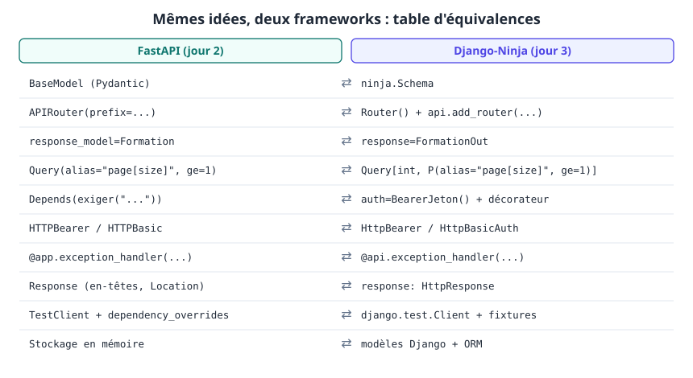
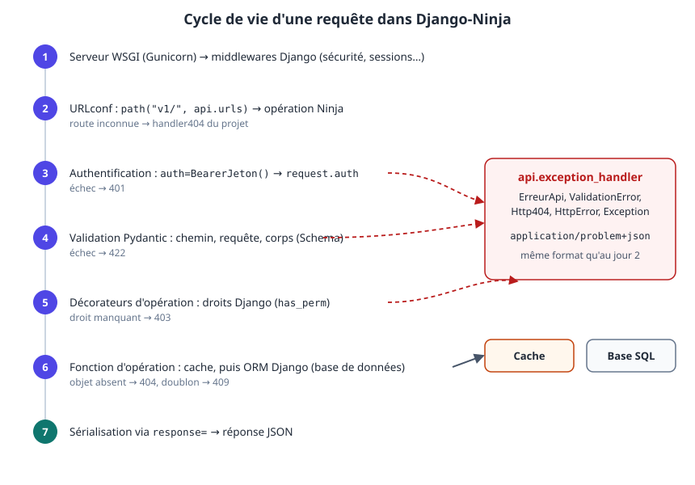
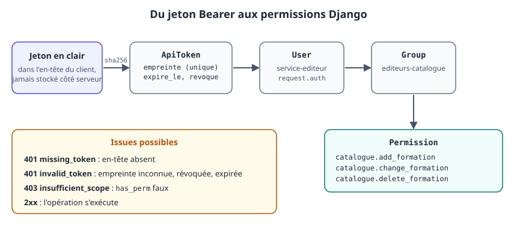
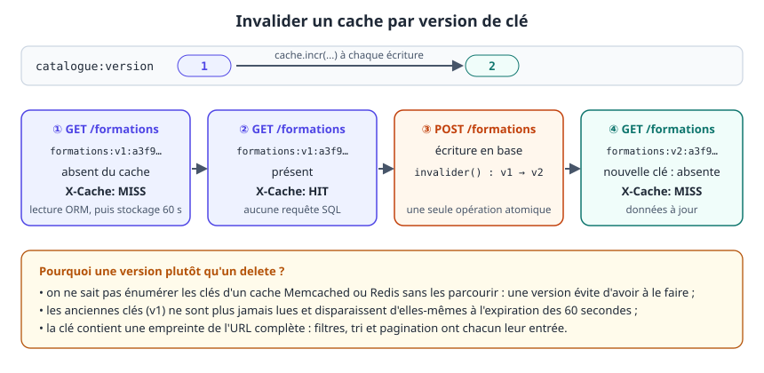
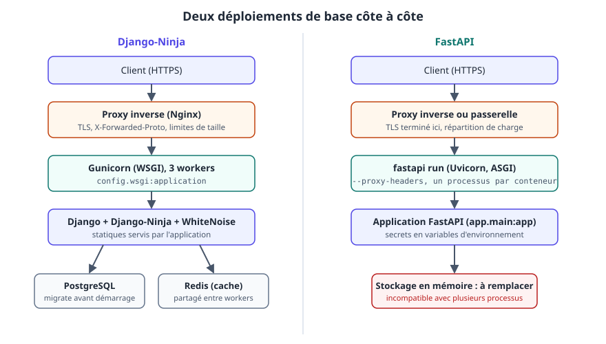

# Jour 3 — Réimplémenter l'API Catalogue avec Django-Ninja, la sécuriser, la mettre en cache et la déployer

> **Formation** : Python Avancé — Web Services (3 jours, réf. PYT100614-F)
> **Programme de référence** : [Dawan — Python Avancé : Web Services](https://www.dawan.fr/formations/python/python-avance/python-avance-web-services)
> **Projet fil rouge** : API Catalogue — le contrat du jour 2 est réimplémenté avec Django-Ninja, puis les deux implémentations sont déployées
> **Blocs couverts** : 5 (implémenter un service web avec Django, atelier Django-Ninja) · 6 (déploiement d'un service web)

**Prérequis** : journées 1 et 2 terminées (dépôt `api-catalogue/` avec `catalogue_client`, `app/`, `tests/` et `verifier_avec_client.py`), notions de base de Django (modèles, migrations, administration).
**Durée** : 7 h (mercredi 9h00 – 17h30, pause déjeuner 12h30 – 13h30, deux pauses de 15 minutes).

## Objectifs pédagogiques

À la fin de la journée, les stagiaires sont capables de :

- situer Django REST framework et Django-Ninja dans l'écosystème des API Django, et choisir entre eux ;
- réimplémenter le contrat de l'API Catalogue avec Django-Ninja, l'ORM Django et des schémas Pydantic ;
- transformer toutes les erreurs en Problem Details, avec le même format que l'implémentation FastAPI ;
- authentifier par jeton Bearer (stocké sous forme d'empreinte) et par BASIC, puis contrôler les droits avec les permissions Django ;
- mettre en cache les lectures avec Redis ou Memcached, et invalider le cache à chaque écriture ;
- décrire et préparer le déploiement d'une API Django et d'une API FastAPI : serveur d'application, proxy, base de données, conteneurs.

### Livrable de la journée

Le dépôt `api-catalogue/` enrichi d'un projet Django `django_api/` qui :

- expose **exactement le même contrat** que l'API FastAPI (mêmes URL, mêmes codes, mêmes erreurs) sous le préfixe `/v1` ;
- stocke les données dans la base via l'ORM, avec des jetons conservés sous forme d'empreinte ;
- contrôle les écritures avec les groupes et permissions Django ;
- met les lectures en cache (Redis ou Memcached en production, mémoire locale en développement) ;
- réussit `verifier_avec_client.py` sans modification du code du client, seule l'URL de base change ;
- dispose d'un `Dockerfile` et d'un `docker-compose.yml` (Django, PostgreSQL, Redis, Nginx) et d'un `Dockerfile` pour l'API FastAPI.

> [!NOTE] Choix pédagogique
> La journée se lit comme un **test de contrat**. Le client du jour 1 et le scénario du jour 2 sont rejoués tels quels contre une implémentation entièrement différente. Si le contrat est bien conçu, le consommateur ne voit pas la différence. C'est la raison d'être des API : séparer ce qu'on promet (le contrat) de la manière dont on le tient (le framework, la base de données, le cache).

## Organisation de la journée

| Heure | Séquence | Blocs programme |
|---|---|---|
| 09h00 – 09h15 | Accueil, retour sur le jour 2, vérification des postes | — |
| 09h15 – 10h45 | **Pratique guidée** — écosystème REST de Django, projet, modèles, schémas, routes | Bloc 5 |
| 10h45 – 11h00 | Pause | |
| 11h00 – 12h30 | **Pratique guidée** — erreurs, authentification, droits Django, mise en cache | Bloc 5 |
| 12h30 – 13h30 | Déjeuner | |
| 13h30 – 15h00 | **Atelier** — Créer un service web avec Django-Ninja | Bloc 5 |
| 15h00 – 15h15 | Pause | |
| 15h15 – 16h45 | **Pratique guidée** — déploiement d'un service web Django et FastAPI | Bloc 6 |
| 16h45 – 17h30 | Bilan, évaluation, suite de parcours | — |

> [!TIP] Rythme
> La théorie reste courte : chaque notion se découvre en construisant l'API. Le code de la section B5 est écrit pas à pas par les stagiaires. L'atelier (B6) assemble l'ensemble, ajoute les tests et rejoue le scénario du jour 2. Les fichiers qui ne figurent pas dans B5 sont donnés en intégralité dans l'atelier.

---

## B5 bloc 5 · 180 min

### 5.1 L'écosystème REST de Django

Django sait déjà servir des pages, mais pas, seul, produire proprement une API : pas de validation structurée du JSON, pas de contrat OpenAPI, pas de format d'erreur unifié. Deux bibliothèques comblent ce manque et dominent l'écosystème :

| Critère | **Django REST framework** (DRF) | **Django-Ninja** |
|---|---|---|
| Ancienneté | depuis 2011, très répandu en entreprise | plus récent, inspiré de FastAPI |
| Validation et sérialisation | **sérialiseurs** (`Serializer`, `ModelSerializer`) | **schémas Pydantic** (`Schema`) |
| Déclaration des routes | classes (`ViewSet`) et routeurs | fonctions décorées, comme FastAPI |
| Documentation OpenAPI | via une extension ou un générateur de schéma | **native**, générée à partir des annotations de type |
| Authentification et droits | classes d'authentification et de permission, riches et éprouvées | classes d'authentification, droits à écrire avec des décorateurs ou des exceptions |
| Paramètres et filtres | `django-filter`, pagination configurable | annotations de type, pagination intégrée |
| Courbe d'apprentissage | plus longue (beaucoup de concepts) | courte si l'on connaît FastAPI |
| Quand le choisir | gros projet existant, équipe qui connaît DRF, besoin de son écosystème | nouvelle API, besoin de typage, de rapidité d'écriture et d'une documentation automatique |

Les deux s'intègrent à l'ORM, à l'administration, au système d'authentification et aux migrations de Django. C'est l'argument décisif face à FastAPI quand une application Django existe déjà : **les modèles, les utilisateurs, les groupes et les permissions sont déjà là**.

**Rappel de DRF** (aperçu, non réalisé aujourd'hui) : le même point d'entrée tient en trois blocs.

```python
from rest_framework import routers, serializers, viewsets

class FormationSerializer(serializers.ModelSerializer):
    class Meta:
        model = Formation
        fields = ["id", "code", "titre", "duree_jours", "niveau"]

class FormationViewSet(viewsets.ModelViewSet):
    queryset = Formation.objects.all()
    serializer_class = FormationSerializer

router = routers.DefaultRouter(trailing_slash=False)
router.register("formations", FormationViewSet)
```

`ModelViewSet` fournit seul les cinq opérations (liste, lecture, création, modification, suppression). C'est très concis tant que le comportement standard convient ; dès qu'il faut un format d'erreur, une pagination ou un contrat précis, on redéfinit des méthodes de classe. Django-Ninja part de l'idée inverse : chaque opération est écrite explicitement, ce qui convient à un **contrat défini à l'avance**, comme celui de l'API Catalogue.



> [!NOTE] Analogie : deux ateliers, un plan
> Deux menuisiers qui disposent des mêmes plans fabriquent le même meuble avec des outils différents. Le plan est le contrat OpenAPI de l'API Catalogue ; FastAPI et Django-Ninja sont les deux ateliers. Le client du jour 1 joue le rôle de l'inspecteur qui vérifie la conformité du meuble.

### 5.2 Créer le projet Django

**Choix de version.** On se forme sur une version à **support long terme** (LTS) : **Django 5.2**. Django-Ninja se rattache à n'importe quel projet Django existant ; il n'a pas besoin d'être déclaré dans `INSTALLED_APPS`, sauf si l'on veut servir les ressources de la documentation interactive par les fichiers statiques de Django plutôt que par un CDN (réseau d'hébergement tiers), ce que nous ferons pour le déploiement.

```bash
# dans api-catalogue/, environnement virtuel actif
pip install "Django>=5.2,<5.3" "django-ninja>=1.8,<2" pytest-django whitenoise gunicorn
pip freeze > requirements.txt

mkdir django_api && cd django_api
django-admin startproject config .
python manage.py startapp catalogue
```

Arborescence cible, avec les fichiers écrits aujourd'hui :

```
api-catalogue/
├── .env                              # + variables du jour 3
├── catalogue_client/                 # jour 1
├── app/                              # jour 2 (FastAPI)
├── django_api/                       # jour 3 (Django-Ninja)
│   ├── manage.py
│   ├── pytest.ini
│   ├── config/
│   │   ├── settings.py
│   │   ├── urls.py
│   │   └── wsgi.py
│   ├── catalogue/
│   │   ├── enums.py
│   │   ├── models.py
│   │   ├── admin.py
│   │   ├── schemas.py
│   │   ├── erreurs.py
│   │   ├── securite.py
│   │   ├── pagination.py
│   │   ├── cache_catalogue.py
│   │   ├── api.py
│   │   ├── routes/
│   │   │   ├── __init__.py
│   │   │   ├── formations.py
│   │   │   └── statistiques.py
│   │   └── management/commands/initialiser_catalogue.py
│   └── tests/test_api_django.py
└── verifier_avec_client.py
```

**Réglages essentiels de `config/settings.py`.** Le fichier généré par `startproject` est conservé ; on en change les points qui diffèrent entre développement et production. Tout ce qui varie se lit dans l'environnement, d'après la règle du jour 1.

```python
import os
from pathlib import Path

from django.core.exceptions import ImproperlyConfigured
from dotenv import load_dotenv

BASE_DIR = Path(__file__).resolve().parent.parent
load_dotenv(BASE_DIR.parent / ".env")        # .env partagé avec les jours 1 et 2


def env_bool(nom: str, defaut: bool = False) -> bool:
    return os.getenv(nom, str(defaut)).strip().lower() in {"1", "true", "yes", "on"}


PRODUCTION = env_bool("DJANGO_PRODUCTION")
DEBUG = False if PRODUCTION else env_bool("DJANGO_DEBUG", True)

SECRET_KEY = os.environ.get("DJANGO_SECRET_KEY")
if not SECRET_KEY:
    if PRODUCTION:
        raise ImproperlyConfigured("DJANGO_SECRET_KEY est obligatoire en production.")
    SECRET_KEY = "cle-de-developpement-uniquement"

ALLOWED_HOSTS = [h for h in os.getenv("DJANGO_ALLOWED_HOSTS", "127.0.0.1,localhost").split(",") if h]

INSTALLED_APPS = [
    "django.contrib.admin",
    "django.contrib.auth",
    "django.contrib.contenttypes",
    "django.contrib.sessions",
    "django.contrib.messages",
    "django.contrib.staticfiles",
    "ninja",                 # docs servies en statique, sans CDN
    "catalogue",
]

MIDDLEWARE = [
    "django.middleware.security.SecurityMiddleware",
    "whitenoise.middleware.WhiteNoiseMiddleware",
    "django.contrib.sessions.middleware.SessionMiddleware",
    "django.middleware.common.CommonMiddleware",
    "django.middleware.csrf.CsrfViewMiddleware",
    "django.contrib.auth.middleware.AuthenticationMiddleware",
    "django.contrib.messages.middleware.MessageMiddleware",
    "django.middleware.clickjacking.XFrameOptionsMiddleware",
]

LANGUAGE_CODE = "fr-fr"
TIME_ZONE = "Europe/Paris"
USE_TZ = True
DEFAULT_AUTO_FIELD = "django.db.models.BigAutoField"

STATIC_URL = "static/"
STATIC_ROOT = BASE_DIR / "staticfiles"
STORAGES = {
    "default": {"BACKEND": "django.core.files.storage.FileSystemStorage"},
    "staticfiles": {"BACKEND": "whitenoise.storage.CompressedStaticFilesStorage"},
}
```

Les parties « base de données », « cache » et « sécurité HTTPS » du même fichier sont écrites plus loin (sections 5.8 et B7).

**Brancher l'API dans `config/urls.py` :**

```python
from django.contrib import admin
from django.urls import path

from catalogue.api import api

handler404 = "catalogue.erreurs.page_introuvable"

urlpatterns = [
    path("admin/", admin.site.urls),
    path("v1/", api.urls),
]
```

Le préfixe `v1/` reproduit celui de l'API FastAPI : `/v1/formations` désigne la même ressource dans les deux implémentations. Le site d'administration Django reste sous `/admin/` et n'a rien à voir avec `/v1/admin/statistiques`.

### 5.3 Modèles et schémas

**Le modèle de données** traduit les ressources du contrat en tables. Les énumérations restent des objets Python simples, partagées par l'ORM et par les schémas :

```python
# catalogue/enums.py
from enum import Enum


class Niveau(str, Enum):
    initiation = "initiation"
    intermediaire = "intermediaire"
    avance = "avance"


class StatutSession(str, Enum):
    planifiee = "planifiee"
    confirmee = "confirmee"
    annulee = "annulee"
```

```python
# catalogue/models.py
import hashlib
import secrets
import uuid
from datetime import timedelta

from django.conf import settings
from django.core.validators import MaxValueValidator, MinValueValidator, RegexValidator
from django.db import models
from django.utils import timezone

from .enums import Niveau, StatutSession


def empreinte(jeton: str) -> str:
    return hashlib.sha256(jeton.encode("utf8")).hexdigest()


class Formation(models.Model):
    id = models.UUIDField(primary_key=True, default=uuid.uuid4, editable=False)
    code = models.CharField(max_length=11, unique=True,
                            validators=[RegexValidator(r"^[A-Z]{3}\d{6}-[A-Z]$")])
    titre = models.CharField(max_length=120)
    description = models.TextField(null=True, blank=True)
    duree_jours = models.PositiveSmallIntegerField(
        validators=[MinValueValidator(1), MaxValueValidator(10)])
    niveau = models.CharField(max_length=13, choices=[(n.value, n.value) for n in Niveau])
    cree_le = models.DateTimeField(auto_now_add=True)
    modifie_le = models.DateTimeField(auto_now=True)

    class Meta:
        ordering = ["code"]

    def __str__(self) -> str:
        return f"{self.code} — {self.titre}"


class SessionFormation(models.Model):
    id = models.UUIDField(primary_key=True, default=uuid.uuid4, editable=False)
    formation = models.ForeignKey(Formation, on_delete=models.CASCADE, related_name="sessions")
    date_debut = models.DateField()
    lieu = models.CharField(max_length=80)
    places = models.PositiveSmallIntegerField(
        validators=[MinValueValidator(1), MaxValueValidator(30)])
    statut = models.CharField(max_length=10, default=StatutSession.planifiee.value,
                              choices=[(s.value, s.value) for s in StatutSession])

    class Meta:
        ordering = ["date_debut", "id"]


class ApiToken(models.Model):
    utilisateur = models.ForeignKey(settings.AUTH_USER_MODEL, on_delete=models.CASCADE,
                                    related_name="jetons")
    nom = models.CharField(max_length=80)
    empreinte = models.CharField(max_length=64, unique=True, editable=False)
    expire_le = models.DateTimeField(null=True, blank=True)
    revoque = models.BooleanField(default=False)
    cree_le = models.DateTimeField(auto_now_add=True)

    @classmethod
    def generer(cls, utilisateur, nom: str, validite_jours: int | None = None):
        """Crée un jeton ; la valeur en clair n'est renvoyée qu'ici, une seule fois."""
        jeton = secrets.token_urlsafe(32)
        expire = timezone.now() + timedelta(days=validite_jours) if validite_jours else None
        instance = cls.objects.create(utilisateur=utilisateur, nom=nom,
                                      empreinte=empreinte(jeton), expire_le=expire)
        return instance, jeton

    def est_expire(self) -> bool:
        return self.expire_le is not None and self.expire_le <= timezone.now()
```

Points à commenter avec les stagiaires :

- les **UUID** comme clés primaires reproduisent le choix du jour 2 (identifiants opaques) ; le contrat ne dépend pas de la base ;
- `ApiToken` ne conserve **que l'empreinte** (SHA-256) du jeton. Quiconque lit la base ne peut pas rejouer les jetons, comme pour un mot de passe. Contrairement à un mot de passe choisi par un humain, un jeton aléatoire de 256 bits ne se devine pas par dictionnaire : une empreinte rapide (SHA-256) suffit, là où un mot de passe exige un algorithme volontairement lent ;
- la valeur en clair n'est connue qu'à la génération : GoRest fonctionne de la même façon (« affiché une seule fois »).

```bash
python manage.py makemigrations catalogue
python manage.py migrate
```

```python
# catalogue/admin.py
from django.contrib import admin

from .models import ApiToken, Formation, SessionFormation

admin.site.register(Formation)
admin.site.register(SessionFormation)


@admin.register(ApiToken)
class ApiTokenAdmin(admin.ModelAdmin):
    list_display = ("nom", "utilisateur", "expire_le", "revoque", "cree_le")
    readonly_fields = ("empreinte",)
```

**Les schémas** décrivent ce qui entre et ce qui sort de l'API. `ninja.Schema` est un modèle Pydantic qui sait aussi lire des objets ORM : le code de validation du jour 2 se reprend presque à l'identique.

```python
# catalogue/schemas.py
import uuid
from datetime import date, datetime

from ninja import Schema
from pydantic import ConfigDict, Field, field_validator, model_validator

from .enums import Niveau, StatutSession


class FormationIn(Schema):
    model_config = ConfigDict(str_strip_whitespace=True)

    code: str = Field(pattern=r"^[A-Z]{3}\d{6}-[A-Z]$", examples=["PYT100614-F"])
    titre: str = Field(min_length=3, max_length=120)
    description: str | None = Field(default=None, max_length=2000)
    duree_jours: int = Field(ge=1, le=10)
    niveau: Niveau


class FormationPatch(Schema):
    model_config = ConfigDict(str_strip_whitespace=True, extra="forbid")

    titre: str | None = Field(default=None, min_length=3, max_length=120)
    description: str | None = Field(default=None, max_length=2000)
    duree_jours: int | None = Field(default=None, ge=1, le=10)
    niveau: Niveau | None = None

    @model_validator(mode="after")
    def refuser_null_sur_champs_obligatoires(self) -> "FormationPatch":
        for champ in ("titre", "duree_jours", "niveau"):
            if champ in self.model_fields_set and getattr(self, champ) is None:
                raise ValueError(f"{champ} ne peut pas être null")
        return self


class FormationOut(Schema):
    id: uuid.UUID
    code: str
    titre: str
    description: str | None = None
    duree_jours: int
    niveau: Niveau
    cree_le: datetime
    modifie_le: datetime


class SessionIn(Schema):
    model_config = ConfigDict(str_strip_whitespace=True)

    date_debut: date
    lieu: str = Field(min_length=2, max_length=80)
    places: int = Field(ge=1, le=30)
    statut: StatutSession = StatutSession.planifiee

    @field_validator("date_debut")
    @classmethod
    def dans_le_futur(cls, valeur: date) -> date:
        if valeur <= date.today():
            raise ValueError("la date de début doit être postérieure à aujourd'hui")
        return valeur


class SessionOut(Schema):
    id: uuid.UUID
    formation_id: uuid.UUID
    date_debut: date
    lieu: str
    places: int
    statut: StatutSession


class Meta(Schema):
    has_more: bool
    next_cursor: str | None = None
    total: int | None = None


class PageFormations(Schema):
    data: list[FormationOut]
    meta: Meta


class PageSessions(Schema):
    data: list[SessionOut]
    meta: Meta


class Statistiques(Schema):
    formations: int
    sessions: int
    demandeur: str
```

La comparaison avec `app/schemas.py` du jour 2 montre deux différences seulement : `Schema` remplace `BaseModel`, et les modèles ne portent plus l'`id` ni les dates (l'ORM s'en charge). Les contraintes sont **identiques mot pour mot** : c'est ce qui garantit que les deux API refusent les mêmes données.

### 5.4 Pagination, cache et routes

**La pagination par curseur** du jour 2 est reprise, appliquée à un `QuerySet` : on lit un élément de plus que la taille de page pour savoir s'il en reste, sans compter la table.

```python
# catalogue/pagination.py
import base64
from typing import Any

from .erreurs import ErreurApi


def encoder_curseur(decalage: int) -> str:
    return base64.urlsafe_b64encode(str(decalage).encode()).decode()


def decoder_curseur(curseur: str) -> int:
    try:
        decalage = int(base64.urlsafe_b64decode(curseur.encode()).decode())
    except ValueError as exc:      # binascii.Error et UnicodeDecodeError héritent de ValueError
        raise ErreurApi(400, "invalid_cursor", "Curseur de pagination invalide.") from exc
    if decalage < 0:
        raise ErreurApi(400, "invalid_cursor", "Curseur de pagination invalide.")
    return decalage


def paginer(qs, taille: int, apres: str | None, compter: bool, schema) -> dict[str, Any]:
    debut = decoder_curseur(apres) if apres else 0
    lot = list(qs[debut: debut + taille + 1])            # un élément de plus : y a-t-il une suite ?
    suite = len(lot) > taille
    return {
        "data": [schema.model_validate(objet).model_dump(mode="json") for objet in lot[:taille]],
        "meta": {
            "has_more": suite,
            "next_cursor": encoder_curseur(debut + taille) if suite else None,
            "total": qs.count() if compter else None,
        },
    }
```

Les données sont sérialisées en types JSON simples (`mode="json"`) : le résultat est **directement stockable dans un cache** (section 5.8).

**Les routes des formations.** Chaque opération porte ses contraintes de paramètres avec `Query[type, P(...)]`, forme documentée par Django-Ninja ; `alias=` expose les noms `page[size]`, `filter[niveau]` du contrat.

```python
# catalogue/routes/formations.py
import uuid
from typing import Literal

from django.db import IntegrityError, transaction
from django.db.models import Q
from django.http import HttpRequest, HttpResponse
from django.shortcuts import get_object_or_404
from ninja import P, Query, Router, Status

from .. import cache_catalogue
from ..enums import Niveau
from ..erreurs import ErreurApi
from ..models import Formation, SessionFormation
from ..pagination import paginer
from ..schemas import (FormationIn, FormationOut, FormationPatch, PageFormations,
                       PageSessions, SessionIn, SessionOut)
from ..securite import JETON, exiger_permission

router = Router(tags=["formations"])


@router.get("", response=PageFormations, summary="Lister les formations")
def lister_formations(
    request: HttpRequest,
    response: HttpResponse,
    niveau: Query[Niveau | None, P(alias="filter[niveau]")] = None,
    recherche: Query[str | None, P(alias="search", min_length=2, max_length=50)] = None,
    tri: Query[Literal["code", "-code", "titre", "-titre", "duree_jours", "-duree_jours"],
               P(alias="sort")] = "code",
    taille: Query[int, P(alias="page[size]", ge=1, le=100)] = 25,
    apres: Query[str | None, P(alias="page[after]")] = None,
    compter: Query[bool, P(alias="page[count]")] = False,
):
    """Liste filtrée, triée et paginée par curseur."""
    def calculer():
        qs = Formation.objects.all()
        if niveau:
            qs = qs.filter(niveau=niveau.value)
        if recherche:
            qs = qs.filter(Q(titre__icontains=recherche) | Q(code__icontains=recherche))
        qs = qs.order_by(("-" if tri.startswith("-") else "") + tri.lstrip("-"), "id")
        return paginer(qs, taille, apres, compter, FormationOut)

    return cache_catalogue.lire_ou_calculer(request, response, "formations", calculer)


@router.get("/{formation_id}", response=FormationOut, summary="Lire une formation")
def lire_formation(request: HttpRequest, response: HttpResponse, formation_id: uuid.UUID):
    def calculer():
        formation = get_object_or_404(Formation, pk=formation_id)
        return FormationOut.model_validate(formation).model_dump(mode="json")

    return cache_catalogue.lire_ou_calculer(request, response, "formation", calculer)


@router.post("", response={201: FormationOut}, auth=JETON, summary="Créer une formation")
@exiger_permission("catalogue.add_formation")
def creer_formation(request: HttpRequest, response: HttpResponse, donnees: FormationIn):
    try:
        with transaction.atomic():
            formation = Formation.objects.create(**donnees.model_dump(mode="json"))
    except IntegrityError as exc:
        raise ErreurApi(409, "code_deja_utilise", f"Le code {donnees.code} existe déjà.") from exc
    cache_catalogue.invalider()
    response["Location"] = request.build_absolute_uri(f"{request.path.rstrip('/')}/{formation.id}")
    return Status(201, formation)


@router.patch("/{formation_id}", response=FormationOut, auth=JETON,
              summary="Modifier partiellement une formation")
@exiger_permission("catalogue.change_formation")
def modifier_formation(request: HttpRequest, formation_id: uuid.UUID, changements: FormationPatch):
    formation = get_object_or_404(Formation, pk=formation_id)
    for champ, valeur in changements.model_dump(exclude_unset=True, mode="json").items():
        setattr(formation, champ, valeur)
    formation.save()
    cache_catalogue.invalider()
    return formation


@router.delete("/{formation_id}", response={204: None}, auth=JETON,
               summary="Supprimer une formation")
@exiger_permission("catalogue.delete_formation")
def supprimer_formation(request: HttpRequest, formation_id: uuid.UUID):
    get_object_or_404(Formation, pk=formation_id).delete()
    cache_catalogue.invalider()
    return Status(204, None)
```

Les différences notables avec la version FastAPI, à faire repérer :

| Point | FastAPI (jour 2) | Django-Ninja (jour 3) |
|---|---|---|
| Code de succès d'une création | `status_code=201` dans le décorateur | `response={201: FormationOut}` et `Status(201, ...)` |
| Suppression | `status_code=204`, `response_class=Response` | `response={204: None}` et `Status(204, None)` |
| En-tête `Location` | paramètre `reponse: Response` | paramètre `response: HttpResponse` (même idée, autre type) |
| Doublon de code | vérifié avant l'écriture en mémoire | garanti par la contrainte `unique` de la base, interceptée via `IntegrityError` |
| Objet renvoyé | modèle Pydantic | **objet ORM** directement, converti par `response=` |
| Introuvable | `ErreurApi(404, ...)` | `get_object_or_404`, converti par un gestionnaire d'exceptions |

> [!WARN] Piège : les énumérations et l'ORM
> `donnees.model_dump()` laisse `niveau` sous forme d'objet `Niveau.avance`. Écrit tel quel dans un champ `CharField`, un membre d'énumération de type `(str, Enum)` n'est pas toujours converti en `"avance"` (selon la version de Python, `str(Niveau.avance)` renvoie `"Niveau.avance"`). `model_dump(mode="json")` renvoie les valeurs simples (`"avance"`, dates ISO) et supprime le risque. À utiliser **chaque fois** qu'on écrit en base à partir d'un schéma.

**Les sessions et l'administration.** Elles complètent le même fichier :

```python
@router.get("/{formation_id}/sessions", response=PageSessions,
            summary="Lister les sessions d'une formation")
def lister_sessions(
    request: HttpRequest,
    response: HttpResponse,
    formation_id: uuid.UUID,
    taille: Query[int, P(alias="page[size]", ge=1, le=100)] = 25,
    apres: Query[str | None, P(alias="page[after]")] = None,
    compter: Query[bool, P(alias="page[count]")] = False,
):
    def calculer():
        formation = get_object_or_404(Formation, pk=formation_id)
        return paginer(formation.sessions.all(), taille, apres, compter, SessionOut)

    return cache_catalogue.lire_ou_calculer(request, response, "sessions", calculer)


@router.post("/{formation_id}/sessions", response={201: SessionOut}, auth=JETON,
             summary="Planifier une session")
@exiger_permission("catalogue.add_sessionformation")
def creer_session(request: HttpRequest, formation_id: uuid.UUID, donnees: SessionIn):
    formation = get_object_or_404(Formation, pk=formation_id)
    session = SessionFormation.objects.create(formation=formation, **donnees.model_dump(mode="json"))
    cache_catalogue.invalider()
    return Status(201, session)
```



### 5.5 Validation et gestion des erreurs

Django-Ninja valide les paramètres comme FastAPI, puis répond avec ses propres formats par défaut :

| Source d'erreur | Réponse par défaut de Django-Ninja |
|---|---|
| validation (`ninja.errors.ValidationError`) | `422` et `{"detail": [ ... ]}` |
| `HttpError` levée par le code | statut choisi et `{"detail": "<message>"}` |
| `Http404` (par exemple `get_object_or_404`) | `404` et `{"detail": "Not Found"}` |
| `AuthenticationError` | `401` et `{"detail": "Unauthorized"}` |
| exception imprévue, `DEBUG=True` | `500` et la **trace complète en texte brut** |
| exception imprévue, `DEBUG=False` | l'exception remonte au mécanisme d'erreur de Django (page `500`, journaux, e-mails aux administrateurs) |

Comme au jour 2, ces formats sont différents les uns des autres. On installe des **gestionnaires** (`@api.exception_handler`) qui produisent tous un document Problem Details. Deux particularités à connaître :

- les gestionnaires sont enregistrés **par instance** de `NinjaAPI` ; un `Router` n'en possède pas ;
- une URL qui ne correspond à aucune opération n'atteint jamais Ninja : c'est Django qui répond. On personnalise alors `handler404` dans l'`urls.py` du projet. Django n'utilise ce gestionnaire que si `DEBUG=False`.

```python
# catalogue/erreurs.py
import logging
import uuid
from http import HTTPStatus

from django.http import Http404, HttpRequest, JsonResponse
from ninja import NinjaAPI
from ninja.errors import HttpError, ValidationError

journal = logging.getLogger("catalogue")

SOURCES = {"body", "query", "path", "header", "cookie", "form", "file"}
PARAMETRES_DE_CORPS = {"donnees", "changements"}     # noms des paramètres de corps des routes


class ErreurApi(Exception):
    def __init__(self, status: int, code: str, detail: str,
                 erreurs: list[dict] | None = None,
                 headers: dict[str, str] | None = None) -> None:
        super().__init__(detail)
        self.status = status
        self.code = code
        self.detail = detail
        self.erreurs = erreurs
        self.headers = headers


def probleme(request: HttpRequest, status: int, code: str, detail: str,
             erreurs: list[dict] | None = None,
             headers: dict[str, str] | None = None) -> JsonResponse:
    corps = {
        "type": f"https://api-catalogue.example/erreurs#{code}",
        "title": HTTPStatus(status).phrase,
        "status": status,
        "code": code,
        "detail": detail,
        "instance": request.path,
        "request_id": str(uuid.uuid4()),
    }
    if erreurs:
        corps["errors"] = erreurs
    reponse = JsonResponse(corps, status=status, content_type="application/problem+json")
    for nom, valeur in (headers or {}).items():
        reponse[nom] = valeur
    return reponse


def pointeur(loc) -> str:
    morceaux = [str(m) for m in loc]
    if morceaux and morceaux[0] in SOURCES:
        morceaux = morceaux[1:]
    if morceaux and morceaux[0] in PARAMETRES_DE_CORPS:
        morceaux = morceaux[1:]
    return "/" + "/".join(morceaux)


def page_introuvable(request: HttpRequest, exception: Exception) -> JsonResponse:
    return probleme(request, 404, "not_found", "Ressource introuvable.")


def installer_gestionnaires(api: NinjaAPI) -> None:
    @api.exception_handler(ErreurApi)
    def erreur_api(request, exc: ErreurApi):
        return probleme(request, exc.status, exc.code, exc.detail, exc.erreurs, exc.headers)

    @api.exception_handler(ValidationError)
    def erreur_validation(request, exc: ValidationError):
        erreurs = [{"pointer": pointeur(e["loc"]), "code": e["type"], "detail": e["msg"]}
                   for e in exc.errors]
        return probleme(request, 422, "validation_failed",
                        "Certains champs ne sont pas valides.", erreurs)

    @api.exception_handler(Http404)
    def introuvable(request, exc: Http404):
        return probleme(request, 404, "not_found", "Ressource introuvable.")

    @api.exception_handler(HttpError)
    def erreur_http(request, exc: HttpError):
        return probleme(request, exc.status_code, "http_error", str(exc))

    @api.exception_handler(Exception)
    def erreur_inattendue(request, exc: Exception):
        journal.exception("Erreur non gérée sur %s", request.path)
        return probleme(request, 500, "internal_error", "Erreur interne du serveur.")
```

**Deux subtilités propres à Ninja** :

1. **Le nom du paramètre de corps apparaît dans `loc`.** Quand une opération reçoit un schéma en corps (`donnees: FormationIn`), Ninja peut inclure ce nom dans la localisation d'une erreur (`["body", "donnees", "duree_jours"]`). La fonction `pointeur` retire la source (`body`, `query`…) puis, si besoin, le nom du paramètre de corps : on obtient dans les deux cas `/duree_jours`, le pointeur du contrat. **À constater** : les stagiaires affichent `exc.errors` pendant l'atelier pour voir la structure réelle.
2. **Le gestionnaire pour `Exception` masque les erreurs imprévues.** Il doit journaliser la trace côté serveur (`journal.exception`), sans quoi les erreurs disparaissent des logs. La documentation de Django-Ninja avertit de ce risque.

> [!WARN] Un `DEBUG=True` oublié en production
> Avec `DEBUG=True`, Django et Django-Ninja renvoient des traces complètes et des fragments de code dans les réponses. Le gestionnaire `Exception` ci-dessus supprime l'exposition de la trace pour l'API, mais **il ne remplace pas** la règle absolue : `DEBUG=False` en production. La section B7 l'impose par construction (`DJANGO_PRODUCTION`).

### 5.6 Authentification BASIC et Bearer

Django-Ninja traite l'authentification avec une seule option, `auth=`, applicable à une opération, un routeur ou toute l'API. L'argument est un **objet appelable** : s'il renvoie une valeur « vraie », elle devient `request.auth` et l'opération s'exécute ; sinon la réponse est `401`. Des classes prêtes à l'emploi (`HttpBearer`, `HttpBasicAuth`, `APIKeyHeader`, `django_auth`…) gèrent la lecture de l'en-tête et publient le schéma de sécurité dans OpenAPI : Swagger UI affiche alors le bouton **Authorize**.



**Bearer avec des jetons en base.** Au jour 2, les jetons étaient lus dans l'environnement. Ici ils vivent dans la table `ApiToken`, rattachés à un utilisateur Django : on peut en créer, en révoquer, en faire expirer, sans redémarrer l'application.

```python
# catalogue/securite.py
from functools import wraps

from django.contrib.auth import authenticate
from ninja.security import HttpBasicAuth, HttpBearer

from .erreurs import ErreurApi
from .models import ApiToken, empreinte


class BearerJeton(HttpBearer):
    def __call__(self, request):
        utilisateur = super().__call__(request)
        if not utilisateur:       # en-tête absent ou schéma différent de Bearer
            raise ErreurApi(401, "missing_token",
                            "Jeton absent ou schéma d'authentification incorrect.",
                            headers={"WWW-Authenticate": "Bearer"})
        return utilisateur

    def authenticate(self, request, token):
        jeton = (ApiToken.objects.select_related("utilisateur")
                 .filter(empreinte=empreinte(token), revoque=False).first())
        if jeton is None or jeton.est_expire() or not jeton.utilisateur.is_active:
            raise ErreurApi(401, "invalid_token", "Jeton invalide.",
                            headers={"WWW-Authenticate": 'Bearer error="invalid_token"'})
        return jeton.utilisateur


class BasicAdmin(HttpBasicAuth):
    def __call__(self, request):
        utilisateur = super().__call__(request)
        if not utilisateur:
            raise ErreurApi(401, "invalid_credentials", "Identifiant ou mot de passe incorrect.",
                            headers={"WWW-Authenticate": 'Basic realm="admin"'})
        return utilisateur

    def authenticate(self, request, username, password):
        utilisateur = authenticate(request, username=username, password=password)
        if utilisateur is not None and utilisateur.is_staff:
            return utilisateur
        return None


JETON = BearerJeton()
```

Points à faire repérer :

- **La redéfinition de `__call__`** transforme les cas « en-tête absent » en erreurs au format du contrat (`missing_token`, avec `WWW-Authenticate`). Sans elle, Django-Ninja répond `401` avec `{"detail": "Unauthorized"}` et sans indication du schéma attendu.
- Le jeton reçu n'est **jamais comparé en clair** : on calcule son empreinte et on interroge la base sur la colonne `empreinte` (unique, indexée). La recherche par index d'une empreinte de 256 bits ne laisse pas fuiter d'information utilisable sur le jeton.
- **BASIC passe par `django.contrib.auth.authenticate`** : les mots de passe sont vérifiés avec les algorithmes de hachage de Django (volontairement lents), les comptes inactifs sont refusés, et le même message sert pour un identifiant inconnu ou un mot de passe erroné.
- La route d'administration exige en plus `is_staff` : un utilisateur ordinaire, même authentifié, reçoit `401` (un `403` donnerait à un attaquant la confirmation que le compte existe).

**Alternatives intégrées à Django-Ninja** (à citer, pas à réaliser) : `APIKeyHeader` (clé dans un en-tête personnalisé), `django_auth` (session Django, avec contrôle CSRF puisque le navigateur envoie le cookie automatiquement), `django_auth_is_staff`, ou une liste `auth=[A(), B()]` qui accepte la première méthode valide.

### 5.7 Les droits dans Django : groupes et permissions

L'**authentification** répond à « qui êtes-vous ? ». Les **droits** répondent à « que pouvez-vous faire ? ». Django les gère depuis ses origines :

| Concept | Rôle | Exemple |
|---|---|---|
| **Permission** | autorisation d'une action sur un modèle ; créées automatiquement après `migrate` (`add_`, `change_`, `delete_`, `view_` + nom du modèle) | `catalogue.add_formation` |
| **Groupe** | ensemble de permissions que l'on affecte en une fois à des utilisateurs | `editeurs-catalogue` |
| **Utilisateur** | possède des groupes et, éventuellement, des permissions directes ; `is_superuser` contourne tout | `service-editeur` |
| **Vérification** | `utilisateur.has_perm("catalogue.add_formation")` | `True` ou `False` |

Les droits s'appliquent à l'**action métier** (ajouter une formation), pas à l'URL. L'administration Django les utilise déjà : un utilisateur du groupe `lecteurs-catalogue` y verrait les formations sans pouvoir les modifier. L'API et l'administration partagent donc **la même politique de droits**, ce que FastAPI n'offre pas d'office.

**Un décorateur d'opération** contrôle la permission après l'authentification, quand `request.auth` est connu. Placé sous le décorateur de route et écrit avec `@wraps` (qui conserve la signature de la fonction), il laisse Django-Ninja lire les paramètres normalement.

```python
# catalogue/securite.py (suite)
def exiger_permission(permission: str):
    def decorateur(func):
        @wraps(func)
        def enveloppe(request, *args, **kwargs):
            if not request.auth.has_perm(permission):
                raise ErreurApi(403, "insufficient_scope",
                                f"La permission {permission} est requise.",
                                headers={"WWW-Authenticate": 'Bearer error="insufficient_scope"'})
            return func(request, *args, **kwargs)
        return enveloppe
    return decorateur
```

Ordre d'exécution à retenir (documentation de Django-Ninja) :

1. l'authentification (`auth=`) ;
2. la validation des paramètres et du corps ;
3. les décorateurs d'**opération**, dont `exiger_permission` ;
4. la fonction d'opération.

Un décorateur de mode **vue** (`@decorate_view`) s'exécute **avant** l'authentification : il ne peut pas lire `request.auth`. C'est la raison pour laquelle le contrôle des droits est écrit en mode opération.

**Groupes, utilisateurs de service et jetons : une commande de gestion.** Elle rend la configuration des droits reproductible : on la rejoue dans n'importe quel environnement.

```python
# catalogue/management/commands/initialiser_catalogue.py
from django.contrib.auth import get_user_model
from django.contrib.auth.models import Group, Permission
from django.core.management.base import BaseCommand
from django.db import transaction

from catalogue.models import ApiToken

MODELES = ("formation", "sessionformation")


class Command(BaseCommand):
    help = "Crée les groupes, deux utilisateurs de service et leurs jetons (affichés une seule fois)."

    @transaction.atomic
    def handle(self, *args, **options):
        utilisateurs = get_user_model()
        editeurs, _ = Group.objects.get_or_create(name="editeurs-catalogue")
        lecteurs, _ = Group.objects.get_or_create(name="lecteurs-catalogue")

        droits = Permission.objects.filter(content_type__app_label="catalogue")
        editeurs.permissions.set(
            droits.filter(codename__regex=rf"^(add|change|delete|view)_({'|'.join(MODELES)})$"))
        lecteurs.permissions.set(
            droits.filter(codename__regex=rf"^view_({'|'.join(MODELES)})$"))

        for nom, groupe in (("service-editeur", editeurs), ("service-lecteur", lecteurs)):
            utilisateur, _ = utilisateurs.objects.get_or_create(username=nom)
            utilisateur.set_unusable_password()
            utilisateur.save()
            utilisateur.groups.add(groupe)
            _, jeton = ApiToken.generer(utilisateur, nom="atelier")
            self.stdout.write(f"{nom} : {jeton}")
```

```bash
python manage.py initialiser_catalogue
# service-editeur : <jeton à copier dans CATALOGUE_TOKEN_ECRITURE>
# service-lecteur : <jeton à copier dans CATALOGUE_TOKEN_LECTURE>
python manage.py createsuperuser        # compte staff pour la route BASIC
```

Les jetons sont à recopier dans `.env` sous **les mêmes noms de variables qu'au jour 2** (`CATALOGUE_TOKEN_ECRITURE`, `CATALOGUE_TOKEN_LECTURE`) : `verifier_avec_client.py` fonctionnera alors sans modification.

### 5.8 La mise en cache avec Redis ou Memcached

**Pourquoi un cache ?** Une API publique est lue bien plus souvent qu'elle n'est modifiée. Servir une réponse déjà calculée évite des requêtes SQL, du travail de sérialisation et de la latence. Le prix : un risque de **données périmées** si l'on ne gère pas l'**invalidation**.

**Le cache de Django** est un service unique, `django.core.cache.cache`, derrière lequel on branche des moteurs interchangeables :

| Moteur | `BACKEND` | Usage |
|---|---|---|
| mémoire locale | `django.core.cache.backends.locmem.LocMemCache` | développement et tests ; **un cache par processus**, non partagé |
| **Redis** | `django.core.cache.backends.redis.RedisCache` | production ; partagé entre les processus et les machines, peut persister ; nécessite le paquet `redis` |
| **Memcached** | `django.core.cache.backends.memcached.PyMemcacheCache` | production ; très rapide, uniquement en mémoire ; nécessite le paquet `pymemcache` |
| base de données, fichiers | `DatabaseCache`, `FileBasedCache` | cas particuliers |

```bash
# services de test locaux, si Docker est disponible
docker run --name redis-catalogue -p 6379:6379 -d redis:7
docker run --name memcached-catalogue -p 11211:11211 -d memcached:1.6
pip install redis pymemcache
```

**Configuration dans `settings.py`** : le moteur se choisit par variable d'environnement, sans changer le code.

```python
CACHE_BACKEND = os.getenv("CACHE_BACKEND", "locmem")

if CACHE_BACKEND == "redis":
    CACHES = {"default": {
        "BACKEND": "django.core.cache.backends.redis.RedisCache",
        "LOCATION": os.environ["CACHE_URL"],              # redis://127.0.0.1:6379
        "KEY_PREFIX": "catalogue",
    }}
elif CACHE_BACKEND == "memcached":
    CACHES = {"default": {
        "BACKEND": "django.core.cache.backends.memcached.PyMemcacheCache",
        "LOCATION": os.environ["CACHE_URL"],              # 127.0.0.1:11211
        "KEY_PREFIX": "catalogue",
    }}
else:
    CACHES = {"default": {"BACKEND": "django.core.cache.backends.locmem.LocMemCache"}}

if os.getenv("POSTGRES_DB"):
    DATABASES = {"default": {
        "ENGINE": "django.db.backends.postgresql",
        "NAME": os.environ["POSTGRES_DB"],
        "USER": os.environ["POSTGRES_USER"],
        "PASSWORD": os.environ["POSTGRES_PASSWORD"],
        "HOST": os.getenv("POSTGRES_HOST", "db"),
        "PORT": os.getenv("POSTGRES_PORT", "5432"),
        "CONN_MAX_AGE": 60,
    }}
else:
    DATABASES = {"default": {"ENGINE": "django.db.backends.sqlite3",
                             "NAME": BASE_DIR / "db.sqlite3"}}
```

> [!WARN] Le cache local est un cache par processus
> Avec `LocMemCache`, chaque processus Gunicorn possède **son propre cache**. Une invalidation faite dans un processus n'est pas vue par les autres : c'est exactement le piège des « plusieurs workers » rencontré avec le stockage en mémoire de FastAPI. Redis et Memcached sont des **services partagés**, donc cohérents entre processus.

**Deux stratégies de cache pour une API :**

| Stratégie | Principe | Avantages | Limites |
|---|---|---|---|
| **Cache de vue** (`cache_page`) | met en cache la réponse HTTP entière pendant N secondes | une ligne de code | pas d'invalidation fine ; ne tient pas compte de l'identité de l'appelant |
| **Cache applicatif** (`cache.get` / `cache.set`) | met en cache le résultat calculé, avec une clé que l'on maîtrise | invalidation précise, données partageables | un peu de code |

Le cache de vue se branche avec `decorate_view`, qui adapte un décorateur Django à une opération Ninja :

```python
from django.views.decorators.cache import cache_page
from django.views.decorators.vary import vary_on_headers
from ninja.decorators import decorate_view

@router.get("/exemple-public")
@decorate_view(cache_page(60), vary_on_headers("Authorization"))
def exemple(request): ...
```

> [!DANGER] Un cache de vue ignore qui appelle
> Sans `vary_on_headers("Authorization")`, la réponse mise en cache pour un utilisateur peut être **servie à un autre** : fuite de données. Le cache de vue convient à du contenu strictement public. Pour l'API Catalogue, la lecture est publique, mais on préfère le **cache applicatif** : il permet d'invalider les entrées dès qu'une formation change, ce que `cache_page` ne sait pas faire (il attend l'expiration).

**Le cache applicatif avec invalidation par version de clé.** Un compteur `catalogue:version` entre dans toutes les clés. Chaque écriture l'incrémente : toutes les anciennes entrées deviennent inaccessibles en une seule opération, sans avoir à les énumérer, et disparaissent à l'expiration.



```python
# catalogue/cache_catalogue.py
import hashlib
from collections.abc import Callable
from typing import Any

from django.core.cache import cache
from django.http import HttpRequest, HttpResponse

CLE_VERSION = "catalogue:version"
DUREE = 60      # secondes


def _version() -> int:
    cache.add(CLE_VERSION, 1, timeout=None)       # ne fait rien si la clé existe déjà
    return cache.get(CLE_VERSION, 1)


def _cle(request: HttpRequest, prefixe: str) -> str:
    empreinte_url = hashlib.sha256(request.get_full_path().encode()).hexdigest()[:32]
    return f"{prefixe}:v{_version()}:{empreinte_url}"


def invalider() -> None:
    cache.add(CLE_VERSION, 1, timeout=None)
    cache.incr(CLE_VERSION)                        # atomique sur Redis et Memcached


def lire_ou_calculer(request: HttpRequest, response: HttpResponse, prefixe: str,
                     calcul: Callable[[], Any]) -> Any:
    cle = _cle(request, prefixe)
    valeur = cache.get(cle)
    if valeur is None:
        response["X-Cache"] = "MISS"
        valeur = calcul()                           # une exception (404…) n'est jamais mise en cache
        cache.set(cle, valeur, DUREE)
    else:
        response["X-Cache"] = "HIT"
    return valeur
```

Les choix à faire expliquer :

- la **clé contient l'empreinte de l'URL complète** (filtres, tri, curseur) : chaque combinaison a son entrée, et la clé reste courte et sans caractère interdit. Memcached limite les clés à 250 caractères et refuse les espaces ;
- `DUREE = 60` est un **filet de sécurité**, pas le mécanisme principal : si une écriture arrive par un autre chemin (administration, script), les données restent périmées au plus 60 secondes ;
- l'en-tête `X-Cache: HIT` ou `MISS` rend le comportement **observable** par les stagiaires et par les tests ;
- seules les réponses réussies sont stockées : une erreur levée dans `calcul()` interrompt la fonction avant `cache.set`.

> [!NOTE] Analogie : l'annuaire de l'entreprise
> L'annuaire papier est tiré chaque mois : le consulter est instantané mais il peut être périmé. À chaque changement important, on ne réécrit pas les anciennes pages, on diffuse la nouvelle édition (v2) et on jette l'ancienne. La clé versionnée procède de même.

**Quelques règles pour décider de ce qu'on met en cache :**

| Mettre en cache | Ne pas mettre en cache |
|---|---|
| lectures publiques fréquentes (catalogue, référentiels) | données propres à un utilisateur (sauf clé qui l'identifie) |
| résultats de calculs coûteux | écritures, jetons, mots de passe |
| réponses identiques pour tous | réponses qui doivent refléter l'état exact à la seconde |

---

## B6 bloc 5 (atelier) · 90 min

### 🛠️ Atelier 3 — Créer un service web avec Django-Ninja

**Contexte.** L'équipe qui exploite l'API Catalogue est déjà très à l'aise avec Django : modèles, administration, groupes d'utilisateurs. Elle veut que le catalogue vive dans cet écosystème, **sans que les consommateurs aient à changer une ligne** de leur code. Les stagiaires livrent la même API sous Django-Ninja, puis prouvent la conformité avec le client du jour 1.

| Étape | Contenu | Durée |
|---|---|---|
| 1 | Projet Django, réglages, base et cache, migrations | 15 min |
| 2 | Modèles, schémas, erreurs, pagination, cache, routes (code de B5) | 25 min |
| 3 | Sécurité : jetons en base, droits Django, route BASIC, commande d'initialisation | 15 min |
| 4 | Tests `pytest-django` | 20 min |
| 5 | Scénario de conformité avec `catalogue_client` et comparaison des deux API | 15 min |

> [!TIP] Méthode de travail
> Le code de B5 est déjà écrit pendant la séance guidée : l'atelier consiste à l'**assembler, le faire tourner et le prouver**. Chaque étape se termine par un point de contrôle. Si un point de contrôle échoue plus de 5 minutes, ouvrir le corrigé de l'étape.

#### Étape 1 — Réglages complets et variables d'environnement (15 min)

**Compléter `config/settings.py`** avec le bloc production, la journalisation et la suite décrite en B5 (base, cache) :

```python
if PRODUCTION:
    SECURE_PROXY_SSL_HEADER = ("HTTP_X_FORWARDED_PROTO", "https")
    SECURE_SSL_REDIRECT = env_bool("DJANGO_SSL_REDIRECT", True)
    SESSION_COOKIE_SECURE = True
    CSRF_COOKIE_SECURE = True
    SECURE_HSTS_SECONDS = int(os.getenv("DJANGO_HSTS_SECONDS", "0"))
    CSRF_TRUSTED_ORIGINS = [o for o in os.getenv("DJANGO_CSRF_TRUSTED_ORIGINS", "").split(",") if o]

LOGGING = {
    "version": 1,
    "disable_existing_loggers": False,
    "handlers": {"console": {"class": "logging.StreamHandler"}},
    "root": {"handlers": ["console"], "level": os.getenv("DJANGO_LOG_LEVEL", "INFO")},
}
```

Le fichier `settings.py` généré par `startproject` fournit déjà `ROOT_URLCONF`, `WSGI_APPLICATION`, `TEMPLATES` et `AUTH_PASSWORD_VALIDATORS` : on les conserve tels quels. Le bloc `if PRODUCTION:` n'est actif que lorsque `DJANGO_PRODUCTION=true` : en développement et en test, rien ne force HTTPS.

**Variables à ajouter à `.env`** (le fichier reste ignoré par Git) :

```bash
# .env (ajouts du jour 3)
DJANGO_DEBUG=true
# remplis plus loin par la commande initialiser_catalogue :
CATALOGUE_TOKEN_ECRITURE=
CATALOGUE_TOKEN_LECTURE=
```

> [!NOTE] Pourquoi réutiliser les noms du jour 2 ?
> `verifier_avec_client.py` lit `CATALOGUE_TOKEN_ECRITURE` et `CATALOGUE_TOKEN_LECTURE`. Les remplir avec les jetons générés par Django permet de rejouer le script **tel quel**. Les jetons de l'API FastAPI et ceux de l'API Django ne sont pas interchangeables, mais ils portent la même étiquette.

**Point de contrôle**

- [ ] `python manage.py check` signale « no issues » ;
- [ ] `python manage.py migrate` s'exécute et crée `db.sqlite3` dans `django_api/` ;
- [ ] `git status` ne montre ni `.env` ni `db.sqlite3` (ajouter `db.sqlite3` et `staticfiles/` au `.gitignore`).

#### Étape 2 — Assembler l'API (25 min)

Créer les fichiers de B5 : `enums.py`, `models.py`, `admin.py`, `schemas.py`, `erreurs.py`, `pagination.py`, `cache_catalogue.py`, `routes/formations.py`. Il reste à écrire trois fichiers courts.

**Corrigé — `catalogue/routes/__init__.py`** : fichier vide.

**Corrigé — `catalogue/routes/statistiques.py`**

```python
from django.http import HttpRequest
from ninja import Router

from ..models import Formation, SessionFormation
from ..schemas import Statistiques
from ..securite import BasicAdmin

router = Router(tags=["administration"])


@router.get("/statistiques", response=Statistiques, auth=BasicAdmin(),
            summary="Statistiques du catalogue")
def statistiques(request: HttpRequest):
    return {
        "formations": Formation.objects.count(),
        "sessions": SessionFormation.objects.count(),
        "demandeur": request.auth.get_username(),
    }
```

**Corrigé — `catalogue/api.py`**

```python
from ninja import NinjaAPI

from .erreurs import installer_gestionnaires
from .routes import formations, statistiques

api = NinjaAPI(
    title="API Catalogue",
    version="1.0.0",
    description="Catalogue de formations. Les lectures sont publiques ; "
                "les écritures exigent un jeton Bearer et les permissions Django correspondantes.",
    urls_namespace="catalogue",
)
installer_gestionnaires(api)

api.add_router("/formations", formations.router)
api.add_router("/admin", statistiques.router)


@api.get("/sante", tags=["technique"], summary="État du service")
def sante(request):
    return {"statut": "ok"}
```

```bash
python manage.py runserver 8001
```

On utilise le port `8001` pour garder l'API FastAPI disponible sur `8000`. La documentation est servie sur `http://127.0.0.1:8001/v1/docs`.

**Point de contrôle**

- [ ] `http://127.0.0.1:8001/v1/sante` répond `{"statut": "ok"}` ;
- [ ] `/v1/docs` affiche les groupes `formations`, `administration` et `technique`, et un bouton **Authorize** ;
- [ ] `GET /v1/formations` répond `200` avec une enveloppe `data` + `meta` et un en-tête `X-Cache` ;
- [ ] `/v1/openapi.json` décrit les mêmes chemins que celui de l'API FastAPI (comparer à l'export du jour 2).

#### Étape 3 — Sécurité et droits (15 min)

Créer `catalogue/securite.py` (sections 5.6 et 5.7) et la commande `initialiser_catalogue`.

```bash
python manage.py initialiser_catalogue
python manage.py createsuperuser
```

Recopier les deux jetons affichés dans `.env`, puis tester :

```bash
curl.exe -i -X POST http://127.0.0.1:8001/v1/formations -H "Content-Type: application/json" -d "{}"
```

**Résultats attendus**

| Appel | Statut | Corps (`code`) | `WWW-Authenticate` |
|---|---|---|---|
| `POST /v1/formations` sans en-tête | `401` | `missing_token` | `Bearer` |
| avec un jeton inventé | `401` | `invalid_token` | `Bearer error="invalid_token"` |
| avec le jeton **lecteur** | `403` | `insufficient_scope` | `Bearer error="insufficient_scope"` |
| avec le jeton **éditeur** et un corps valide | `201` | — | — |
| `GET /v1/admin/statistiques` sans identifiants | `401` | `invalid_credentials` | `Basic realm="admin"` |
| avec le compte `staff` créé par `createsuperuser` | `200` | — | — |

Ouvrir ensuite `http://127.0.0.1:8001/admin/` : le groupe `lecteurs-catalogue` n'a que les droits `view_*` ; dans l'administration, l'utilisateur `service-lecteur` ne pourrait donc pas modifier une formation. La politique de droits est unique, qu'on passe par l'API ou par l'administration.

#### Étape 4 — Tests (20 min)

**Corrigé — `django_api/pytest.ini`**

```ini
[pytest]
DJANGO_SETTINGS_MODULE = config.settings
pythonpath = .
python_files = test_*.py
```

**Corrigé — `django_api/tests/test_api_django.py`**

```python
import base64

import pytest
from django.contrib.auth.models import Permission, User
from django.core.cache import cache

from catalogue.models import ApiToken

URL = "/v1/formations"
FORMATION = {"code": "PYT100614-F", "titre": "Python Avancé : Web Services",
             "duree_jours": 3, "niveau": "avance"}
DROITS_EDITEUR = ["add_formation", "change_formation", "delete_formation",
                  "add_sessionformation"]


@pytest.fixture(autouse=True)
def cache_vide():
    cache.clear()
    yield
    cache.clear()


def creer_acces(nom: str, droits: list[str]) -> dict[str, str]:
    utilisateur = User.objects.create_user(nom, password="mdp-de-test")
    utilisateur.user_permissions.set(
        Permission.objects.filter(content_type__app_label="catalogue", codename__in=droits))
    _, jeton = ApiToken.generer(utilisateur, nom="test")
    return {"HTTP_AUTHORIZATION": f"Bearer {jeton}"}


@pytest.fixture()
def ecriture(db):
    return creer_acces("editeur", DROITS_EDITEUR)


@pytest.fixture()
def lecture(db):
    return creer_acces("lecteur", ["view_formation"])


def envoyer(client, methode, url, donnees=None, entetes=None):
    return getattr(client, methode)(url, data=donnees, content_type="application/json",
                                    **(entetes or {}))


def test_liste_publique_et_vide(client, db):
    r = client.get(URL)
    assert r.status_code == 200
    assert r.json() == {"data": [], "meta": {"has_more": False, "next_cursor": None, "total": None}}


def test_creation_sans_jeton_refusee(client, db):
    r = envoyer(client, "post", URL, FORMATION)
    assert r.status_code == 401
    assert r["WWW-Authenticate"] == "Bearer"
    assert r["Content-Type"].startswith("application/problem+json")
    assert r.json()["code"] == "missing_token"


def test_jeton_inconnu_ou_revoque(client, ecriture):
    r = envoyer(client, "post", URL, FORMATION, {"HTTP_AUTHORIZATION": "Bearer inconnu"})
    assert r.status_code == 401 and r.json()["code"] == "invalid_token"
    ApiToken.objects.update(revoque=True)
    r = envoyer(client, "post", URL, FORMATION, ecriture)
    assert r.status_code == 401 and r.json()["code"] == "invalid_token"


def test_jeton_sans_la_permission(client, lecture):
    r = envoyer(client, "post", URL, FORMATION, lecture)
    assert r.status_code == 403
    assert r.json()["code"] == "insufficient_scope"


def test_creation_puis_lecture(client, ecriture):
    r = envoyer(client, "post", URL, FORMATION, ecriture)
    assert r.status_code == 201
    formation = r.json()
    assert r["Location"].endswith(f"{URL}/{formation['id']}")
    assert client.get(f"{URL}/{formation['id']}").json() == formation


def test_doublon_de_code(client, ecriture):
    envoyer(client, "post", URL, FORMATION, ecriture)
    r = envoyer(client, "post", URL, FORMATION, ecriture)
    assert r.status_code == 409
    assert r.json()["code"] == "code_deja_utilise"


def test_validation_renvoie_les_erreurs_par_champ(client, ecriture):
    r = envoyer(client, "post", URL, {**FORMATION, "duree_jours": 99}, ecriture)
    assert r.status_code == 422
    assert r.json()["errors"][0]["pointer"] == "/duree_jours"


def test_patch_partiel_et_champs_interdits(client, ecriture):
    formation = envoyer(client, "post", URL, FORMATION, ecriture).json()
    url = f"{URL}/{formation['id']}"
    r = envoyer(client, "patch", url, {"duree_jours": 4}, ecriture)
    assert r.status_code == 200
    assert r.json()["duree_jours"] == 4 and r.json()["titre"] == FORMATION["titre"]
    assert envoyer(client, "patch", url, {"code": "AUT100000-X"}, ecriture).status_code == 422
    assert envoyer(client, "patch", url, {"titre": None}, ecriture).status_code == 422


def test_suppression_puis_404(client, ecriture):
    formation = envoyer(client, "post", URL, FORMATION, ecriture).json()
    url = f"{URL}/{formation['id']}"
    assert client.delete(url, **ecriture).status_code == 204
    r = client.get(url)
    assert r.status_code == 404
    assert r.json()["code"] == "not_found"


def test_pagination_par_curseur(client, ecriture):
    for i in range(3):
        envoyer(client, "post", URL, {**FORMATION, "code": f"PYT10061{i}-F"}, ecriture)
    p1 = client.get(URL, {"page[size]": 2}).json()
    assert len(p1["data"]) == 2 and p1["meta"]["has_more"] is True
    p2 = client.get(URL, {"page[size]": 2, "page[after]": p1["meta"]["next_cursor"]}).json()
    assert len(p2["data"]) == 1 and p2["meta"]["has_more"] is False


def test_curseur_invalide(client, db):
    assert client.get(URL, {"page[after]": "pas-un-curseur"}).status_code == 400


def test_cache_hit_puis_invalidation(client, ecriture):
    assert client.get(URL)["X-Cache"] == "MISS"
    assert client.get(URL)["X-Cache"] == "HIT"
    envoyer(client, "post", URL, FORMATION, ecriture)
    r = client.get(URL)
    assert r["X-Cache"] == "MISS"
    assert len(r.json()["data"]) == 1


def test_session_dans_le_passe_refusee(client, ecriture):
    formation = envoyer(client, "post", URL, FORMATION, ecriture).json()
    r = envoyer(client, "post", f"{URL}/{formation['id']}/sessions",
                {"date_debut": "2020-01-06", "lieu": "Paris", "places": 8}, ecriture)
    assert r.status_code == 422
    assert r.json()["errors"][0]["pointer"] == "/date_debut"


def test_admin_basic(client, db):
    User.objects.create_user("admin", password="mdp-de-test", is_staff=True)

    def basic(mot_de_passe: str) -> dict[str, str]:
        brut = base64.b64encode(f"admin:{mot_de_passe}".encode()).decode()
        return {"HTTP_AUTHORIZATION": f"Basic {brut}"}

    url = "/v1/admin/statistiques"
    assert client.get(url).status_code == 401
    assert client.get(url, **basic("faux")).status_code == 401
    r = client.get(url, **basic("mdp-de-test"))
    assert r.status_code == 200 and r.json()["demandeur"] == "admin"


def test_route_inconnue_au_format_problem_details(client, db):
    r = client.get("/v1/nexiste-pas")
    assert r.status_code == 404
    assert r["Content-Type"].startswith("application/problem+json")
```

```bash
cd django_api
python -m pytest -q
```

**Point de contrôle**

- [ ] la suite passe entièrement ; sinon, lire le premier échec **en entier** avant de modifier le code ;
- [ ] le test `test_validation_renvoie_les_erreurs_par_champ` confirme que `pointer == "/duree_jours"` (si ce n'est pas le cas, afficher `exc.errors` dans le gestionnaire pour voir la vraie structure de `loc`) ;
- [ ] le stagiaire explique pourquoi `test_route_inconnue_au_format_problem_details` ne passerait pas avec `DEBUG=True`.

#### Étape 5 — Démontrer la conformité avec le client du jour 1 (15 min)

Rendre l'URL de base de `verifier_avec_client.py` configurable :

```python
# verifier_avec_client.py, remplacer la ligne BASE
BASE = os.environ.get("CATALOGUE_BASE_URL", "http://127.0.0.1:8000/v1")
```

```bash
# terminal 1 : API Django
cd django_api && python manage.py runserver 8001

# terminal 2 : le même script, deux cibles
python verifier_avec_client.py                                   # API FastAPI (port 8000)
CATALOGUE_BASE_URL=http://127.0.0.1:8001/v1 python verifier_avec_client.py     # API Django
```

```powershell
$env:CATALOGUE_BASE_URL = "http://127.0.0.1:8001/v1"
python verifier_avec_client.py
```

**Résultat attendu** : **les huit lignes de sortie sont identiques** pour les deux serveurs (seuls les identifiants changent). Si une ligne diffère, c'est un écart de contrat : le stagiaire identifie l'implémentation fautive en relisant le tableau de contrat du jour 2 (section 3.3) et la corrige.

| Ligne | Attendu |
|---|---|
| 1. sans jeton | `401 missing_token` |
| 2. jeton de lecture | `403 insufficient_scope` |
| 3. création | identifiant de la formation créée |
| 4. doublon | `409 code_deja_utilise` |
| 5. validation | `/duree_jours` + message de validation |
| 6. modification | `4 jours` |
| 7. liste | codes de formation de la base |
| 8. après suppression | `404` |

> [!NOTE] Pourquoi le message de la ligne 5 peut différer
> Le **pointeur** et le **code** (`less_than_equal`) viennent de Pydantic dans les deux implémentations. Le texte `detail` est repris tel quel de la bibliothèque de validation : s'il varie d'une version de Pydantic à l'autre, ce n'est pas une rupture de contrat, car le contrat promet la structure et le `code`, pas la phrase.

**Points de contrôle de fin d'atelier**

- [ ] `python -m pytest -q` passe dans `django_api/` ;
- [ ] `verifier_avec_client.py` produit les mêmes huit lignes sur les deux API ;
- [ ] aucun jeton ni mot de passe n'apparaît dans le code ni dans `git status` ;
- [ ] le stagiaire sait lister trois différences entre l'implémentation FastAPI et l'implémentation Django, et expliquer laquelle il choisirait pour une application qui possède déjà une administration Django.

> [!WARN] Pièges fréquents dans l'atelier
> `ImproperlyConfigured: DJANGO_SECRET_KEY` : `DJANGO_PRODUCTION=true` est défini dans le terminal. `no such table` : `migrate` n'a pas été exécuté. `ModuleNotFoundError: catalogue` dans `pytest` : la commande est lancée hors de `django_api/`. `401 invalid_token` alors que le jeton est correct : le jeton recopié est celui d'une exécution précédente de `initialiser_catalogue` (la commande en génère de nouveaux à chaque appel). `X-Cache: HIT` inattendu après une modification faite dans l'administration : l'invalidation est déclenchée par l'API ; une écriture par l'administration attend l'expiration des 60 secondes.

#### Extensions pour les plus rapides

1. **Limitation de débit.** Appliquer le mécanisme de limitation intégré de Django-Ninja (`throttle=`) aux écritures, et vérifier le `429`.
2. **Versionnement.** Créer une seconde instance `NinjaAPI(version="2.0.0", urls_namespace="catalogue_v2")` montée sur `v2/`, qui ajoute un champ à `FormationOut`, pendant que `/v1` reste inchangé.
3. **Invalidation par signal.** Brancher `post_save` et `post_delete` pour invalider le cache aussi lors des modifications faites dans l'administration.
4. **Révocation.** Écrire une action d'administration « Révoquer les jetons sélectionnés » pour `ApiToken`.
5. **Test de contrat paramétré.** Un test `pytest` unique, paramétré par l'URL de base, qui rejoue `verifier_avec_client.py` contre chaque serveur disponible.

---

## B7 bloc 6 · 90 min

### 7.1 Ce qu'un déploiement doit résoudre

Un script qui fonctionne sur le poste d'un développeur n'est pas un service. Pour passer en production, six préoccupations apparaissent, indépendamment du framework :

| Préoccupation | Question | Réponse typique |
|---|---|---|
| **HTTPS** | qui chiffre les échanges et gère les certificats ? | un proxy inverse ou le service d'un fournisseur (terminaison TLS) |
| **Démarrage** | qui lance l'application au démarrage de la machine ? | systemd, Docker, un orchestrateur |
| **Redémarrage** | qui relance l'application si elle plante ? | le même outil, avec une politique de redémarrage |
| **Réplication** | combien de processus, sur combien de machines ? | plusieurs *workers*, ou plusieurs conteneurs derrière un répartiteur de charge |
| **Mémoire** | combien consomme chaque processus ? | une limite et une surveillance par processus |
| **Étapes préalables** | quoi exécuter avant le démarrage ? | migrations de base, collecte des fichiers statiques, vérifications |

Ces six points sont communs à Django et à FastAPI. Seuls changent les outils qui les prennent en charge.

**Les serveurs de développement ne sont pas faits pour la production.** `python manage.py runserver` et `fastapi dev` sont pratiques (rechargement, messages détaillés) mais ne sont ni durcis, ni optimisés. La documentation de Django l'énonce explicitement : `runserver` n'est pas conçu pour un environnement de production, il faut un serveur WSGI ou ASGI.

| Interface | Serveurs d'application courants | Frameworks vus pendant la formation |
|---|---|---|
| **WSGI** (synchrone) | Gunicorn (Linux, macOS), Waitress (portable, dont Windows) | Django classique, Flask |
| **ASGI** (asynchrone) | Uvicorn, Hypercorn | FastAPI, Django en mode ASGI |

Django-Ninja avec des opérations synchrones s'exécute très bien sous WSGI : c'est le choix retenu. Un déploiement ASGI (Uvicorn) est possible pour des opérations `async def`.

### 7.2 Architecture de base d'un déploiement Django



| Composant | Rôle | Pourquoi ne pas s'en passer |
|---|---|---|
| **Proxy inverse** (Nginx) | termine TLS, filtre les hôtes, limite la taille des corps, relaie vers l'application | l'application n'est jamais exposée directement |
| **Serveur d'application** (Gunicorn) | exécute plusieurs processus Django, les relance s'ils meurent | Django n'est pas un serveur réseau durci |
| **Application** (Django + Ninja + WhiteNoise) | traite les requêtes, sert ses fichiers statiques | WhiteNoise évite un service supplémentaire pour la documentation et l'administration |
| **Base de données** (PostgreSQL) | stockage durable, partagé entre processus | SQLite convient au développement, pas à plusieurs processus en écriture |
| **Cache** (Redis) | cache partagé entre les processus | `LocMemCache` serait un cache par processus |

**Les réglages de production** (déjà préparés dans `settings.py`) :

| Réglage | Valeur en production | Rôle |
|---|---|---|
| `DEBUG` | `False` (forcé par `DJANGO_PRODUCTION`) | aucune trace ni code source dans les réponses |
| `SECRET_KEY` | variable `DJANGO_SECRET_KEY`, aléatoire, jamais dans Git | signature des sessions et des jetons Django |
| `ALLOWED_HOSTS` | liste des noms d'hôte réels | refuse les requêtes dont l'en-tête `Host` est inattendu |
| `SECURE_PROXY_SSL_HEADER` | `("HTTP_X_FORWARDED_PROTO", "https")` | Django sait que la requête initiale était en HTTPS, derrière le proxy |
| `SECURE_SSL_REDIRECT` | `True` | redirige HTTP vers HTTPS |
| `SESSION_COOKIE_SECURE`, `CSRF_COOKIE_SECURE` | `True` | cookies jamais envoyés en clair |
| `SECURE_HSTS_SECONDS` | une valeur élevée une fois HTTPS validé | le navigateur impose HTTPS pour ce domaine |
| `STATIC_ROOT` | dossier de `collectstatic` | fichiers statiques servis par WhiteNoise |
| `CONN_MAX_AGE` | `60` | réutilise les connexions à la base |

> [!DANGER] `SECURE_PROXY_SSL_HEADER` ne se règle que derrière un proxy de confiance
> Ce réglage dit à Django de **croire** l'en-tête `X-Forwarded-Proto`. Si l'application est atteignable directement, n'importe quel client peut forger cet en-tête. Le conteneur de l'application ne doit donc jamais être exposé sur Internet : seul le proxy l'est, et il positionne lui-même l'en-tête.

**La commande qui audite les réglages :**

```bash
python manage.py check --deploy
```

Elle liste les réglages de sécurité manquants (par exemple `security.W004` pour HSTS ou `security.W008` pour la redirection HTTPS). À exécuter **avec les variables de production** ; aucun avertissement ne doit subsister sans justification.

**Les étapes préalables d'une mise en production Django :**

```bash
python manage.py migrate --noinput          # schéma de la base
python manage.py collectstatic --noinput    # fichiers statiques vers STATIC_ROOT
python manage.py check --deploy             # audit des réglages
gunicorn config.wsgi:application --bind 0.0.0.0:8000 --workers 3 --access-logfile -
```

**Nombre de workers.** Gunicorn recommande, comme point de départ, `(2 × nombre de cœurs) + 1` processus. Chaque worker a sa mémoire : le cache local et les verrous en mémoire ne sont **pas** partagés. Il faut mesurer sous charge et ajuster.

> [!WARN] Gunicorn ne fonctionne pas sous Windows
> Pour tester localement un serveur WSGI de production sous Windows, utiliser Waitress : `pip install waitress` puis `waitress-serve --listen=127.0.0.1:8001 config.wsgi:application`. Sous WSL ou dans un conteneur Linux, Gunicorn s'utilise normalement.

### 7.3 Architecture de base d'un déploiement FastAPI

Le schéma de la section précédente montre le parallèle : le cœur est le même (proxy, serveur d'application, application), mais le serveur d'application est asynchrone.

| Élément | Django | FastAPI |
|---|---|---|
| Serveur d'application | Gunicorn (WSGI) | Uvicorn, lancé par la commande `fastapi run` (ASGI) |
| Commande de production | `gunicorn config.wsgi:application ...` | `fastapi run app/main.py --proxy-headers --port 8000` |
| Plusieurs processus | `--workers N` de Gunicorn | `--workers N` de `fastapi run` |
| Derrière un proxy TLS | `SECURE_PROXY_SSL_HEADER` | `--proxy-headers` |
| Fichiers statiques | WhiteNoise ou proxy | sans objet pour une API pure |
| Étapes préalables | `migrate`, `collectstatic` | migrations de la base (outil au choix) ; aucune dans notre cas |
| Configuration | variables d'environnement lues par `settings.py` | variables d'environnement lues par `securite.py` |

La commande `fastapi dev` du jour 2 (rechargement automatique) devient `fastapi run` : **pas de rechargement, mode production**. L'option `--proxy-headers` indique à Uvicorn de faire confiance aux en-têtes envoyés par le proxy pour savoir que l'application est servie en HTTPS.

> [!DANGER] Le stockage en mémoire est incompatible avec plusieurs processus
> L'API FastAPI du jour 2 garde ses données dans la mémoire d'**un** processus. Avec `--workers 4`, chaque worker aurait sa propre copie : une formation créée par l'un serait invisible pour les autres, et la même requête donnerait des réponses différentes d'un appel à l'autre. Avant tout déploiement réel, le `Stockage` doit être remplacé par une base de données partagée (c'est ce que fait l'ORM de Django). Tant que ce n'est pas fait : **un seul processus**.

**Un processus par conteneur, la réplication à l'extérieur.** La documentation de FastAPI recommande, dans un environnement de conteneurs avec orchestrateur (Kubernetes ou similaire), de lancer **un seul processus par conteneur** et de multiplier les conteneurs derrière un répartiteur de charge, plutôt que d'utiliser `--workers` dans chaque conteneur. L'option `--workers` garde du sens pour une application simple sur un seul serveur, ou avec Docker Compose sur une machine.

### 7.4 Conteneurs : Django, PostgreSQL, Redis et Nginx

Un **conteneur** empaquette l'application et ses dépendances avec une image du système, de sorte que l'environnement de production est strictement celui qu'on a testé. Une **image** est le modèle figé ; un **conteneur** est une instance en cours d'exécution.

**Dépendances de production de l'API Django** (`django_api/requirements-django.txt`) :

```
Django>=5.2,<5.3
django-ninja>=1.8,<2
python-dotenv
gunicorn
whitenoise
psycopg[binary]
redis
```

**`django_api/Dockerfile`**

```dockerfile
FROM python:3.13-slim

ENV PYTHONDONTWRITEBYTECODE=1 \
    PYTHONUNBUFFERED=1

WORKDIR /srv

# Les dépendances d'abord : cette couche reste en cache tant que le fichier ne change pas
COPY requirements-django.txt .
RUN pip install --no-cache-dir -r requirements-django.txt

COPY manage.py .
COPY config ./config
COPY catalogue ./catalogue
RUN python manage.py collectstatic --noinput

RUN useradd --create-home appli && chown -R appli /srv
USER appli

EXPOSE 8000
CMD ["gunicorn", "config.wsgi:application", "--bind", "0.0.0.0:8000", "--workers", "3", "--access-logfile", "-"]
```

Choix à commenter : la copie des dépendances **avant** le code accélère les reconstructions ; l'application s'exécute avec un **utilisateur non privilégié** ; la forme `CMD [...]` (forme « exec ») permet un arrêt propre quand le conteneur reçoit un signal ; les journaux vont sur la **sortie standard**, collectée par Docker.

**`deploiement/nginx.conf`**

```nginx
server {
    listen 80;
    server_name _;
    client_max_body_size 1m;

    location / {
        proxy_pass http://web:8000;
        proxy_set_header Host $host;
        proxy_set_header X-Real-IP $remote_addr;
        proxy_set_header X-Forwarded-For $proxy_add_x_forwarded_for;
        proxy_set_header X-Forwarded-Proto $scheme;
    }
}
```

**`docker-compose.yml`** (à la racine de `api-catalogue/`, à côté de `.env`) :

```yaml
services:
  db:
    image: postgres:17
    environment:
      POSTGRES_DB: catalogue
      POSTGRES_USER: catalogue
      POSTGRES_PASSWORD: ${POSTGRES_PASSWORD}
    volumes:
      - donnees-db:/var/lib/postgresql/data
    healthcheck:
      test: ["CMD-SHELL", "pg_isready -U catalogue -d catalogue"]
      interval: 5s
      timeout: 3s
      retries: 10

  cache:
    image: redis:7

  web:
    build: ./django_api
    environment:
      DJANGO_PRODUCTION: "true"
      DJANGO_SECRET_KEY: ${DJANGO_SECRET_KEY}
      DJANGO_ALLOWED_HOSTS: localhost,127.0.0.1
      DJANGO_SSL_REDIRECT: "false"          # démonstration locale en HTTP ; à retirer derrière un vrai TLS
      POSTGRES_DB: catalogue
      POSTGRES_USER: catalogue
      POSTGRES_PASSWORD: ${POSTGRES_PASSWORD}
      POSTGRES_HOST: db
      CACHE_BACKEND: redis
      CACHE_URL: redis://cache:6379
    depends_on:
      db:
        condition: service_healthy
      cache:
        condition: service_started
    command: >
      sh -c "python manage.py migrate --noinput &&
             gunicorn config.wsgi:application --bind 0.0.0.0:8000 --workers 3 --access-logfile -"
    healthcheck:
      test: ["CMD", "python", "-c", "import urllib.request; urllib.request.urlopen('http://127.0.0.1:8000/v1/sante')"]
      interval: 10s
      timeout: 3s
      retries: 5
    restart: unless-stopped

  proxy:
    image: nginx:1
    ports:
      - "8080:80"
    volumes:
      - ./deploiement/nginx.conf:/etc/nginx/conf.d/default.conf:ro
    depends_on:
      - web

volumes:
  donnees-db:
```

Correspondance avec les six préoccupations :

| Préoccupation | Où elle est traitée |
|---|---|
| HTTPS | le proxy (`proxy`) ; ici désactivé pour la démonstration locale, en production un certificat est monté ou géré par le fournisseur |
| Démarrage et redémarrage | `restart: unless-stopped`, `healthcheck` |
| Réplication | Gunicorn (`--workers 3`) ; l'ajout de conteneurs `web` passerait par un orchestrateur |
| Mémoire | limites du conteneur (`mem_limit` ou équivalent), hors de la démonstration |
| Étapes préalables | `migrate` au démarrage du conteneur `web` (convient avec **un** conteneur `web` ; avec plusieurs, déplacer la migration dans une tâche unique) |
| Secrets | `.env` du poste, jamais dans l'image ; en production, secrets de l'orchestrateur |

**Le Dockerfile de l'API FastAPI** suit le modèle de la documentation officielle de FastAPI, avec l'option de proxy et un utilisateur non privilégié.

```
# requirements-fastapi.txt
fastapi[standard]
python-dotenv
```

```dockerfile
FROM python:3.13-slim

WORKDIR /code

COPY requirements-fastapi.txt /code/requirements-fastapi.txt
RUN pip install --no-cache-dir --upgrade -r /code/requirements-fastapi.txt

COPY ./app /code/app

RUN useradd --create-home appli
USER appli

EXPOSE 8000
CMD ["fastapi", "run", "app/main.py", "--proxy-headers", "--port", "8000"]
```

Les jetons et le mot de passe d'administration (`CATALOGUE_TOKEN_*`, `CATALOGUE_ADMIN_*`) sont transmis **à l'exécution** (`docker run --env-file`, `environment:` ou secrets), jamais copiés dans l'image. Un fichier `.dockerignore` écarte `.env`, `.venv`, `__pycache__` et `.git` du contexte de construction.

### 🛠️ Micro-atelier 10 — Mettre en production locale l'API Django (35 min)

**Avec Docker** (poste équipé de Docker Desktop ou d'un moteur de conteneurs) :

1. Ajouter à `.env` : `DJANGO_SECRET_KEY` (valeur générée avec `python -c "import secrets; print(secrets.token_urlsafe(50))"`) et `POSTGRES_PASSWORD`.
2. Créer `django_api/requirements-django.txt`, `django_api/Dockerfile`, `deploiement/nginx.conf` et `docker-compose.yml`.
3. Démarrer :

```bash
docker compose up --build -d
docker compose ps                                           # les services doivent être « running » ou « healthy »
docker compose exec web python manage.py initialiser_catalogue
docker compose exec web python manage.py createsuperuser
docker compose exec web python manage.py check --deploy
```

4. Recopier les jetons affichés dans `.env`, puis rejouer le scénario **à travers le proxy** :

```bash
CATALOGUE_BASE_URL=http://localhost:8080/v1 python verifier_avec_client.py
```

5. Lire les journaux et observer le cache partagé :

```bash
docker compose logs -f web
curl.exe -i http://localhost:8080/v1/formations      # X-Cache: MISS puis HIT
```

6. Arrêter et nettoyer :

```bash
docker compose down            # conserve les données ; « down -v » supprime aussi le volume
```

**Résultats attendus**

- [ ] `docker compose ps` montre `web` en bonne santé, et `proxy` à l'écoute sur `8080` ;
- [ ] `check --deploy` n'affiche que des avertissements justifiés (HTTPS désactivé pour la démonstration locale) ;
- [ ] `verifier_avec_client.py` produit les huit lignes attendues à travers Nginx, Gunicorn, Django, PostgreSQL et Redis ;
- [ ] le second appel `GET /v1/formations` répond `X-Cache: HIT`, **quel que soit le worker Gunicorn** qui le traite (preuve que le cache est partagé).

**Sans Docker :**

1. Installer `waitress` (`pip install waitress`) et lancer `waitress-serve --listen=127.0.0.1:8001 config.wsgi:application` dans `django_api/`.
2. Lancer `python manage.py check --deploy` avec `DJANGO_PRODUCTION=true` et `DJANGO_SECRET_KEY` définis, puis interpréter chaque avertissement.
3. Construire (sans l'exécuter) l'image de l'API FastAPI si Docker est disponible, ou rédiger la commande `fastapi run` correspondante et expliquer chaque option.

### 7.5 Exploitation : ce qui vient après la mise en ligne

| Sujet | Bonne pratique |
|---|---|
| **Journaux** | sur la sortie standard, un format lisible par machine, avec le `request_id` des erreurs ; jamais d'en-tête `Authorization` ni de mot de passe |
| **Supervision** | un point de santé (`/v1/sante`) interrogé par l'orchestrateur ; des alertes sur les taux de `5xx` et de `429` |
| **Santé approfondie** | un second point d'entrée qui vérifie la base et le cache, distinct du point de vie simple, pour éviter qu'une panne de base ne provoque des redémarrages en boucle |
| **Sauvegardes** | de la base de données, testées par une restauration réelle |
| **Mises à jour** | migrations compatibles avec l'ancienne et la nouvelle version du code ; déploiement progressif (un conteneur après l'autre) |
| **Secrets** | stockés hors de l'image et du dépôt, renouvelés ; jetons d'API avec expiration et révocation |
| **Limites** | taille de corps (proxy), quotas par jeton (`429`), délais d'attente du proxy |
| **Compatibilité** | une évolution incompatible de l'API se publie sous un nouveau préfixe (`/v2`), l'ancien reste en service le temps de la migration (leçon du jour 1 avec GoRest v2 et v3) |

> [!TIP] Le contrat protège le déploiement
> Une API déployée derrière un proxy, avec une base partagée et un cache, doit répondre exactement comme celle du poste de développement. `verifier_avec_client.py` est le test d'acceptation : s'il passe, le déploiement n'a pas altéré le contrat.

---

## Synthèse de fin de journée

### Ce qui est en place

```
api-catalogue/
├── .env                          # jetons, secrets, paramètres (non versionné)
├── docker-compose.yml            # web (Django), db, cache, proxy
├── deploiement/nginx.conf
├── requirements-fastapi.txt
├── catalogue_client/             # jour 1 : client réutilisable
├── app/                          # jour 2 : API FastAPI (+ Dockerfile)
├── django_api/                   # jour 3 : API Django-Ninja
│   ├── Dockerfile
│   ├── requirements-django.txt
│   ├── config/                   # réglages (développement et production)
│   ├── catalogue/                # modèles, schémas, erreurs, sécurité, cache, routes
│   └── tests/test_api_django.py
├── tests/test_api.py             # tests de l'API FastAPI
└── verifier_avec_client.py       # scénario de conformité (les deux API)
```

### Les réflexes installés

| Réflexe | Pourquoi |
|---|---|
| Le contrat d'abord, l'implémentation ensuite | deux frameworks différents ont tenu la même promesse |
| Un test de contrat joué par un vrai client | il détecte ce que les tests internes ne voient pas |
| `model_dump(mode="json")` avant d'écrire en base ou en cache | types simples, aucun piège sur les énumérations et les dates |
| Jetons stockés sous forme d'empreinte, avec expiration et révocation | une fuite de la base ne livre aucun jeton utilisable |
| Droits portés par des permissions Django | une seule politique pour l'API et l'administration |
| Cache applicatif avec invalidation par version de clé | des lectures rapides sans données périmées |
| `DEBUG=False`, `SECRET_KEY` externe et `check --deploy` | un déploiement ne se fait jamais avec les réglages du poste de développement |
| Un point de santé et des journaux sur la sortie standard | l'orchestrateur sait quand relancer, l'équipe sait pourquoi |
| Un seul processus tant que l'état est en mémoire | la cohérence des données passe avant la performance |

### Pièges vus aujourd'hui (à récapituler oralement)

1. Écrire `donnees.model_dump()` dans un champ à choix : un membre d'énumération peut être enregistré sous la forme `"Niveau.avance"`. Utiliser `mode="json"`.
2. Placer un décorateur de droits **avant** l'authentification (mode vue) : `request.auth` n'existe pas encore.
3. Oublier `@wraps` dans un décorateur d'opération : Django-Ninja ne lit plus la signature de la fonction.
4. Un cache de vue sans `vary_on_headers("Authorization")` sert la réponse d'un utilisateur à un autre.
5. `LocMemCache` avec plusieurs workers : un cache par processus, des invalidations invisibles aux autres.
6. Garder `DEBUG=True` en production : traces, code source et réglages dans les réponses.
7. Exposer le conteneur Django sur Internet avec `SECURE_PROXY_SSL_HEADER` : n'importe qui peut forger `X-Forwarded-Proto`.
8. Lancer `migrate` dans chaque conteneur d'une flotte répliquée : exécuter les migrations une seule fois, dans une tâche dédiée.
9. Déployer le stockage en mémoire de FastAPI avec plusieurs workers : chaque processus voit des données différentes.
10. Mettre un secret dans l'image (`COPY .env`) : il reste dans les couches, même supprimé ensuite.

### Suite de parcours

Les trois jours ont couvert les blocs du programme officiel : consommer des API (jour 1), concevoir et implémenter avec FastAPI (jour 2), réimplémenter avec Django-Ninja puis déployer (jour 3). Le catalogue Dawan propose, dans la continuité de ce stage :

- **Python Avancé : FastAPI** (3 jours), pour approfondir l'asynchrone, les bases de données et l'architecture d'un service FastAPI ;
- **Python Intermédiaire : Bonnes pratiques** et **Multithreading et Tests** (respectivement 3 et 2 jours), pour la qualité du code et la concurrence.

En fin de stage, un positionnement de sortie, une évaluation à chaud et l'attestation de fin de formation sont disponibles depuis l'espace personnel `moncompte.dawan.fr`. Les ateliers réalisés pendant les trois jours constituent l'évaluation des acquis.

---

## Annexe — Commandes du jour (cheat-sheet)

```bash
# --- Projet Django ---------------------------------------------------------
django-admin startproject config .
python manage.py startapp catalogue
python manage.py makemigrations catalogue
python manage.py migrate
python manage.py runserver 8001
python manage.py initialiser_catalogue          # groupes, utilisateurs de service, jetons
python manage.py createsuperuser                # compte staff (route BASIC)
python manage.py check --deploy                 # audit des réglages de production
python manage.py collectstatic --noinput
python -m pytest -q                             # depuis django_api/

# --- Production ------------------------------------------------------------
gunicorn config.wsgi:application --bind 0.0.0.0:8000 --workers 3 --access-logfile -
waitress-serve --listen=127.0.0.1:8001 config.wsgi:application     # alternative sous Windows
fastapi run app/main.py --proxy-headers --port 8000

# --- Conteneurs ------------------------------------------------------------
docker compose up --build -d
docker compose ps
docker compose logs -f web
docker compose exec web python manage.py initialiser_catalogue
docker compose down

# --- Générer un secret -----------------------------------------------------
python -c "import secrets; print(secrets.token_urlsafe(50))"

# --- Rejouer le scénario de conformité ---------------------------------------
CATALOGUE_BASE_URL=http://127.0.0.1:8001/v1 python verifier_avec_client.py
```

| Besoin | Code Django-Ninja |
|---|---|
| Instance de l'API | `api = NinjaAPI(title=..., version=..., urls_namespace="catalogue")` |
| Brancher dans les URL | `path("v1/", api.urls)` |
| Routeur monté | `api.add_router("/formations", router)` |
| Paramètre de requête avec alias | `taille: Query[int, P(alias="page[size]", ge=1, le=100)] = 25` |
| Réponse et code de succès | `@router.post("", response={201: FormationOut})` puis `return Status(201, objet)` |
| Réponse sans corps | `response={204: None}` puis `return Status(204, None)` |
| En-tête de réponse | paramètre `response: HttpResponse`, puis `response["Location"] = ...` |
| Authentification | `auth=BearerJeton()` ou `auth=BasicAdmin()` ; `auth=None` pour désactiver |
| Droit sur une opération | `@exiger_permission("catalogue.add_formation")` sous le décorateur de route |
| Objet introuvable | `get_object_or_404(Formation, pk=...)` |
| Gestionnaire d'erreur | `@api.exception_handler(Exception)` |
| URL inconnue | `handler404 = "catalogue.erreurs.page_introuvable"` dans `urls.py` |
| Cache de vue | `@decorate_view(cache_page(60), vary_on_headers("Authorization"))` |
| Test d'API | `client.post(url, data=..., content_type="application/json", HTTP_AUTHORIZATION=...)` |

| Variable d'environnement | Rôle |
|---|---|
| `DJANGO_PRODUCTION` | `true` : `DEBUG` forcé à `False`, réglages de sécurité HTTPS activés |
| `DJANGO_SECRET_KEY` | clé secrète (obligatoire en production) |
| `DJANGO_ALLOWED_HOSTS` | noms d'hôte autorisés, séparés par des virgules |
| `DJANGO_SSL_REDIRECT` | `false` seulement pour une démonstration locale en HTTP |
| `POSTGRES_DB`, `POSTGRES_USER`, `POSTGRES_PASSWORD`, `POSTGRES_HOST` | active PostgreSQL à la place de SQLite |
| `CACHE_BACKEND`, `CACHE_URL` | `redis` ou `memcached`, et l'adresse du service |
| `CATALOGUE_TOKEN_ECRITURE`, `CATALOGUE_TOKEN_LECTURE` | jetons utilisés par `verifier_avec_client.py` |
| `CATALOGUE_BASE_URL` | URL de base de l'API vérifiée |

| Code | Cas dans l'API Django (identique à l'API FastAPI) |
|---|---|
| `200`, `201`, `204` | lecture ou modification, création avec `Location`, suppression |
| `400` | curseur de pagination illisible |
| `401` | jeton absent, invalide, révoqué ou expiré ; identifiants BASIC faux |
| `403` | permission Django manquante |
| `404` | formation inconnue, URL inconnue |
| `409` | code de formation déjà utilisé |
| `422` | donnée invalide |
| `500` | bug imprévu, sans trace dans la réponse |
